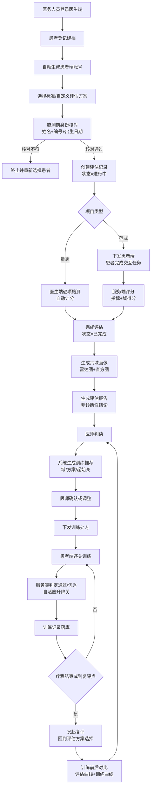
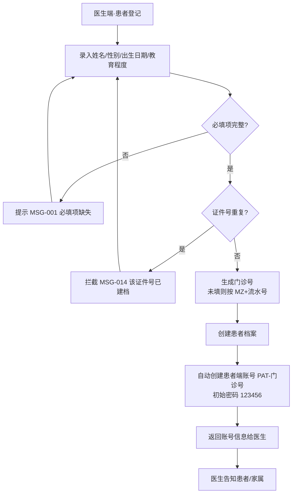
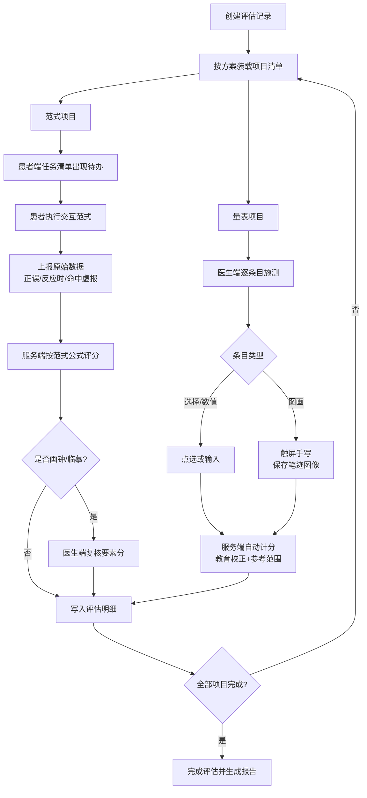
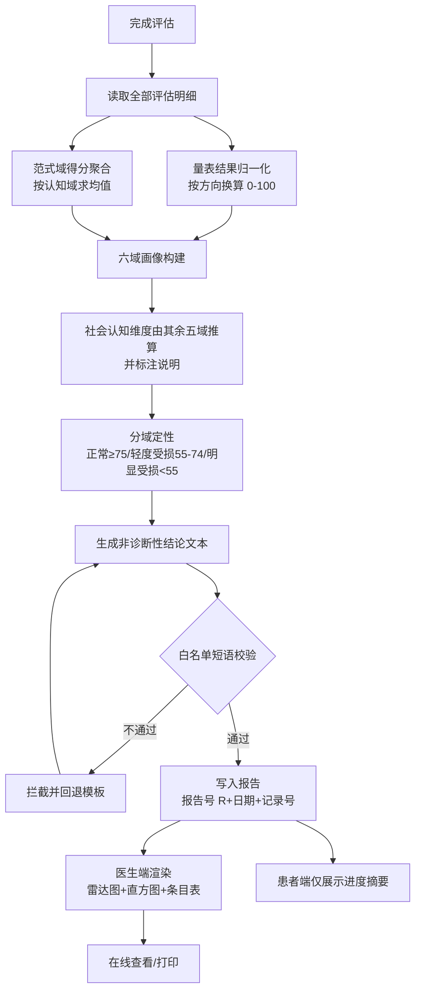
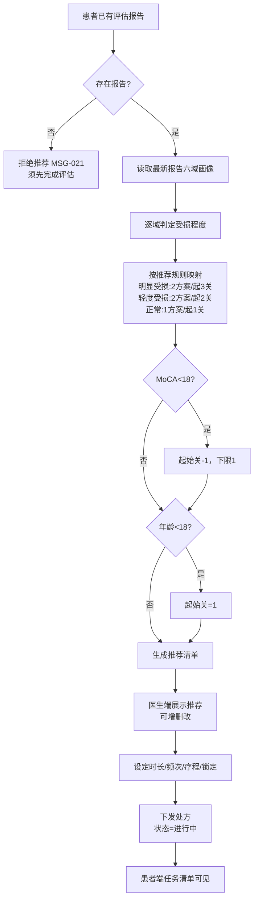
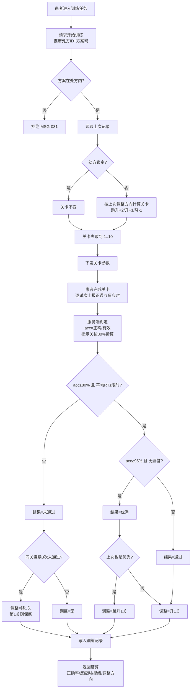

# 认知功能障碍评估与训练软件

# 需求规格说明书（SRS）

| 项目      | 内容                                          |
| ------- | ------------------------------------------- |
| 文档编号    | LBYH-SRS-002                                |
| 产品名称    | 认知功能障碍评估与训练软件                               |
| 型号规格    | HS-CRT-01                                   |
| 文档版本    | V1.0                                        |
| 密级      | 内部受控 · 仅限注册与研发使用                            |
| 编制单位    | 海思太科医疗科技（杭州）有限公司                            |
| 编制日期    | 2026-10-27                                  |
| 依据文件    | 《产品需求文档（PRD）》LBYH-PRD-001 V1.0              |
| 下游文件    | 《概要设计说明书》LBYH-HLD-003、《详细设计说明书》LBYH-LLD-004 |
| 软件安全性级别 | B 级（依据 YY/T 0664-2020）                      |
| 分类编码    | 21-06（21-06-01 康复训练软件），第二类医疗器械              |

## 修订记录

| 版本       | 日期             | 修订内容                                                                                                                    | 说明    |
| -------- | -------------- | ----------------------------------------------------------------------------------------------------------------------- | ----- |
| V0.9     | 2026-10-24     | 首版编制，建立 FR/PR/IO/IF/UI/SEC 六类需求编号体系                                                                                     | 内部评审稿 |
| **V1.0** | **2026-10-27** | 重构为 8 章结构；补业务流程图（6 张）、页面功能清单、角色—功能权限矩阵与数据权限规则；补字段级定义、业务规则编号（BR）、提示文案编号（MSG）；补范围演进说明（V0.3 草稿 → V1.0 收敛）；需求条目与体验版实现逐条对齐核验 | 本版    |

---

## 目录

1. 文档信息
2. 产品概述
3. 总体功能架构
4. 功能需求
5. 页面清单与权限矩阵
6. 非功能需求
7. 接口与数据需求
8. 需求追溯与附录

---

# 1 文档信息

## 1.1 编写目的

本文档依据《产品需求文档（PRD）》（LBYH-PRD-001 V1.0）编制，给出「认知功能障碍评估与训练软件」（型号 HS-CRT-01，以下简称"本产品"）**可实现、可验证、可追溯**的软件需求规格，作为：

1. 软件设计（概要设计、详细设计）、编码、测试的需求基线；
2. 注册申报资料（软件研究资料、产品技术要求、说明书）的需求来源；
3. 需求—设计—测试—风险四方追溯的起点。

本文档的编制与维护遵循 **YY/T 0664-2020**《医疗器械软件 软件生存周期过程》。本产品软件安全性级别为 **B 级**，本文档按 B 级要求达到"详细版"颗粒度：功能需求描述到字段、业务规则、枚举值与提示文案层级。

## 1.2 读者对象

| 读者                 | 关注章节                      |
| ------------------ | ------------------------- |
| 产品负责人 / 项目经理       | 第 2、3、4 章                 |
| 架构师 / 开发工程师        | 第 3、4、5、7 章               |
| 测试工程师              | 第 4、5、6、7、8 章（验收准则、追溯矩阵）  |
| 注册法规（RA）/ 质量保证（QA） | 第 1、2、6、8 章               |
| 临床顾问（神经内科/康复科/老年科） | 第 2、3.3、4.3 章（量表、范式、训练方案） |

## 1.3 术语与缩略语

| 术语                      | 全称 / 说明                                                |
| ----------------------- | ------------------------------------------------------ |
| MCI                     | 轻度认知障碍（Mild Cognitive Impairment）                      |
| CCRT                    | 计算机化认知矫正治疗（Computerized Cognitive Remediation Therapy） |
| SaMD                    | 独立医用软件（Software as a Medical Device）                   |
| DSM-5                   | 《精神疾病诊断与统计手册》第 5 版；其神经认知障碍部分划分六大认知域                    |
| 六大认知域                   | 复合性注意、执行能力、学习与记忆、语言、视结构-知觉能力、社会认知                      |
| MMSE                    | 简易精神状态量表                                               |
| MoCA                    | 蒙特利尔认知评估量表                                             |
| ADAS-Cog                | 阿尔茨海默病评定量表-认知部分                                        |
| IMCT                    | 常识-记忆-注意测验量表                                           |
| CCSE                    | 认知能力筛查量表                                               |
| AMT                     | 简易智力检测量表                                               |
| TMT                     | 连线测试（A/B 型）                                            |
| BNT                     | 波士顿命名测验                                                |
| CDT                     | 画钟测验                                                   |
| CPT                     | 持续性操作测验                                                |
| SDMT                    | 符号数字模式测验                                               |
| AVLT                    | 听觉词语学习测验                                               |
| 范式（Paradigm）            | 基于经典心理学实验范式的计算机化认知测量任务                                 |
| 关卡（Level）               | 训练方案内的难度层级，每方案 10 关（L1–L10）                            |
| 会话（Session）             | 一次连续训练过程，按处方时长编排若干关卡                                   |
| 认知域画像                   | 由评估结果映射得到的六域得分向量（0–100），用于雷达图与推荐                       |
| RBAC                    | 基于角色的访问控制                                              |
| 非诊断性表述                  | 仅描述"处于参考范围内/低于参考范围"，不作疾病判断的白名单表述                       |
| FR / BR / MSG           | 功能需求 / 业务规则 / 提示文案（本文档编号前缀）                            |
| PR / SEC / IF / IO / UI | 性能 / 信息安全 / 接口 / 输入输出 / 界面需求                           |

## 1.4 参考文件

**法规与指导原则**

1. 《医疗器械监督管理条例》（国务院令第 739 号）
2. 《医疗器械注册与备案管理办法》（国家市场监督管理总局令第 47 号）
3. 《医疗器械分类目录》（2017 年第 104 号公告）21-06 康复训练软件
4. 《康复类数字疗法软件产品分类界定指导原则》
5. 《医疗器械软件注册审查指导原则（2022 年修订版）》
6. 《医疗器械网络安全注册审查指导原则（2022 年修订版）》
7. 《医疗器械临床评价技术指导原则》（同品种临床评价路径）
8. 《医疗器械说明书和标签管理规定》

**标准**

1. YY/T 0664-2020《医疗器械软件 软件生存周期过程》
2. GB/T 42062-2022《医疗器械 风险管理对医疗器械的应用》
3. GB/T 25000.51-2016《系统与软件工程 系统与软件质量要求和评价（SQuaRE）》
4. GB/T 22239-2019《信息安全技术 网络安全等级保护基本要求》
5. YY/T 1474-2016《医疗器械 可用性工程对医疗器械的应用》

**临床与项目文件**

1. 《认知训练中国指南（2022 年版）》
2. 《认知训练中国专家共识（2019）》
3. 《神经心理认知量表操作指南》（彭丹涛、张占军主编，人民卫生出版社，2015）
4. LBYH-PRD-001《产品需求文档》V1.0
5. 《同品种比对报告——认知功能障碍评估与训练软件》

## 1.5 范围与基线说明（重要）

本项目在立项期存在两版范围定义，本文档明确以 **V1.0 收敛版**为唯一基线：

| 维度         | 立项期草稿（PRD V0.3）     | **注册基线（PRD V1.0，本文档采用）**                               | 差异处置                                              |
| ---------- | ------------------- | ------------------------------------------------------ | ------------------------------------------------- |
| 量表数量       | ≥4 类、≥25 个量表        | **6 个量表**（MMSE/MoCA/ADAS-Cog/IMCT/CCSE/AMT），与主比对品种构成一致 | 25 量表方案降级为 V2.0 规划；V1.0 通过"量表库配置化 + 启用/停用"为后续扩充预留 |
| 评估任务结构     | 6 模块 × 36 任务 × 6 难度 | **5 域 12 项范式**（注意/执行/记忆/语言/视空间）                        | 36 任务方案降级为 V2.0 规划；V1.0 范式数量与比对品种一致或为其子集          |
| 训练任务结构     | 6 模块 × 36 任务 × 6 难度 | **6 域 24 方案 × 10 关卡 = 240 关**                          | 已按 DSM-5 六域全覆盖，域数与草稿一致，粒度由"6 难度"改为"10 关卡"         |
| 社会认知评估     | 4 个评估任务             | **不设独立社会认知评估范式**，六域画像中社会认知维度由其余五域推算并显式标注               | 规避无标准临床范式支撑的计分争议；训练侧保留 4 个社会认知方案                  |
| 年龄范围       | 不限制                 | 不限制                                                    | 一致                                                |
| HIS/EMR 对接 | 不需要                 | 不需要（预留报告字段）                                            | 一致                                                |

> **RA 批注**：范围收敛的核心目的是"与主比对品种功能构成可比"。同品种比对路径下，申报产品的功能项应为比对品种的**子集或等效**；若 V1.0 直接主张 25 个量表 + 36 个自研任务，将显著增加"实质性等同"论证难度与临床评价工作量。V1.0 的 6 量表 + 12 范式与南京伟思 CCRT 构成一致，论证路径最短。量表与任务扩充放入 V2.0，按软件更新要求管理。

## 1.6 需求编号规则

| 前缀        | 含义         | 示例               |
| --------- | ---------- | ---------------- |
| FR-C-nn   | 通用功能需求（跨端） | FR-C-01 登录认证     |
| FR-A-nn   | 管理端功能需求    | FR-A-05 RBAC 管理  |
| FR-D-nn   | 医生端功能需求    | FR-D-13 量表自动计分   |
| FR-P-nn   | 患者端功能需求    | FR-P-04 训练任务执行   |
| BR-xxx-nn | 业务规则（按模块）  | BR-AS-03 评估记录不可改 |
| MSG-nnn   | 提示文案       | MSG-014 重复建档     |
| PR-nn     | 性能需求       | PR-06 计时精度       |
| SEC-nn    | 信息安全需求     | SEC-04 存储保护      |
| IF-nn     | 接口需求       | IF-03 内部 API     |
| IO-nn     | 输入输出与数据需求  | IO-05 评估结果       |
| UI-nn     | 界面需求       | UI-04 患者端界面      |

**优先级定义**：高 = V1.0 必须实现且必须通过验收；中 = V1.0 实现，允许参数裁剪；低 = 可降级实现或后续版本。

---

# 2 产品概述

## 2.1 产品标识

| 项目      | 内容                                                               |
| ------- | ---------------------------------------------------------------- |
| 产品名称    | 认知功能障碍评估与训练软件                                                    |
| 型号规格    | HS-CRT-01                                                        |
| 发布版本    | V1.0（发布版本号 1，完整版本号 V1.0.0）                                       |
| 产品组成    | 服务端程序 + 管理端 Web + 医生端 Web + 患者端 Web；内置量表库、范式库、训练方案库；关系型数据库；使用说明书 |
| 交付形态    | 独立软件（SaMD），B/S 架构，机构内局域网 Web 交付，**不含专用硬件**                       |
| 分类编码    | 21-06（21-06-01 康复训练软件）                                           |
| 管理类别    | 第二类医疗器械（浙江省药品监督管理局审批）                                            |
| 临床评价路径  | 同品种临床评价（同产品比对）                                                   |
| 软件安全性级别 | B 级                                                              |
| 使用期限    | 5 年                                                              |

## 2.2 预期用途与适用范围

> **【预期用途 · 注册申报用正式表述】**
>
> 本产品适用于**轻度认知障碍的辅助治疗**。用于对认知功能障碍人群进行认知功能评估并提供认知训练，评估结果和训练记录供医疗专业人员参考，**产品不具备自动诊断功能**。

**表述约束（贯穿全部界面文案、报告、说明书）**

| 允许表述                  | 禁止表述                |
| --------------------- | ------------------- |
| 辅助评估 / 辅助治疗 / 供专业人员参考 | 诊断 / 确诊 / 筛查结论      |
| 认知训练 / 认知练习 / 认知干预    | 治疗 / 治愈 / 康复治愈 / 逆转 |
| 处于参考范围内 / 低于参考范围      | 认知正常 / 认知障碍（作为结论输出） |
| 建议复评 / 请在医师指导下解读      | 建议用药 / 病情判断 / 预后    |

> **RA 批注**：预期用途是注册资料的"锚点"。产品 UI、报告模板、导出文件、说明书均不得超出本节表述。患者端可见界面额外施加"白名单短语校验"（见 BR-RP-05）。

## 2.3 适用人群与禁忌

| 项目    | 内容                                                     |
| ----- | ------------------------------------------------------ |
| 目标人群  | 经临床医师评估、存在认知功能障碍并接受认知训练的人群（含 MCI）                      |
| 年龄范围  | **不限制**。系统不设年龄校验拦截；由医务人员根据个体认知状况选择适宜量表、范式难度与训练关卡       |
| 教育程度  | 需录入教育程度（MMSE/MoCA 计分校正依赖）；枚举：文盲 / 小学 / 初中 / 高中 / 大学及以上 |
| 施测者   | 经产品培训的医务人员（医师、康复治疗师、护士）                                |
| 训练执行者 | 患者本人，在医务人员指导下、于院内完成                                    |

**禁忌与慎用（写入说明书）**

- 意识障碍或无法理解、配合软件评估与训练任务者不宜使用；
- 存在严重视听、运动障碍等影响人机交互的情况时，应由医师评估后决定是否使用；
- 训练中出现明显疲劳、烦躁、头晕等不适，应立即中止并由医师评估。

## 2.4 预期使用环境与运行环境

| 项目        | 要求                                                                |
| --------- | ----------------------------------------------------------------- |
| 部署位置      | 医疗机构**内部局域网**（评估室、训练室、病房），不接入互联网                                  |
| 服务端       | Linux 64 位（LTS）；CPU 4 核；内存 16 GB；硬盘 500 GB（可用 ≥200 GB）            |
| 管理端 / 医生端 | Windows 10/11 64 位；Microsoft Edge 88+ 或 Chrome 100+；分辨率 1920×1080 |
| 患者端       | Android 10+ 平板（≥10 英寸触屏，分辨率 ≥1920×1080）或触屏一体机浏览器                  |
| 网络        | 院内局域网，百兆及以上；服务器固定内网地址；建议配 UPS                                     |
| 外部依赖      | **无**。系统须在完全断外网条件下正常运行                                            |
| 系统集成      | **不对接** HIS/EMR/LIS 等院内信息系统；不与其他医疗器械软硬件存在控制接口                     |

> **合规含义**：内网独立部署规避互联网医疗、远程医疗的额外准入要求，但仍受《网络安全法》《数据安全法》《个人信息保护法》与等保 2.0 约束；患者认知健康数据按敏感个人信息管理。


## 2.5 用户角色定义

| 角色    | 角色码         | 使用端 | 职责边界                                          |
| ----- | ----------- | --- | --------------------------------------------- |
| 系统管理员 | `admin`     | 管理端 | 账号与权限、数据查询与导出、系统配置、备份恢复。**不得修改患者临床数据**        |
| 医师    | `doctor`    | 医生端 | 患者建档、评估施测、报告判读、训练处方、数据记录。具备全部医生端权限            |
| 治疗师   | `therapist` | 医生端 | 患者建档、评估施测、训练处方与执行监督。**无**方案模板管理权限（`doc:plan`） |
| 患者    | `patient`   | 患者端 | 仅执行本人评估任务与训练任务、查看本人受限报告。**无**任何管理或数据编辑权限      |

> **设计说明**：V1.0 不设独立"科室主任/统计"角色，科室级汇总统计并入 `admin` 数据管理视图，避免角色爆炸；如后续需要，通过 RBAC 自定义角色扩展，不改代码（见 FR-A-05）。

## 2.6 假设与依赖

| 编号   | 假设 / 依赖                                |
| ---- | -------------------------------------- |
| A-01 | 机构具备稳定内部局域网与供电条件（建议 UPS）               |
| A-02 | 量表施测由受训医务人员按标准化指导语执行；诊断结论由医师作出，软件不输出诊断 |
| A-03 | 患者处于可配合状态，不属 2.3 禁忌人群                  |
| A-04 | 部署环境已按等保二级要求完成基础安全建设（网络分区、主机加固、日志留存）   |
| A-05 | 机构提供院内服务器与运维责任人，配合完成备份介质存放与恢复演练        |
| A-06 | 训练素材（图片、音频）由注册人自制或取得授权，随软件版本受控发布       |

## 2.7 软件安全性级别判定

| 判定要素    | 结论                                                |
| ------- | ------------------------------------------------- |
| 预期用途    | 轻度认知障碍的辅助治疗，不用于危急生命场景，不输出自动诊断                     |
| 最严重伤害情景 | 计分错误或难度失当 → 训练无效、评估结果偏差 → 由医师判读环节拦截，可能导致**非严重**伤害 |
| 判定结果    | **B 级**                                           |
| 结论依据    | 软件失效不会直接导致死亡或严重伤害；医师判读与处方确认构成有效风险控制环节             |

> **RA 批注**：若后续版本引入"自动生成训练处方并直接下发、无医师确认"或"输出疾病分期结论"，须重新评估是否升级为 C 级。C 级将显著提高开发过程与文档要求。

---

# 3 总体功能架构

## 3.1 功能架构

产品由**三端 + 一引擎群**构成：管理端（运维与数据）、医生端（临床业务）、患者端（任务执行），共用服务端业务引擎（量表计分、范式评分、六域画像、训练自适应、推荐、报告）。

```
┌───────────────────────────────────────────────────────────────────────────┐
│                          认知功能障碍评估与训练软件 HS-CRT-01                │
├───────────────┬───────────────────┬───────────────────┬───────────────────┤
│    管理端      │      医生端        │      患者端        │   服务端引擎群     │
│   (admin)     │     (doctor)      │    (patient)      │                   │
├───────────────┼───────────────────┼───────────────────┼───────────────────┤
│ 用户管理       │ 患者信息           │ 任务模块           │ 量表计分引擎       │
│  · 医生账号    │  · 登记            │  · 评估任务        │ 范式评分引擎       │
│  · 患者账号    │  · 查询            │  · 训练任务        │ 六域画像引擎       │
│ 数据管理       │  · 详情（5页签）    │ 报告模块           │ 训练自适应引擎     │
│  · 评估数据    │ 方案管理           │  · 受限报告        │ 推荐引擎           │
│  · 训练数据    │  · 标准评估方案     │                   │ 报告引擎           │
│ 系统设置       │  · 标准训练方案     │                   │ 审计 / 备份 / 导出  │
│  · RBAC       │ 评估功能           │                   │                   │
│  · 评估配置    │  · 量表评定（6）    │                   │                   │
│  · 基础设置    │  · 范式评估（12）   │                   │                   │
│  · 审计日志    │  · 评估报告        │                   │                   │
│  · 数据备份    │ 训练功能           │                   │                   │
│               │  · 处方 / 推荐      │                   │                   │
│               │ 数据记录           │                   │                   │
│               │  · 成绩 / 依从性    │                   │                   │
└───────────────┴───────────────────┴───────────────────┴───────────────────┘
```

**架构约束**

| 编号   | 约束                                        |
| ---- | ----------------------------------------- |
| C-01 | 三端共用一套账号体系与 RBAC 权限模型，权限点按"端:模块"粒度划分      |
| C-02 | 患者端不具备任何数据编辑入口；所有临床数据写入仅来自医生端或患者端任务提交     |
| C-03 | 全部评估/训练计分与难度判定在**服务端**执行，患者端不可绕过（防篡改）     |
| C-04 | 量表、范式、训练方案以"受控初始数据 + 参数配置"形式存在，新增内容不改核心代码 |
| C-05 | 系统不产生诊断性结论；全部结果文本经非诊断性白名单校验               |

## 3.2 三端功能模块划分

| 端   | 一级模块 | 二级功能                           | 需求编号              |
| --- | ---- | ------------------------------ | ----------------- |
| 管理端 | 用户管理 | 医生/治疗师账号增删改查、启用停用、密码重置         | FR-A-01           |
| 管理端 | 用户管理 | 患者账号查询、启用停用                    | FR-A-02           |
| 管理端 | 数据管理 | 评估数据查询、明细查看、CSV 导出             | FR-A-03           |
| 管理端 | 数据管理 | 训练数据查询、明细查看、CSV 导出             | FR-A-04           |
| 管理端 | 数据管理 | 概览看板（患者数、评估数、报告数、训练量、7 日趋势）    | FR-A-08           |
| 管理端 | 系统设置 | RBAC（用户/角色/权限/菜单）              | FR-A-05           |
| 管理端 | 系统设置 | 评估配置（量表启停、指导语、常模参数）            | FR-A-06           |
| 管理端 | 系统设置 | 基础设置（科室字典、默认时长、报告抬头）           | FR-A-07           |
| 管理端 | 系统设置 | 审计日志查询                         | FR-C-05           |
| 管理端 | 系统设置 | 手动备份 / 恢复                      | FR-C-06           |
| 医生端 | 患者信息 | 患者登记（含自动生成患者端账号）               | FR-D-01           |
| 医生端 | 患者信息 | 患者查询（姓名/门诊号/手机号模糊）             | FR-D-02           |
| 医生端 | 患者信息 | 患者详情（基础信息/评估方案/训练方案/评估数据/训练数据） | FR-D-03           |
| 医生端 | 患者信息 | 施测前身份核对（姓名+编号+出生日期）            | FR-D-04           |
| 医生端 | 方案管理 | 标准评估方案（4 类模板）+ 自定义组合           | FR-D-05 / FR-D-06 |
| 医生端 | 方案管理 | 标准训练方案库（24 方案 × 10 关）          | FR-D-07           |
| 医生端 | 评估功能 | 量表评定（6 量表，电子化施测 + 自动计分）        | FR-D-11 ~ FR-D-14 |
| 医生端 | 评估功能 | 范式评估（5 域 12 项，患者端执行 + 服务端评分）   | FR-D-15 ~ FR-D-19 |
| 医生端 | 评估功能 | 画钟/临摹医生复核评分                    | FR-D-20           |
| 医生端 | 评估功能 | 评估报告生成（雷达图/直方图/非诊断性结论）         | FR-D-21 ~ FR-D-23 |
| 医生端 | 训练功能 | 训练处方（域/方案/起始关/时长/频次/疗程）        | FR-D-08           |
| 医生端 | 训练功能 | 方案推荐（按六域画像 + MoCA 修正）          | FR-D-09           |
| 医生端 | 训练功能 | 难度锁定 / 处方状态变更（暂停/终止）           | FR-D-10 / FR-D-27 |
| 医生端 | 数据记录 | 训练成绩趋势、依从性日历、多次评估对比            | FR-D-24 / FR-D-25 |
| 患者端 | 任务模块 | 待办任务清单（评估范式任务 + 训练关卡）          | FR-P-02           |
| 患者端 | 任务模块 | 评估任务执行（范式交互 + 画钟手写）            | FR-P-03           |
| 患者端 | 任务模块 | 训练任务执行（逐关游戏化 + 实时反馈）           | FR-P-04           |
| 患者端 | 任务模块 | 分级提示（提示关成绩按 80% 折算）            | FR-P-05           |
| 患者端 | 报告模块 | 受限报告查看（进度与鼓励性反馈）               | FR-P-07           |

## 3.3 核心业务流程

### 3.3.1 评估—训练闭环总流程



### 3.3.2 患者建档与身份核对流程



### 3.3.3 评估施测流程



### 3.3.4 报告生成流程



### 3.3.5 训练处方与推荐流程



### 3.3.6 训练执行与自适应流程



## 3.4 需求功能清单

> 完整需求描述见第 4 章。本表为总览，编号与第 4 章一一对应。

| 域      | 编号区间              | 条目数    | 覆盖内容                         |
| ------ | ----------------- | ------ | ---------------------------- |
| 通用     | FR-C-01 ~ FR-C-11 | 11     | 登录认证、会话、权限、审计、备份、导出、授权、文案规范  |
| 管理端    | FR-A-01 ~ FR-A-08 | 8      | 账号、数据、概览、RBAC、评估配置、基础设置      |
| 医生端    | FR-D-01 ~ FR-D-28 | 28     | 患者、方案、量表、范式、复核、报告、处方、推荐、记录   |
| 患者端    | FR-P-01 ~ FR-P-08 | 8      | 登录、清单、评估执行、训练执行、提示、适老化、报告、断点 |
| **合计** | —                 | **55** | —                            |

---

# 4 功能需求

## 4.1 通用功能需求（FR-C）

### 4.1.1 登录与会话

| 编号      | 需求描述                                                                      | 验收准则                                    | 优先级 |
| ------- | ------------------------------------------------------------------------- | --------------------------------------- | --- |
| FR-C-01 | 三端统一登录入口。用户名 + 密码认证；密码经不可逆哈希存储，任何界面、日志、接口响应均不得出现明文密码                      | 正确凭据登录成功并返回令牌；错误凭据被拒并提示；密码在数据库与日志中均为哈希值 | 高   |
| FR-C-02 | 会话管理。登录成功签发令牌，有效期 8 小时；令牌内含用户 ID、用户名、姓名、角色、关联档案 ID、权限点集合；无有效令牌访问受保护接口一律拒绝 | 缺失/过期/伪造令牌访问受保护接口返回 401                 | 高   |
| FR-C-03 | 会话超时。医生端/管理端 30 分钟无操作自动登出（令牌过期即失效）；患者端随会话结束退出                             | 超时后继续操作被拒绝并跳转登录                         | 高   |
| FR-C-04 | 首次登录强制改密；管理员重置密码后同样强制改密                                                   | 未改密时仅可访问改密接口                            | 高   |


**登录失败锁定（BR-AU-01）**

| 规则    | 内容                                    |
| ----- | ------------------------------------- |
| 计数口径  | 按"用户名"计数，连续失败累加，成功登录清零                |
| 阈值    | 连续 5 次失败锁定 10 分钟                      |
| 锁定期行为 | 拒绝登录并提示剩余时间；不区分"用户不存在"与"密码错误"（防用户名枚举） |
| 审计    | 每次失败写入审计日志（用户名、时间、结果）                 |

> **实现说明**：V1.0 体验版以提示文案声明锁定策略（MSG-002），锁定计数在注册版由服务端会话存储实现；该差异已记入《详细设计说明书》第 9 章"体验版与注册版差异"。

### 4.1.2 权限与审计

| 编号      | 需求描述                                                                                                   | 验收准则                         | 优先级 |
| ------- | ------------------------------------------------------------------------------------------------------ | ---------------------------- | --- |
| FR-C-05 | RBAC 权限控制。接口级校验权限点；越权访问返回 403 并记审计；管理员角色默认拥有全部权限点                                                      | 以治疗师账号访问方案管理被拒；以患者账号访问患者列表被拒 | 高   |
| FR-C-06 | 审计日志。记录登录成功/失败、改密、用户增改、重置密码、患者登记、发起评估、量表/范式提交、复核评分、生成报告、开具处方、处方状态变更、训练结算、数据导出、备份等操作；字段含操作人、角色、动作、对象、时间 | 任意关键操作可在日志中按时间倒序检索到          | 高   |
| FR-C-07 | 日志不可篡改。日志仅追加，不提供修改/删除接口；界面不提供删除入口                                                                      | 接口清单中无日志删除接口                 | 高   |

### 4.1.3 数据备份与导出

| 编号      | 需求描述                                                  | 验收准则                   | 优先级 |
| ------- | ----------------------------------------------------- | ---------------------- | --- |
| FR-C-08 | 手动备份。管理员一键生成数据库全量备份文件，文件名含时间戳，保存于备份目录                 | 备份文件生成成功且可被恢复          | 高   |
| FR-C-09 | 自动备份。每日 01:00 执行全量备份，保留 30 天，超期自动清理（注册版）              | 定时任务按计划执行；保留策略生效       | 高   |
| FR-C-10 | 数据导出。评估数据、训练数据支持导出 CSV（UTF-8 BOM，Excel 可直接打开）；导出行为记审计 | 导出文件字段完整、中文不乱码、条数与库内一致 | 高   |
| FR-C-11 | 授权控制（注册版）。License 绑定机构、站点数与使用期限；无有效 License 时拒绝启动核心业务 | 过期 License 无法进入业务界面    | 高   |

### 4.1.4 提示文案规范

| 编号      | 场景        | 文案                               |
| ------- | --------- | -------------------------------- |
| MSG-001 | 必填项缺失     | 请填写必填项：{字段名}                     |
| MSG-002 | 登录失败      | 用户名或密码错误（连续 5 次将锁定 10 分钟）        |
| MSG-003 | 账号停用      | 账号已停用，请联系管理员                     |
| MSG-004 | 会话过期      | 未登录或会话已过期，请重新登录                  |
| MSG-005 | 无权限       | 无权限：{权限点}                        |
| MSG-006 | 改密成功      | 密码修改成功，请重新登录                     |
| MSG-007 | 新密码格式不符   | 新密码须为 6–16 位字母或数字组合              |
| MSG-008 | 原密码错误     | 原密码不正确                           |
| MSG-009 | 用户名重复     | 用户名已存在                           |
| MSG-010 | 用户新增成功    | 新增成功，初始密码 123456（首次登录请修改）        |
| MSG-011 | 密码重置      | 已重置为初始密码 123456                  |
| MSG-012 | 患者登记成功    | 登记成功；患者端账号：PAT-{门诊号}，初始密码 123456 |
| MSG-013 | 必填项缺失（患者） | 必填项缺失：{字段名}                      |
| MSG-014 | 证件号重复     | 该证件号已建档，禁止重复建档                   |
| MSG-015 | 患者不存在     | 患者不存在                            |
| MSG-016 | 仅可查看本人档案  | 无权限：仅可查看本人档案                     |
| MSG-017 | 评估项目缺失    | 缺少患者或评估项目                        |
| MSG-018 | 无作答数据     | 尚无任何作答数据，无法生成报告                  |
| MSG-019 | 评估记录不存在   | 评估记录不存在                          |
| MSG-020 | 明细不存在     | 明细不存在                            |
| MSG-021 | 无评估依据不得开方 | 该患者尚无评估报告，请先完成评估（不允许无依据开方）       |
| MSG-022 | 处方缺项      | 缺少患者或训练方案                        |
| MSG-023 | 处方不存在     | 训练处方不存在                          |
| MSG-024 | 方案不在处方内   | 该方案不在处方中                         |
| MSG-025 | 报告不存在     | 报告不存在                            |
| MSG-026 | 仅患者账号可访问  | 仅患者账号                            |
| MSG-027 | 备份完成      | 备份完成：{文件名}                       |
| MSG-028 | 导出成功      | 已导出 {n} 条记录                      |
| MSG-029 | 服务异常      | 服务异常：{错误摘要}                      |

> **文案红线**：全部提示文案不得出现"诊断""确诊""病情""治愈"等词；错误提示不得回显患者临床数据；不得暴露内部堆栈信息。

## 4.2 管理端功能需求（FR-A）

### 4.2.1 用户管理

| 编号      | 需求描述                                                                  | 验收准则                     | 优先级 |
| ------- | --------------------------------------------------------------------- | ------------------------ | --- |
| FR-A-01 | 医生/治疗师账号管理：新增、修改、查询、启用/停用、重置密码。**不提供物理删除**，停用即逻辑删除                    | 新增后可用初始密码登录；停用后登录被拒；操作留痕 | 高   |
| FR-A-02 | 患者账号管理（只读）：按姓名、门诊号、科室、状态查询患者账号；可启用/停用、重置登录凭证；**不可新增或编辑患者档案**（建档仅在医生端） | 管理端无患者新增入口；停用后患者无法登录     | 高   |

**账号字段定义（sys_user）**

| 字段            | 类型  | 必填 | 约束 / 枚举                                      | 说明                        |
| ------------- | --- | -- | -------------------------------------------- | ------------------------- |
| username      | 字符串 | 是  | 唯一，≤32 字符                                    | 登录名；患者账号为 `PAT-{门诊号}`     |
| password_hash | 字符串 | 是  | bcrypt，cost ≥10                              | 初始密码 123456，强制首登改密        |
| real_name     | 字符串 | 是  | ≤32 字符                                       | 真实姓名                      |
| role          | 枚举  | 是  | `admin` / `doctor` / `therapist` / `patient` | 角色码                       |
| dept          | 字符串 | 否  | ≤32 字符                                       | 科室                        |
| phone         | 字符串 | 否  | ≤20 字符                                       | 联系方式                      |
| status        | 整数  | 是  | 1=启用，0=停用                                    | 默认 1                      |
| ref_id        | 整数  | 否  | 患者角色必填                                       | 关联 `patient.id`，用于患者端数据隔离 |

**业务规则**

| 编号       | 规则                                           |
| -------- | -------------------------------------------- |
| BR-UA-01 | 用户名全局唯一（含已停用账号），重复时返回 MSG-009                |
| BR-UA-02 | 患者角色账号不参与"用户管理"列表展示，仅在"患者账号"视图展示             |
| BR-UA-03 | 修改接口对 `role='patient'` 的记录不生效（防止管理端篡改患者账号归属） |
| BR-UA-04 | 角色变更即时生效；已签发令牌中的权限点在下次登录时刷新                  |

### 4.2.2 数据管理

| 编号      | 需求描述                                                                                      | 验收准则                  | 优先级 |
| ------- | ----------------------------------------------------------------------------------------- | --------------------- | --- |
| FR-A-03 | 评估数据管理：按姓名、门诊号、项目编码关键字查询；按类型（量表/范式）筛选；分页查看明细（含原始 payload 与复核状态）；导出 CSV                    | 查询结果与库内一致；分页正确；导出字段完整 | 高   |
| FR-A-04 | 训练数据管理：按姓名、门诊号、方案码查询；按结果（通过/优秀/未通过）筛选；分页查看明细；导出 CSV                                       | 同上                    | 高   |
| FR-A-08 | 概览看板：患者总数、系统用户数、患者账号数、评估总数、进行中评估数、报告数、训练总次数、进行中处方数、当日日志数、累计训练分钟数、近 7 日训练趋势、最近操作日志、方案训练量分布 | 各项统计口径与明细一致；趋势按自然日聚合  | 中   |

**业务规则**

| 编号       | 规则                                          |
| -------- | ------------------------------------------- |
| BR-AD-01 | 管理端对评估/训练数据**只读**，不提供修改、删除接口                |
| BR-AD-02 | 管理端可查看患者档案只读视图（含评估/训练汇总），但**不提供临床数据编辑入口**   |
| BR-AD-03 | 分页参数：`limit` 默认 20、上限 200；`offset` ≥0       |
| BR-AD-04 | 导出 CSV 使用 UTF-8 BOM，字段值含逗号/引号时按 RFC 4180 转义 |

> **RA 批注**：管理员与医生的数据权限分离，是《个人信息保护法》"最小必要"原则的落地要求。管理员仅做技术运维，不接触临床内容判读。

### 4.2.3 系统设置

| 编号      | 需求描述                                                                                    | 验收准则                          | 优先级 |
| ------- | --------------------------------------------------------------------------------------- | ----------------------------- | --- |
| FR-A-05 | RBAC 管理：维护用户、角色、权限点、菜单四要素；预置 `admin`/`doctor`/`therapist` 三角色；支持自定义角色并勾选权限点；权限变更即时生效并留痕 | 新增角色分配权限后，该角色账号可见菜单与可操作功能符合授权 | 高   |
| FR-A-06 | 评估配置：量表/范式启用停用；指导语文本与语音配置（支持上传自定义录音）；常模与参考范围参数配置（按教育程度分层）；评估方案模板配置                      | 配置变更后施测端按新配置执行；变更留痕           | 中   |
| FR-A-07 | 基础设置：科室字典、单次训练默认时长、报告抬头与机构信息、导出模板                                                       | 设置在各端正确生效                     | 中   |

**权限点定义（V1.0）**

| 权限点                 | 名称   | 所属端 | 说明              |
| ------------------- | ---- | --- | --------------- |
| `admin:user`        | 用户管理 | 管理端 | 用户与患者账号管理       |
| `admin:data`        | 数据管理 | 管理端 | 评估/训练数据查询与概览    |
| `admin:config`      | 系统设置 | 管理端 | 配置、审计日志、备份      |
| `admin:data:export` | 数据导出 | 管理端 | CSV 导出          |
| `doc:patient`       | 患者信息 | 医生端 | 登记、查询、详情        |
| `doc:plan`          | 方案管理 | 医生端 | 标准/自定义方案与模板     |
| `doc:assess`        | 评估功能 | 医生端 | 发起评估、提交、复核、生成报告 |
| `doc:train`         | 训练功能 | 医生端 | 推荐、开方、难度锁定、状态变更 |
| `doc:record`        | 数据记录 | 医生端 | 成绩趋势、依从性、对比     |

---

## 4.3 医生端功能需求（FR-D）

### 4.3.1 患者信息

| 编号      | 需求描述                                                                        | 验收准则                      | 优先级 |
| ------- | --------------------------------------------------------------------------- | ------------------------- | --- |
| FR-D-01 | 患者登记：录入基础信息建档；保存前必填校验与证件号唯一性校验；成功后自动生成患者端账号并回显账号信息                          | 必填缺失被拦截；重复证件号被拦截；账号自动创建成功 | 高   |
| FR-D-02 | 患者查询：按姓名、门诊号、手机号模糊匹配；返回患者列表并附带进行中处方数、报告数                                    | 关键字命中正确；空关键字返回全部（分页）      | 高   |
| FR-D-03 | 患者详情：五个页签——基础信息、评估方案（历次评估记录）、训练方案（历次处方）、评估数据（历次报告）、训练数据（按方案聚合的成绩）；详情内展示计算年龄 | 五页签数据完整、与库内一致             | 高   |
| FR-D-04 | 施测前身份核对：发起任何评估前强制核对"姓名 + 门诊号 + 出生日期"三项；三项全部匹配方可创建评估记录；训练任务界面常显当前患者姓名与编号     | 核对不符无法创建评估；训练界面患者标识常显     | 高   |

**患者档案字段定义（patient）**

| 字段            | 类型  | 必填 | 约束 / 枚举                   | 说明                |
| ------------- | --- | -- | ------------------------- | ----------------- |
| name          | 字符串 | 是  | ≤32 字符                    | 姓名                |
| sex           | 枚举  | 是  | 男 / 女 / 未说明               | 性别                |
| birth_date    | 日期  | 是  | `YYYY-MM-DD`，不得晚于当日       | 出生日期；用于计算年龄       |
| id_card       | 字符串 | 否  | ≤32 字符，唯一（未删除记录内）         | 证件号；用于重复建档拦截      |
| outpatient_no | 字符串 | 否  | 唯一；未填则自动生成 `MZ{流水号}`      | 门诊号；患者账号以此为后缀     |
| inpatient_no  | 字符串 | 否  | ≤32 字符                    | 住院号               |
| education     | 枚举  | 是  | 文盲 / 小学 / 初中 / 高中 / 大学及以上 | **计分校正依赖**，不可为空   |
| dept          | 字符串 | 否  | ≤32 字符                    | 科室                |
| phone         | 字符串 | 否  | ≤20 字符                    | 联系电话              |
| guardian      | 字符串 | 否  | ≤64 字符                    | 联系人及关系，如"陈女士(女儿)" |
| history       | 文本  | 否  | ≤2000 字符                  | 主诉 / 病史摘要         |
| status        | 整数  | 是  | 1=在册，0=停用                 | 默认 1              |

**业务规则**

| 编号       | 规则                                                                    |
| -------- | --------------------------------------------------------------------- |
| BR-PT-01 | 必填字段：姓名、性别、出生日期、教育程度；缺失返回 MSG-013                                     |
| BR-PT-02 | 证件号在未删除记录内唯一；重复返回 MSG-014                                             |
| BR-PT-03 | 门诊号为空时自动生成，格式 `MZ{6位流水}`，生成后回写并作为患者账号后缀                               |
| BR-PT-04 | 建档成功后自动创建 `patient` 角色账号，用户名 `PAT-{门诊号}`，初始密码 123456；若用户名已存在则跳过创建（幂等） |
| BR-PT-05 | 患者档案的编辑与逻辑删除仅医生端可执行；管理端只读                                             |
| BR-PT-06 | 年龄按 `floor((今天 - 出生日期) / 365.25 天)` 计算，仅用于展示与推荐修正，不参与任何拦截             |


### 4.3.2 方案管理

| 编号      | 需求描述                                                        | 验收准则                  | 优先级 |
| ------- | ----------------------------------------------------------- | --------------------- | --- |
| FR-D-05 | 标准评估方案：预置 4 类模板（快速筛查 / 标准筛查 / 全面评估 / 训练随访），可查看组合内容并复制为自定义方案 | 4 类模板内容与 PRD 表 5-1 一致 | 高   |
| FR-D-06 | 自定义评估方案：在启用的量表/范式库中自由勾选组合，命名保存后可直接用于施测                      | 自定义方案可创建评估记录          | 中   |
| FR-D-07 | 标准训练方案库：内置 DSM-5 六域 24 个方案，每方案 10 关卡；可查看方案说明、范式依据、关卡参数表     | 24 方案 × 10 关全部可查看、可开单 | 高   |

**标准评估方案模板（PRD 表 5-1）**

| 方案名称   | 组合内容                        | 适用场景         | 预计时长     |
| ------ | --------------------------- | ------------ | -------- |
| 快速筛查方案 | MMSE 或 AMT                  | 门诊/病房快速筛查    | 5–10 分钟  |
| 标准筛查方案 | MMSE + MoCA                 | 认知障碍初筛       | 15–20 分钟 |
| 全面评估方案 | MMSE + MoCA + 五域范式（12 项中选配） | 训练前基线评估      | 40–50 分钟 |
| 训练随访方案 | MoCA + 薄弱域范式复查              | 训练 4–12 周后复评 | 20–30 分钟 |
| 自定义方案  | 量表库/范式库自由组合                 | 个体化评估        | 按组合计算    |

**业务规则**

| 编号       | 规则                                       |                         |
| -------- | ---------------------------------------- | ----------------------- |
| BR-PL-01 | 评估方案的项目清单以 JSON 数组存储，元素为 \`{type: scale  | paradigm, code, name}\` |
| BR-PL-02 | 已停用的量表/范式不出现在可选列表中；已下发方案中若含停用项目，施测时跳过并提示 |                         |
| BR-PL-03 | 训练方案为受控初始数据，医生不可编辑关卡参数（参数变更须走版本更新）       |                         |

### 4.3.3 量表评定

| 编号      | 需求描述                                                               | 验收准则                  | 优先级 |
| ------- | ------------------------------------------------------------------ | --------------------- | --- |
| FR-D-11 | 量表库：内置 MMSE、MoCA、ADAS-Cog、IMCT、CCSE、AMT 六个量表，含条目、选项、分值、计分规则、参考范围参数 | 6 个量表条目结构完整、可施测       | 高   |
| FR-D-12 | 电子化施测：逐条目呈现题目与指导语；选择类点选、数值类输入、图画类触屏手写作答并保存笔迹图像                     | 三类条目均可作答并正确保存         | 高   |
| FR-D-13 | 自动计分：按量表规则自动汇总总分与分域得分；应用教育程度校正（MoCA）；与参考范围对比输出定性判定                 | 每量表 ≥3 组标准用例计分与人工核验一致 | 高   |
| FR-D-14 | 量表结果呈现：条目得分表、分域得分、总分、参考范围判定；判定文案限定为"处于参考范围内 / 低于参考范围（分界 N 分）"      | 结果页无诊断性用语             | 高   |

**量表结构与计分规则（附录 A 为完整条目表）**

| 量表       | 条目数             | 满分 | 计分方向 | 教育校正                  | 参考判定                  |
| -------- | --------------- | -- | ---- | --------------------- | --------------------- |
| MMSE     | 26 项（含临摹 1 项图画） | 30 | 越高越好 | 无（按教育分层取分界值）          | 文盲 17 / 小学 20 / 中学 24 |
| MoCA     | 26 项            | 30 | 越高越好 | 教育年限 ≤12 年 +1 分，封顶 30 | 固定分界 26               |
| ADAS-Cog | 11 项（数值输入）      | 67 | 越高越差 | 无                     | 无固定分界，供医师判读           |
| IMCT     | 12 项            | 36 | 越高越差 | 无                     | 无固定分界，记录分部分得分         |
| CCSE     | 30 项            | 30 | 越高越好 | 无                     | 无固定分界                 |
| AMT      | 10 项            | 10 | 越高越好 | 无                     | 固定分界 7（≤7 提示受损可能）     |

**业务规则**

| 编号       | 规则                                                                                      |
| -------- | --------------------------------------------------------------------------------------- |
| BR-SC-01 | 总分 = Σ 条目得分；MoCA 若教育程度 ≤12 年（文盲/小学/初中）则总分 +1，且总分封顶为满分                                   |
| BR-SC-02 | 参考判定按 `direction` 区分：`higher_better` 时总分 < 分界判"低于参考范围"；`lower_better` 时总分 > 分界判"低于参考范围" |
| BR-SC-03 | 教育分层分界值按前缀匹配（"小学"匹配"小学"条目），未命中时取最后一项                                                    |
| BR-SC-04 | 图画类条目（MMSE 临摹、MoCA 画钟）原始图像与要素分同时保存；要素分默认由医生复核录入                                         |
| BR-SC-05 | 量表作答原始值（逐条目）与计算结果分别存储，便于复算与审计                                                           |
| BR-SC-06 | 已提交的量表结果不可编辑；如需修正须作废整条评估记录后重测（BR-AS-04）                                                 |

### 4.3.4 范式评估

| 编号      | 需求描述                                                                   | 验收准则           | 优先级 |
| ------- | ---------------------------------------------------------------------- | -------------- | --- |
| FR-D-15 | 范式库：内置 5 域 12 项范式（注意 3 / 执行 3 / 记忆 2 / 语言 2 / 视空间 2），每项含任务说明、参数配置、指标定义 | 12 项范式全部可施测并出分 | 高   |
| FR-D-16 | 刺激控制：按预设时序呈现刺激（刺激间隔、呈现时长、试次数可配置）；关键计时环节采集精度误差 ≤10ms                    | 计时抽样验证 ≤10ms   | 高   |
| FR-D-17 | 原始数据采集：逐试次记录正误、反应时（ms）、漏答；画钟/临摹额外保存笔迹图像                                | 原始数据完整、可回放     | 高   |
| FR-D-18 | 自动评分：按各范式公式计算指标并换算认知域得分（0–100）                                         | 标准用例评分与人工核验一致  | 高   |
| FR-D-19 | 中断处理：范式执行中断（退出/断网）后可重新进入续作；已提交的范式项目不重复计入                               | 续作不产生重复明细      | 中   |

**范式库与指标（PRD 表 5-3）**

| 编码     | 范式名称     | 认知域 | 时长     | 主要指标            | 患者端交互   |
| ------ | -------- | --- | ------ | --------------- | ------- |
| SPAN   | 数字广度测验   | 注意  | 5 min  | 顺背广度、倒背广度       | 序列输入    |
| CPT    | 持续性操作测验  | 注意  | 5 min  | 正确率、漏报率、平均反应时   | 刺激流点按   |
| SDMT   | 符号数字模式测验 | 注意  | 3 min  | 90 秒正确配对数       | 配对点选    |
| TMT    | 连线测试 A/B | 执行  | 5 min  | A/B 完成时间、错误数    | 节点连线    |
| STROOP | 色词干扰测验   | 执行  | 5 min  | 一致/不一致正确率、干扰量   | 色块点选    |
| TOL    | 伦敦塔测验    | 执行  | 15 min | 总正确数（满分 10）、总步数、总计划时间、总执行时间 | 3 珠 3 柱（柱高不等），左原始状态可操作、右目标状态锁定；2 练习 + 10 正式（最少步数 3–7） |
| AVLT   | 听觉词语学习测验 | 记忆  | 10 min | 即刻回忆、延迟回忆、再认    | 词语输入/选择 |
| REC    | 图形再认测验   | 记忆  | 5 min  | 命中数、虚报数、辨别力     | 新旧判断    |
| BNT    | 波士顿命名测验  | 语言  | 6 min  | 无提示正确数、语义提示数/后正确数、语音提示数/后正确数、总分（满分 30，>24 正常） | 30 幅图逐张命名（20 秒/张，三级提示） |
| FLU    | 词语流畅性测验  | 语言  | 3 min  | 类别流畅词数、首字流畅词数   | 词语生成    |
| CDT    | 画钟测验     | 视空间 | 4 min  | 要素得分（满分随评分法 3/4/5/7/10/30，医生勾选） | 触屏手写    |
| COPY   | 图形临摹测验   | 视空间 | 4 min  | 要素得分（0–10，医生复核） | 触屏手写    |

**范式评分公式（服务端执行）**

| 编码         | 域得分计算                                                                 | 说明              |
| ---------- | --------------------------------------------------------------------- | --------------- |
| SPAN       | `(顺背/9)×55 + (倒背/8)×45`                                               | 广度上限按 9/8 归一    |
| CPT        | `正确率×0.7 + 速度分×0.3`，速度分 = `clamp(100-(平均RT-400)/8, 0, 100)`           | 正确率主导           |
| SDMT       | `clamp(配对数/40×100, 0, 100)`                                           | 40 为参考上限        |
| TMT        | 仅有 A：`A分`；有 B：`A分×0.4 + B分×0.6`，单型分 = `clamp(参考值×1.8/耗时×100, 0, 100)` | 参考值 A=45s、B=90s |
| STROOP     | `一致正确率×0.3 + 不一致正确率×0.7`                                              | 不一致条件加权         |
| TOL        | `总正确数/10×100`                                                          | 记录单未给界值，仅作域得分换算 |
| AVLT       | `(延迟回忆/12)×70 + (再认正确/12)×30`                                         | 延迟回忆主导          |
| REC        | `clamp(((命中/8)-(虚报/8))×100, 0, 100)`                                  | 辨别力 d' 简化式      |
| BNT        | `总分 = 无提示正确数 + 语义提示后正确数`（最高 30；语音提示只作临床，不计分）                                   | 提示分级不计半分；> 24 分为正常 |
| FLU        | `clamp(动物词数×5,0,100)×0.5 + clamp(首字词数×5,0,100)×0.5`                   | 双任务等权           |
| CDT / COPY | `要素分/满分×100`                                                          | 医生复核后计算         |

**伦敦塔（TOL）施测规则**

| 项 | 规则 |
| -- | ---- |
| 装置 | 3 颗彩色珠（红/蓝/绿）+ 3 根长度不等的柱子，柱高 4 / 3 / 2 颗；珠子无大小之分 |
| 与汉诺塔的差异 | 柱子长度不同（汉诺塔等长）、珠子只分颜色不分大小、初始与目标状态多样化、最初版本为 3 珠 |
| 界面 | 左侧为原始状态（可操作），右侧为目标状态（锁定不可操作）；一次只移动一根柱子最上面那颗珠子 |
| 题量 | 先 2 题练习（不计分、可提示），再 10 题正式；正式题最少完成步数分别为 3、3、4、4、5、5、6、6、7、7（由状态空间 BFS 复核，见 `scripts/shot-r108.mjs`） |
| 限时 | 单题 60 秒，自题目呈现起算；超时记为未完成并进入下一题 |
| 停止 | 连续 3 题未正确解决即可停止测验，已完成题目照常计入 |
| 计分 | 总正确数 = 限时内用**最少步数**解决的题数（满分 10）；其余三项为过程指标：总步数 = Σ(实际步数 − 最少步数)、总计划时间 = Σ(呈现→第一步)、总执行时间 = Σ(第一步→完成) |
| 判读 | 记录单未给出界值，仅按四项指标记录，供医师结合常模判读；域得分 = 总正确数 / 10 × 100，仅用于雷达图换算 |

**业务规则**

| 编号       | 规则                                                   |
| -------- | ---------------------------------------------------- |
| BR-PD-01 | 范式原始数据由患者端上报，**评分在服务端完成**，患者端不得上报分数                  |
| BR-PD-02 | 域得分统一夹取到 0–100 并四舍五入取整                               |
| BR-PD-03 | 画钟/临摹类范式在医生复核前，其域得分标记为"待复核"，不参与报告结论生成（可选：以 0 分暂计并标注） |
| BR-PD-04 | 同一评估记录内同一范式编码只保留一条明细；重复提交以最新为准并记审计                   |
| BR-PD-05 | 范式项目未完成时，评估记录保持"进行中"，患者端任务清单持续显示                     |

### 4.3.5 画钟/临摹医生复核

| 编号      | 需求描述                                                        | 验收准则              | 优先级 |
| ------- | ----------------------------------------------------------- | ----------------- | --- |
| FR-D-20 | 医生对画钟/临摹项目按要素评分：画钟可在 3/4/5/7/10/30 分评分法中选定一种，逐项勾选自动合计，**题目满分随所选评分法变化**；提交后触发该范式域得分重算并标记"已复核"；复核动作记审计 | 复核后报告得分更新且满分与评分法一致；复核记录可追溯 | 高   |

**要素评分参考（画钟，六种评分法任选其一）**

施测端右侧先选评分法，再按该评分法的项目逐项勾选，勾中项即计该项分值，合计为本题得分；**满分随评分法变化**（3/4/5/7/10/30 分）。同一患者多次评估应沿用同一评分法。

| 评分法     | 满分 | 评分项（分值）                                                                                   | 判读界值            |
| ------- | -- | ----------------------------------------------------------------------------------------- | --------------- |
| 3 分评分法  | 3  | 画好一个封闭的圆（1）／正确标出 12 个数字（1）／将指针置于正确的位置（1）                                                  | < 3 分执行功能下降     |
| 4 分评分法  | 4  | 封闭的圆（1）／12 个数字均无遗漏（1）／数字位置及顺序准确（1）／指针位置正确（1）                                             | < 4 分执行功能下降     |
| 5 分评分法  | 5  | 4 分法四项 + 画出 2 个指针（1）                                                                     | < 5 分执行功能下降     |
| 7 分评分法  | 7  | 按 4 象限计数每个象限的数字（各应有 3 个）：第一/二/三象限数目有误各 1 分，第四象限有误 4 分（错误计分）                              | 得分越高越差，≤ 3 分正常 |
| 10 分评分法 | 10 | 画好一个封闭的圆（2）／12 个数字的位置及顺序正确（4）／指针的位置和大小正确（4）                                              | < 9 分执行功能下降     |
| 30 分评分法 | 30 | 表 11-5 共 14 项：锚定 12/3/6/9（4）、写出所有数字（4）、数字在圈内（3）、中央点（1）、钟面完整（1）、有时针和分针（2）、顺时针排列（1）、1–12 次序（1）、“12/3/6/9”分不对称（2）、其他 8 个数字位置（3）、时针指向（2）、分针指向（2）、分针比时针长（2）、两针有箭头（2） | < 19 分执行功能下降    |

> 7 分评分法要求被试在**已有的圆圈内**画钟面，用 2 条线（一条过 12 与中央点，另一条垂直平分它）把钟面分成 4 个象限，从 12 起顺时针计数，每个数字只计一次；落在直线上的数字归入参考线顺时针方向的象限。

### 4.3.6 评估报告

| 编号      | 需求描述                                                                     | 验收准则              | 优先级 |
| ------- | ------------------------------------------------------------------------ | ----------------- | --- |
| FR-D-21 | 评估报告生成：汇总本次评估全部明细，生成患者信息、方案与项目、完成情况、各项目得分、六域画像雷达图、得分直方图、总用时、非诊断性结论；生成报告号 | 报告要素齐全；生成耗时 <5 分钟 | 高   |
| FR-D-22 | 多次评估对比：同一患者历次报告并列对比，呈现六域画像变化与关键项目得分趋势                                    | 对比数据正确            | 高   |
| FR-D-23 | 报告输出：在线查看、浏览器打印；打印版含机构抬头与报告号页脚                                           | 打印格式规范、分页正确       | 中   |

**六域画像构建规则**

| 步骤 | 规则                                                                          |
| -- | --------------------------------------------------------------------------- |
| 1  | 收集本次评估中全部范式明细的域得分，按认知域分组求算术平均                                               |
| 2  | 量表结果按方向归一化：`higher_better` → `总分/满分×100`；`lower_better` → `100 - 总分/满分×100` |
| 3  | 某域无范式数据时，以量表归一化均值填充                                                         |
| 4  | 社会认知维度由其余五域均值推算，并在报告与界面显式标注"该维度由其余五域推算，供参考"                                 |
| 5  | 分域定性：≥75 正常；55–74 轻度受损；<55 明显受损                                             |

**非诊断性结论模板**

```
各项评估已完成。【{低于参考范围的域}】结果低于参考范围；
【{临界域}】处于临界水平，建议关注。
本报告仅供医疗专业人员参考，不能单独作为诊断依据。
建议由医师结合临床进行解读。
```

**业务规则**

| 编号       | 规则                                                                                       |
| -------- | ---------------------------------------------------------------------------------------- |
| BR-RP-01 | 报告号格式：`R{yyyyMMdd}{评估记录ID 4 位补零}`                                                        |
| BR-RP-02 | 同一评估记录重复生成报告时，更新原报告（不新增），保留最新生成时间                                                        |
| BR-RP-03 | 结论文本仅允许白名单短语组合：`处于参考范围内`、`低于参考范围`、`处于临界水平，建议关注`、`供医疗专业人员参考`、`不能单独作为诊断依据`、`建议由医师结合临床进行解读` |
| BR-RP-04 | 报告中的量表得分与雷达图**仅在医生端与管理端可见**；患者端不展示得分与雷达图                                                 |
| BR-RP-05 | 患者端可见文本在渲染前再次执行白名单校验，命中禁用词则降级为"请咨询您的医生"                                                  |
| BR-RP-06 | 报告结构预留 EMR 对接字段（患者标识、报告号、生成时间、项目编码、得分、结论），当前版本不对外提供接口                                    |

### 4.3.7 训练处方与推荐

| 编号      | 需求描述                                                            | 验收准则                      | 优先级 |
| ------- | --------------------------------------------------------------- | ------------------------- | --- |
| FR-D-08 | 训练处方：为患者选择训练方案（24 选 N）、设定起始关卡、单次时长、每周频次、疗程周数、是否锁定难度；下发后患者端可见    | 处方下发后患者端任务清单出现对应关卡        | 高   |
| FR-D-09 | 方案推荐：依据最新评估报告的六域画像，按推荐规则生成推荐清单（域、方案、起始关）；**无报告时拒绝推荐**；医生可增删改后下发 | 推荐结果与规则表一致；无报告时返回 MSG-021 | 高   |
| FR-D-10 | 难度锁定：医生可对某处方锁定难度；锁定后系统只记录不自动升降关                                 | 锁定后连续训练关卡恒定               | 中   |


**处方字段定义（train_plan）**

| 字段         | 类型      | 必填 | 约束 / 默认               | 说明                                                        |
| ---------- | ------- | -- | --------------------- | --------------------------------------------------------- |
| patient_id | 整数      | 是  | 外键                    | 患者                                                        |
| doctor_id  | 整数      | 是  | 外键                    | 开方医生                                                      |
| items      | JSON 数组 | 是  | 至少 1 项                | `[{domain, level, program, name, startLevel, archetype}]` |
| minutes    | 整数      | 是  | 默认 30，范围 10–60        | 单次训练时长（分钟）                                                |
| freq       | 整数      | 是  | 默认 3，范围 1–7           | 每周频次                                                      |
| weeks      | 整数      | 是  | 默认 12，范围 1–52         | 疗程周数                                                      |
| locked     | 整数      | 是  | 0=不锁，1=锁定             | 难度锁定                                                      |
| status     | 枚举      | 是  | 进行中 / 已暂停 / 已完成 / 已终止 | 默认进行中                                                     |

**推荐规则（PRD 4.4 / TDD 4.4）**

| 评估结果          | 推荐方案数                        | 起始关卡         |
| ------------- | ---------------------------- | ------------ |
| 某域明显受损（<55）   | 该域 2 个方案                     | 3 关          |
| 某域轻度受损（55–74） | 该域 2 个方案                     | 2 关          |
| 某域正常（≥75）     | 该域 1 个方案（保健型）                | 1 关          |
| 修正一：MoCA < 18 | 不变                           | 起始关 −1（下限 1） |
| 修正二：年龄 < 18 岁 | 不变                           | 起始关 = 1      |
| 会话编排          | 单次会话取受损最重的前 2–3 域，总时长 ≤30 分钟 | —            |

**业务规则**

| 编号       | 规则                               |
| -------- | -------------------------------- |
| BR-TP-01 | 推荐前必须存在该患者的评估报告；否则拒绝并提示 MSG-021  |
| BR-TP-02 | 推荐结果仅作为建议，处方内容以医生最终提交的 items 为准  |
| BR-TP-03 | 同一患者可有多个处方，患者端只加载最新一条"进行中"处方     |
| BR-TP-04 | 处方锁定后，训练开始与结算均不改变关卡；结算结果记为"医生锁定" |
| BR-TP-05 | 处方状态变更（暂停/终止）即时生效，患者端任务清单同步消失    |

### 4.3.8 数据记录

| 编号      | 需求描述                                                                              | 验收准则            | 优先级 |
| ------- | --------------------------------------------------------------------------------- | --------------- | --- |
| FR-D-24 | 训练数据记录与统计：每关记录域、方案、关卡、用时、正确率、平均反应时、提示次数、结果、难度调整；按方案聚合成绩趋势；依从性按自然日汇总训练时长           | 记录项完整；趋势与日历数据正确 | 高   |
| FR-D-25 | 前后对比：疗程结束或复评后，关联训练前后两次评估报告形成对比视图                                                  | 对比正确、可导出        | 中   |
| FR-D-26 | 训练监控：医生端查看患者当前进行中处方、各方案当前关卡与最近训练时间                                                | 状态刷新及时          | 中   |
| FR-D-27 | 处方状态变更：暂停、恢复、终止；变更留痕                                                              | 变更实时生效          | 高   |
| FR-D-28 | 自适应参数配置：通过阈值（默认 0.80）、优秀阈值（默认 0.95）、连优跳级数（默认 2）、连败降级数（默认 3）、提示折算系数（默认 0.8）可由管理员配置 | 参数修改后按新规则运行     | 中   |

---

## 4.4 患者端功能需求（FR-P）

| 编号      | 需求描述                                                                | 验收准则            | 优先级 |
| ------- | ------------------------------------------------------------------- | --------------- | --- |
| FR-P-01 | 任务登录：患者使用医生端自动下发的账号（`PAT-{门诊号}`）登录；登录后仅加载本人（`ref_id` 匹配）数据          | 以他人账号无法获取本人以外数据 | 高   |
| FR-P-02 | 任务清单：展示两类待办——① 评估范式任务（来自进行中评估记录中未完成的范式项目）；② 训练关卡（来自最新进行中处方的各方案当前关卡） | 清单内容与处方/评估记录一致  | 高   |
| FR-P-03 | 评估任务执行：进入范式任务后按引导完成交互；完成后上报原始数据，页面提示"已提交，等待医生查看"；画钟/临摹支持触屏手写提交      | 上报成功、任务从清单移除    | 高   |
| FR-P-04 | 训练任务执行：按关卡参数呈现任务；逐试次记录正误与反应时；关卡结束提交结算，展示正确率、平均反应时、星级与难度调整提示         | 结算数据与医生端记录一致    | 高   |
| FR-P-05 | 分级提示：训练困难时提供提示（规则提醒 → 示范演示 → 答案排除）；使用提示的关卡正确率按 80% 折算后参与判定          | 提示后折算正确         | 中   |
| FR-P-06 | 适老化 / 适龄化：正文字号 ≥18pt 等效、触控目标 ≥12mm、高对比配色、关键引导语音播报；全流程不超过 3 层导航      | 可用性测试通过         | 高   |
| FR-P-07 | 受限报告：展示训练进度（已完成/总数）、关卡进度、最近成绩趋势与鼓励性反馈；**不展示**评估得分、雷达图、任何疾病或诊断相关表述   | 页面无得分与诊断性用语     | 高   |
| FR-P-08 | 断点保护：训练/评估过程中断网或退出时本地暂存进度，恢复后补传；服务端按任务幂等键去重                         | 恢复后不丢进度、不重复计分   | 高   |

**患者端可见 / 不可见信息边界**

| 信息项       | 患者端可见 | 说明                 |
| --------- | ----- | ------------------ |
| 待办任务数量与名称 | ✅     | 任务名称为中性描述（如"信号捕捉"） |
| 训练关卡与进度   | ✅     | "第 3 关 / 共 10 关"   |
| 单关正确率与星级  | ✅     | 即时反馈，鼓励性表述         |
| 累计训练时长与次数 | ✅     | 进度统计               |
| 评估量表得分    | ❌     | 仅医生端可见             |
| 六域雷达图     | ❌     | 仅医生端可见             |
| 报告结论文本    | ⚠️ 受限 | 仅"请咨询您的医生"类中性提示    |
| 其他患者信息    | ❌     | 服务端按 `ref_id` 隔离   |

**业务规则**

| 编号       | 规则                                                          |
| -------- | ----------------------------------------------------------- |
| BR-PA-01 | 患者账号仅可访问 `/my/*` 类接口与本人档案（`ref_id == patientId`）；其他接口返回 403 |
| BR-PA-02 | 患者端不提供任何写操作入口（除任务作答上报）                                      |
| BR-PA-03 | 训练结算以服务端判定为准，前端展示的星级仅为服务端返回结果的渲染                            |
| BR-PA-04 | 患者端界面文案禁止出现：诊断、确诊、病情、治疗、治愈、康复、障碍程度、异常                       |

---

## 4.5 跨模块业务规则

### 4.5.1 评估记录状态机（BR-AS）

| 编号       | 规则                                                         |
| -------- | ---------------------------------------------------------- |
| BR-AS-01 | 评估记录状态枚举：`进行中` / `已完成` / `已作废`                             |
| BR-AS-02 | 创建记录即为"进行中"；患者端任务清单从"进行中"记录中派生范式待办                         |
| BR-AS-03 | "完成评估并生成报告"操作将记录置为"已完成"并写入 `finished_at`；无任何明细时拒绝（MSG-018） |
| BR-AS-04 | "进行中"记录可作废：置为"已作废"并记录作废原因；已作废记录不参与报告与统计，其明细保留备查            |
| BR-AS-05 | "已完成"记录不可回退为"进行中"；如需修正须作废后新建记录重测                           |
| BR-AS-06 | 同一患者可存在多条"进行中"记录（不同方案），但同一方案同一时间只允许一条进行中记录                 |

### 4.5.2 训练记录状态与关卡推进（BR-TR）

| 编号       | 规则                                                                                                   |
| -------- | ---------------------------------------------------------------------------------------------------- |
| BR-TR-01 | 训练记录结果枚举：`通过` / `优秀` / `未通过`；调整枚举：`无` / `升1关` / `跳升1关` / `降1关` / `保底第1关` / `医生锁定`                    |
| BR-TR-02 | 判定口径：`acc = 正确试次 / 有效试次`；使用提示的关卡 `acc × 0.8`                                                         |
| BR-TR-03 | 通过条件：`acc ≥ 0.80` **且** `平均反应时 ≤ 关卡限时`；优秀条件：`acc ≥ 0.95` 且无漏答                                        |
| BR-TR-04 | 调整计算：本次"优秀"且上次也"优秀" → 跳升 1 关（实际 +2）；本次"通过/优秀" → 升 1 关；本次"未通过"且同关连续 3 次未通过 → 降 1 关；已在第 1 关则记"保底第 1 关" |
| BR-TR-05 | 下次开始训练时的关卡 = 上次记录关卡 + 调整量，夹取到 `[1, 10]`；处方锁定则不应用调整                                                   |
| BR-TR-06 | 关卡上限 10、下限 1，越界不报错，夹取后继续                                                                             |
| BR-TR-07 | 训练记录只追加不修改；同一会话多次结算各生成一条记录                                                                           |

### 4.5.3 数据完整性规则（BR-DI）

| 编号       | 规则                                                  |
| -------- | --------------------------------------------------- |
| BR-DI-01 | 全部业务表使用逻辑删除（`is_deleted`），不执行物理删除；患者账号停用即逻辑删除       |
| BR-DI-02 | 患者档案与评估记录、训练处方、报告之间为强关联；删除患者须先校验无进行中业务              |
| BR-DI-03 | 关键操作全部留痕（FR-C-06），日志与业务数据分离存储                       |
| BR-DI-04 | 敏感字段（证件号、手机号）在注册版加密存储；体验版以明文存储并已在《详细设计说明书》第 9 章标注差异 |
| BR-DI-05 | 时间统一使用服务器本地时间，格式 `YYYY-MM-DD HH:mm:ss`；反应时以毫秒整数存储   |


# 6 非功能需求

## 6.1 性能需求（PR）

| 编号    | 指标     | 要求                            | 验收方法     |
| ----- | ------ | ----------------------------- | -------- |
| PR-01 | 并发用户数  | 支持最大并发 100 用户在线操作核心业务         | 100 并发压测 |
| PR-02 | 关键业务响应 | 登录、保存、提交、查询等关键操作 ≤10 秒        | 计时测试     |
| PR-03 | 页面响应   | 典型环境下页面平均响应 <3 秒              | 抽样统计     |
| PR-04 | 报告生成   | 完整评估报告生成 <5 分钟                | 全流程计时    |
| PR-05 | 数据容量   | 支持 ≥100 万条评估与训练数据存储，查询无明显劣化   | 造数压测     |
| PR-06 | 计时精度   | 范式关键计时环节（刺激呈现 → 响应采集）误差 ≤10ms | 计时单元抽样验证 |
| PR-07 | 任务加载   | 训练/评估关卡加载 ≤3 秒；任务内交互响应 ≤500ms | 实测       |
| PR-08 | 导出性能   | 单次导出 10 万条以内 CSV ≤60 秒        | 造数实测     |
| PR-09 | 备份窗口   | 全量备份在 30 分钟内完成（百万级数据量）        | 实测       |

> **设计约束说明**：PR-06 是范式评估有效性的前提。反应时是本产品核心指标，若计时误差过大将直接导致评估结果失真（风险 R-03）。实现上须采用浏览器高精度时间戳（`performance.now()`）并在服务端校验异常值（如 RT<100ms 或 >限时×1.5 的试次标记为异常）。

## 6.2 信息安全需求（SEC）

依据《医疗器械网络安全注册审查指导原则（2022 年修订版）》。本产品运行于机构内封闭局域网，数据含患者个人信息与认知健康数据，属敏感个人信息。

| 编号     | 需求     | 对应安全能力 | 实现要点                                                                |
| ------ | ------ | ------ | ------------------------------------------------------------------- |
| SEC-01 | 身份鉴别   | 身份鉴别   | 账号+密码；密码 6–16 位字母/数字；不可逆哈希（bcrypt cost ≥10）；首登强制改密；连续 5 次失败锁定 10 分钟 |
| SEC-02 | 访问控制   | 访问控制   | RBAC 接口级校验；患者端按 `ref_id` 数据隔离；越权返回 403 并记审计                         |
| SEC-03 | 传输保护   | 传输加密   | 全站 HTTPS，TLS 1.2+，禁用弱套件；内网自签或机构证书                                   |
| SEC-04 | 存储保护   | 存储加密   | 证件号、手机号等敏感字段 AES-256-GCM 加密；数据库账号最小权限；备份文件加密存放                      |
| SEC-05 | 审计追踪   | 审计     | 关键操作全量记录；日志仅追加；定期归档并校验哈希                                            |
| SEC-06 | 备份恢复   | 可用性    | 每日自动备份 + 手动备份；异地/离线介质存放；恢复演练纳入验收                                    |
| SEC-07 | 会话安全   | 会话管理   | 令牌 8 小时有效；超时 30 分钟无操作失效；登出即时失效；令牌密钥随机生成并持久化                         |
| SEC-08 | 软件完整性  | 防篡改    | 安装包 SHA-256 校验；JavaScript 代码混淆 + 关键算法服务端化；License 绑定机构与期限           |
| SEC-09 | 补丁与升级  | 维护性    | 升级包签名校验；升级前强制备份；失败自动回滚                                              |
| SEC-10 | 个人信息保护 | 合规     | 最小必要采集；界面不展示非必要字段；导出受控并留痕；不向外部传输任何数据                                |

**剩余风险说明**：本产品不接入互联网，主要威胁为院内未授权访问与内部人员越权。通过 RBAC、审计、加密存储与失败锁定将风险降至可接受水平，详见《网络安全描述文档》与《风险管理报告》。

## 6.3 可用性需求

| 编号    | 需求        | 要求                                         |
| ----- | --------- | ------------------------------------------ |
| UX-01 | 适老化 / 适龄化 | 患者端正文字号 ≥18pt 等效；触控目标 ≥12mm；高对比配色；关键引导语音播报 |
| UX-02 | 导航深度      | 患者端任一任务 ≤3 次点击可达                           |
| UX-03 | 引导明确      | 每个任务开始前有玩法说明页（图 + 文字 + 语音）                 |
| UX-04 | 容错        | 误操作可返回；提交前二次确认；异常有明确提示与恢复路径                |
| UX-05 | 一致性       | 三端视觉规范统一（色板、字号、间距、按钮尺寸）；术语一致               |
| UX-06 | 帮助        | 内置操作指引；患者端关键页提供"怎么玩"入口                     |

> **可用性工程要求**：按 YY/T 1474 开展形成性评价与总结性评价，覆盖老年与低龄两端用户。可用性不足是 MCI 人群的**风险源**（误用 → 数据无效），不仅是体验问题。

## 6.4 可靠性需求

| 编号    | 需求    | 要求                                       |
| ----- | ----- | ---------------------------------------- |
| RL-01 | 数据完整性 | 评估/训练数据不丢失；事务提交后才向用户返回成功                 |
| RL-02 | 中断恢复  | 网络中断或页面关闭后，作答本地暂存，恢复后补传；服务端幂等去重          |
| RL-03 | 故障恢复  | 服务异常返回结构化错误（JSON），不返回 HTML 错误页；服务重启后数据一致 |
| RL-04 | 可用性目标 | 按机构作息 7×12 小时可用；非计划停机 ≤4 小时/年            |
| RL-05 | 数据校验  | 关键输入（日期、数值范围、枚举）服务端校验，防止脏数据              |


## 6.5 兼容性需求

| 编号    | 需求    | 要求                                          |
| ----- | ----- | ------------------------------------------- |
| CP-01 | 浏览器   | Microsoft Edge 88+、Chrome 100+；不支持 IE       |
| CP-02 | 服务端   | Linux 64 位（openEuler / 统信 UOS / Ubuntu LTS） |
| CP-03 | 患者端设备 | Android 10+ 平板（≥10 英寸，≥1920×1080）或触屏一体机     |
| CP-04 | 分辨率   | 医生端/管理端 1920×1080 及以上；患者端 1920×1080 横屏      |
| CP-05 | 输入方式  | 患者端触屏优先，兼容键鼠；画钟/临摹需支持触控笔与手指                 |
| CP-06 | 字符集   | 全链路 UTF-8；数据库 utf8mb4                       |

## 6.6 可维护性需求

| 编号    | 需求   | 要求                                  |
| ----- | ---- | ----------------------------------- |
| MT-01 | 配置化  | 量表启停、常模参数、自适应阈值、指导语、报告抬头均可配置，不改代码   |
| MT-02 | 日志   | 运行日志、错误日志、审计日志分离；错误日志含调用链标识         |
| MT-03 | 版本管理 | 版本命名 `发布版本号.更新版本号`；版本变更留痕并在界面展示当前版本 |
| MT-04 | 升级   | 支持平滑升级；升级不丢数据；升级前自动备份；失败可回滚         |
| MT-05 | 缺陷管理 | 建立缺陷台账，按严重程度分级；安全性缺陷修复须回归测试         |
| MT-06 | 反馈闭环 | 内置意见反馈入口，售后登记处理闭环                   |

## 6.7 界面需求（UI）

| 编号    | 界面       | 要求                                                          |
| ----- | -------- | ----------------------------------------------------------- |
| UI-01 | 登录界面（三端） | 账号/密码输入、错误提示、版本号展示、角色入口区分                                   |
| UI-02 | 管理端界面    | 8 个视图（工作台/患者档案/评估数据/训练数据/账号与权限/量表与方案/审计日志/系统设置）；数据表格支持分页与筛选 |
| UI-03 | 医生端界面    | 7 个视图（工作台/患者信息/评估功能/评估报告/方案管理/训练功能/数据记录）；报告打印视图             |
| UI-04 | 患者端界面    | 任务清单、任务执行、结算、进度查看；适老化/适龄化                                   |
| UI-05 | 施测核对界面   | 评估前患者信息核对页（姓名+门诊号+出生日期三项匹配）                                 |
| UI-06 | 通用要求     | 提示齐全（成功/失败/网络异常/系统故障）；界面文案简体中文；患者可见界面禁用诊断性用语                |
| UI-07 | 图表规范     | 雷达图 6 维固定顺序（复合性注意→执行能力→学习与记忆→语言→视结构-知觉能力→社会认知）；色板对色觉障碍友好    |

## 6.8 法规与合规需求

| 编号    | 需求                                             | 依据              |
| ----- | ---------------------------------------------- | --------------- |
| RG-01 | 软件生存周期过程按 B 级执行，输出开发计划、需求、设计、测试、发布、配置管理、问题解决记录 | YY/T 0664-2020  |
| RG-02 | 风险管理贯穿全生命周期，输出风险管理计划、危害分析、风险控制措施、剩余风险评价        | GB/T 42062-2022 |
| RG-03 | 网络安全描述文档：保密性、完整性、可得性、真实性、可核查性、不可否认性            | 网络安全指导原则        |
| RG-04 | 说明书与标签符合规定；预期用途表述与注册申报一致                       | 说明书和标签管理规定      |
| RG-05 | 软件版本命名规则符合指导原则；发布版本变更按软件更新要求管理                 | 软件注册审查指导原则      |
| RG-06 | 可用性工程文档（形成性 + 总结性评价）                           | YY/T 1474-2016  |
| RG-07 | 等保二级建设要求（网络分区、主机加固、日志留存 ≥6 个月）                 | GB/T 22239-2019 |

---

# 7 接口与数据需求

## 7.1 接口需求（IF）

| 编号    | 需求     | 说明                                                                   |
| ----- | ------ | -------------------------------------------------------------------- |
| IF-01 | 用户交互接口 | 全部业务通过 Web 界面完成，无物理接口、无专用硬件接口                                        |
| IF-02 | 外部系统接口 | **不对接** HIS/EMR/LIS 等院内系统；不与其他医疗器械软硬件存在控制接口                          |
| IF-03 | 内部 API | 三端与服务端经 HTTPS 交互，RESTful 风格，路径前缀 `/api/v1`，请求/响应 JSON                |
| IF-04 | 统一响应结构 | `{code, message, data}`；`code=0` 成功，非 0 为错误码                         |
| IF-05 | 鉴权     | `Authorization: Bearer <JWT>`；无令牌/过期返回 401；权限不足返回 403                |
| IF-06 | 幂等     | 评估/训练提交携带客户端生成的幂等键（`taskId`），服务端去重防重复计分                              |
| IF-07 | 文件接口   | 笔迹图像、指导语音频上传采用 `multipart/form-data`；限制类型（PNG/JPEG/WAV/MP3）与大小（≤8MB） |
| IF-08 | 导出接口   | 评估/训练数据导出 CSV，UTF-8 BOM，RFC 4180 转义                                  |
| IF-09 | 错误码规范  | 400 参数错误 / 401 未认证 / 403 无权限 / 404 资源不存在 / 500 服务异常；错误响应不得包含堆栈       |


## 7.2 输入数据需求（IO）

| 编号 | 数据类型 | 内容与格式 |
|---|---|---|
| IO-01 | 患者基本信息 | 姓名、性别、出生日期、证件类型/号、门诊号/住院号、教育程度、联系方式、联系人、病史摘要；文本/日期/枚举 |
| IO-02 | 量表作答数据 | 条目 ID、作答值（选项分值/数值）、图画笔迹图像、作答时间戳 |
| IO-03 | 范式原始数据 | 逐试次正误、反应时（ms）、漏答标记、命中/虚报计数、完成时间、错误数 |
| IO-04 | 训练操作数据 | 关卡号、逐试次正误、反应时、是否使用提示、会话时长、中断事件 |
| IO-05 | 配置数据 | 账号、角色权限、量表/范式启停、常模参数、自适应阈值、指导语音频文件 |

## 7.3 输出数据需求（IO）

| 编号 | 数据类型 | 内容与格式 |
|---|---|---|
| IO-06 | 量表结果 | 条目得分表、分域得分、总分、教育校正值、参考范围判定；页面呈现 |
| IO-07 | 范式结果 | 各指标值、认知域得分、复核状态；页面呈现 |
| IO-08 | 评估报告 | 患者信息、项目清单、六域雷达图、得分直方图、非诊断性结论、报告号；页面呈现 + 打印 |
| IO-09 | 训练记录 | 每关成绩明细、会话小结、疗程统计、进度曲线；页面呈现 + CSV |
| IO-10 | 导出数据 | 评估/训练 CSV（UTF-8 BOM），与 SPSS/Excel 兼容 |
| IO-11 | 备份文件 | 数据库全量备份，文件名含时间戳，存于受控目录 |

## 7.4 数据保留与归档

| 编号 | 规则 |
|---|---|
| DR-01 | 评估与训练数据长期保留（不设自动删除），支持 ≥100 万条在线 |
| DR-02 | 审计日志在线保留 ≥6 个月，之后归档保存 ≥3 年 |
| DR-03 | 备份文件保留 30 天（每日全量），月末备份保留 12 个月 |
| DR-04 | 数据导出行为留痕，导出文件由申请方负责保管 |

---

# 8 需求追溯与附录

## 8.1 需求追溯矩阵

### 8.1.1 同品种功能域 ↔ 本产品需求 ↔ 风险

| 同品种（南京伟思 CCRT）功能域 | 本产品需求 | 主要风险条目 | 设计章节（HLD / LLD） |
|---|---|---|---|
| 管理端（用户/数据/系统设置） | FR-A-01 ~ FR-A-08、FR-C-01 ~ FR-C-11 | R-05 未授权访问、R-04 数据丢失 | HLD 4.1.1；LLD 3.4、3.12 |
| 患者信息（登记/查询/详情） | FR-D-01 ~ FR-D-04 | R-11 患者身份关联错误 | HLD 4.3；LLD 3.5、5.3 |
| 量表评定（MMSE/MoCA/ADAS/IMCT/CCSE/AMT） | FR-D-11 ~ FR-D-14、FR-D-20 | R-01 计分错误、R-12 结果误读 | HLD 4.1.2；LLD 3.7、6.1 |
| 范式评估（Stroop/TOL/TMT/BNT/SDMT/数字广度/画钟等） | FR-D-15 ~ FR-D-19 | R-03 计时误差、R-04 数据中断 | HLD 4.1.2；LLD 3.7、6.2 |
| 训练模块（六域 24 方案 240 关、自适应难度） | FR-D-07 ~ FR-D-10、FR-D-26 ~ FR-D-28、FR-P-04、FR-P-05 | R-06 训练强度不当、R-08 操作困难 | HLD 4.1.2；LLD 3.9、6.6 |
| 报告（雷达图/直方图、非诊断性） | FR-D-21 ~ FR-D-23、FR-P-07 | R-02 结果误读为诊断 | HLD 4.1.2；LLD 3.8、6.3、6.4 |
| 性能（并发/响应/存储/导出） | PR-01 ~ PR-09 | R-10 性能不足影响使用 | HLD 9.1；LLD 4.6 |
| 安全性（B 级、HTTPS、密码加密、备份、License） | SEC-01 ~ SEC-10、FR-C-08 ~ FR-C-11 | R-05 数据泄露 | HLD 7；LLD 3.3、9 |

### 8.1.2 需求 ↔ 测试验证方式

| 需求类别 | 验证方式 | 覆盖要求 |
|---|---|---|
| 功能需求 FR | 功能测试 + 演示 | 52 条逐条验证，形成覆盖矩阵 |
| 性能需求 PR | 压测 + 计时抽样 | PR-01~09 全部实测 |
| 安全需求 SEC | 渗透测试 + 配置核查 + 演练 | 无高危漏洞；备份恢复演练通过 |
| 界面需求 UI | 可用性测试 + 走查 | 覆盖老年与低龄两端用户 |
| 计分与自适应规则 | 标准用例比对 + 模拟用例 | 每量表 ≥3 组；自适应 5 类场景全覆盖 |
| 追溯完整性 | 文档评审 | 需求→设计→测试三方编号可闭合 |

## 8.2 待确认事项

> 以下事项不阻塞开发，但须在注册申报前闭环；标注责任方。

| 编号 | 事项 | 影响 | 责任方 | 状态 |
|---|---|---|---|---|
| Q-01 | 量表版权合规最终方案（MMSE、ADAS-Cog、SDMT、AVLT 等） | 商业可行性、产品组成 | RA + 法务 | 待确认 |
| Q-02 | 常模参数与分界值的循证来源与版本（按教育/年龄分层） | 计分与判定 | 临床顾问 | 待确认 |
| Q-03 | 社会认知维度"由其余五域推算"是否被审评接受 | 报告口径 | RA | 待确认 |
| Q-04 | 画钟已引入 3/4/5/7/10/30 六种评分法（逐项勾选）；仍需临床顾问确认默认评分法与临摹（COPY）的评分细则 | 复核一致性 | 临床顾问 | 部分闭环 |
| Q-05 | 患者端是否保留"报告查看"入口（当前为受限摘要） | 患者端范围、风险控制 | 产品 + RA | 待确认 |
| Q-06 | 网络安全等保定级（二级）由院方确认 | 部署与文档 | 院方 IT + RA | 待确认 |
| Q-07 | 是否提交可用性工程文档 | 注册资料完整性 | RA | 待确认 |
| Q-08 | 训练素材（图片/音频/人脸）的版权与制作方 | 成本、版权 | 产品 + 法务 | 待确认 |
| Q-09 | 数据导出字段范围与脱敏要求 | 安全与隐私 | RA + 产品 | 待确认 |
| Q-10 | 报告预留 EMR 对接字段范围 | 报告结构设计 | RA + 产品 | 待确认 |

## 8.3 附录 A：量表结构总览

| 量表 | 条目数 | 分域构成 | 满分 | 方向 | 教育校正 | 参考判定 |
|---|---|---|---|---|---|---|
| MMSE | 26 | 时间定向 5、地点定向 5、即刻记忆 3、注意与计算 5、短时记忆 3、命名 2、复述 1、三步命令 3、阅读 1、书写 1、视空间 1 | 30 | 越高越好 | 无（按教育取分界） | 文盲 17 / 小学 20 / 中学 24 |
| MoCA | 26 | 视空间执行 5、命名 3、注意 6、语言 3、抽象 2、延迟回忆 5、定向 6 | 30 | 越高越好 | ≤12 年 +1 分 | ≥26 参考正常 |
| ADAS-Cog | 11 | 单词回忆、命名、命令、构图、定向、再认、记忆指令、口头语言、理解、找词、注意 | 67 | 越高越差 | 无 | 供医师判读 |
| IMCT | 12 | 常识 5、记忆 5、注意 2 | 36 | 越高越差 | 无 | 供医师判读 |
| CCSE | 30 | 定向 10、常识/个人 6、记忆与计算 7、语言与视空间 7 | 30 | 越高越好 | 无 | 供筛查参考 |
| AMT | 10 | 10 项快速提问 | 10 | 越高越好 | 无 | ≤7 提示受损可能 |

> 完整条目文本、选项与分值见《详细设计说明书》附录 A 与软件内置受控数据（`scale` 库）。

## 8.4 附录 B：训练方案总表（24 方案 × 10 关）

| 认知域 | 方案码 | 方案名称 | 范式依据 | 关卡数 |
|---|---|---|---|---|
| 复合性注意 | CA-01 | 信号捕捉 | 持续性操作测验（CPT） | 10 |
| 复合性注意 | CA-02 | 目标搜索 | 视觉搜索范式 | 10 |
| 复合性注意 | CA-03 | 一心二用 | 双任务分配注意范式 | 10 |
| 复合性注意 | CA-04 | 快速切换 | 任务转换范式 | 10 |
| 执行能力 | EX-01 | 色词辨析 | Stroop 色词干扰 | 10 |
| 执行能力 | EX-02 | 智慧连线 | 连线测试（TMT） | 10 |
| 执行能力 | EX-03 | 宝塔规划 | 伦敦塔测验（TOL） | 10 |
| 执行能力 | EX-04 | 数字倒数 | 倒数广度 / n-back | 10 |
| 学习与记忆 | LM-01 | 数字传真 | 数字广度测验 | 10 |
| 学习与记忆 | LM-02 | 词海拾贝 | 听觉词语学习测验（AVLT） | 10 |
| 学习与记忆 | LM-03 | 图像配对 | 联想记忆/再认范式 | 10 |
| 学习与记忆 | LM-04 | 超市购物 | 前瞻记忆/场景记忆范式 | 10 |
| 语言 | LA-01 | 看图命名 | 波士顿命名测验（BNT） | 10 |
| 语言 | LA-02 | 词汇风暴 | 言语流畅性测验 | 10 |
| 语言 | LA-03 | 词图匹配 | 语义关联/词图匹配范式 | 10 |
| 语言 | LA-04 | 听指令行动 | 听理解/复述范式 | 10 |
| 视结构-知觉能力 | VP-01 | 火眼金睛 | 图形-背景辨别范式 | 10 |
| 视结构-知觉能力 | VP-02 | 巧手拼搭 | 积木构象/立方体计数 | 10 |
| 视结构-知觉能力 | VP-03 | 空间旋转 | 心理旋转/空间记忆范式 | 10 |
| 视结构-知觉能力 | VP-04 | 妙笔临摹 | 临摹/画钟测验（CDT） | 10 |
| 社会认知 | SC-01 | 察言观色 | 面部情绪识别范式 | 10 |
| 社会认知 | SC-02 | 心有灵犀 | 心理理论（ToM）范式 | 10 |
| 社会认知 | SC-03 | 得体应对 | 社会情境推理范式 | 10 |
| 社会认知 | SC-04 | 言外之意 | 语用理解/情绪语调范式 | 10 |

**合计：24 方案 × 10 关 = 240 关。**

## 8.5 附录 C：需求条目统计

| 类别 | 编号范围 | 条目数 | 高优先级 | 中优先级 |
|---|---|---|---|---|
| 通用功能 FR-C | FR-C-01 ~ FR-C-11 | 11 | 11 | 0 |
| 管理端 FR-A | FR-A-01 ~ FR-A-08 | 8 | 6 | 2 |
| 医生端 FR-D | FR-D-01 ~ FR-D-28 | 28 | 22 | 6 |
| 患者端 FR-P | FR-P-01 ~ FR-P-08 | 8 | 7 | 1 |
| **功能需求合计** | — | **55** | **46** | **9** |
| 性能 PR | PR-01 ~ PR-09 | 9 | — | — |
| 信息安全 SEC | SEC-01 ~ SEC-10 | 10 | — | — |
| 可用性 UX | UX-01 ~ UX-06 | 6 | — | — |
| 可靠性 RL | RL-01 ~ RL-05 | 5 | — | — |
| 兼容性 CP | CP-01 ~ CP-06 | 6 | — | — |
| 可维护性 MT | MT-01 ~ MT-06 | 6 | — | — |
| 界面 UI | UI-01 ~ UI-07 | 7 | — | — |
| 接口 IF | IF-01 ~ IF-09 | 9 | — | — |
| 输入输出 IO | IO-01 ~ IO-11 | 11 | — | — |
| **非功能需求合计** | — | **69** | — | — |
| **全文档需求条目** | — | **124** | — | — |

> 说明：功能需求四类合计 55 条，与 8.5 节统计一致。

## 8.6 附录 D：与其他文档的对应关系

| 文档 | 编号 | 关系 |
|---|---|---|
| 《产品需求文档》PRD | LBYH-PRD-001 | 上游：产品级需求，本文档为其可验证化 |
| 《需求规格说明书》SRS | LBYH-SRS-002（本文档） | 基线 |
| 《概要设计说明书》HLD | LBYH-HLD-003 | 下游：架构与模块划分 |
| 《详细设计说明书》LLD | LBYH-LLD-004 | 下游：接口、数据模型、核心流程 |
| 《同品种比对报告》 | — | 平行：功能域比对依据 |
| 《风险管理报告》 | — | 平行：风险条目与需求互引 |
| 《软件研究资料》 | — | 下游：由 SRS/HLD/LLD 汇总形成 |

---

**文档结束**

> 本文档 V1.0 为注册申报基线版。第 8.2 节 10 项待确认事项须在提交前闭环；若任一事项导致需求变更，须评估对设计、测试与风险文档的连带影响并同步更新版本。
