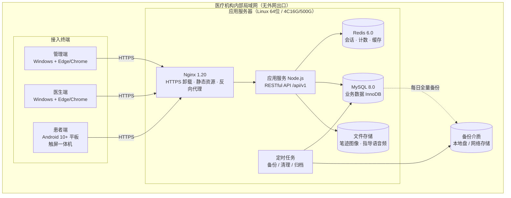
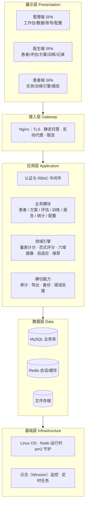
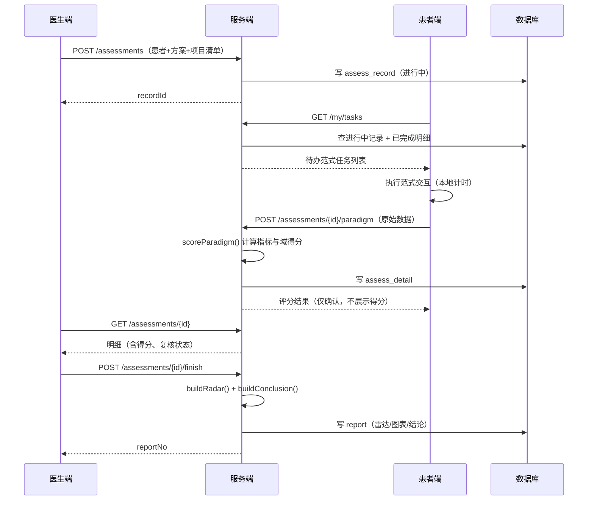
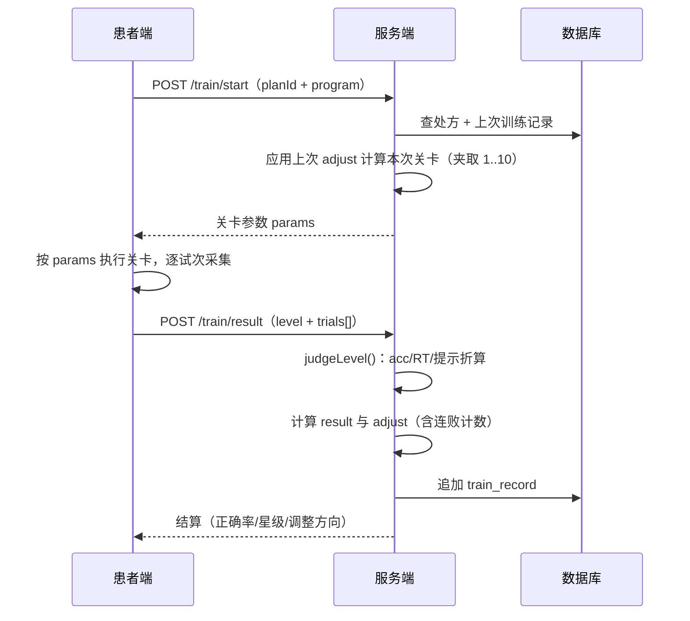
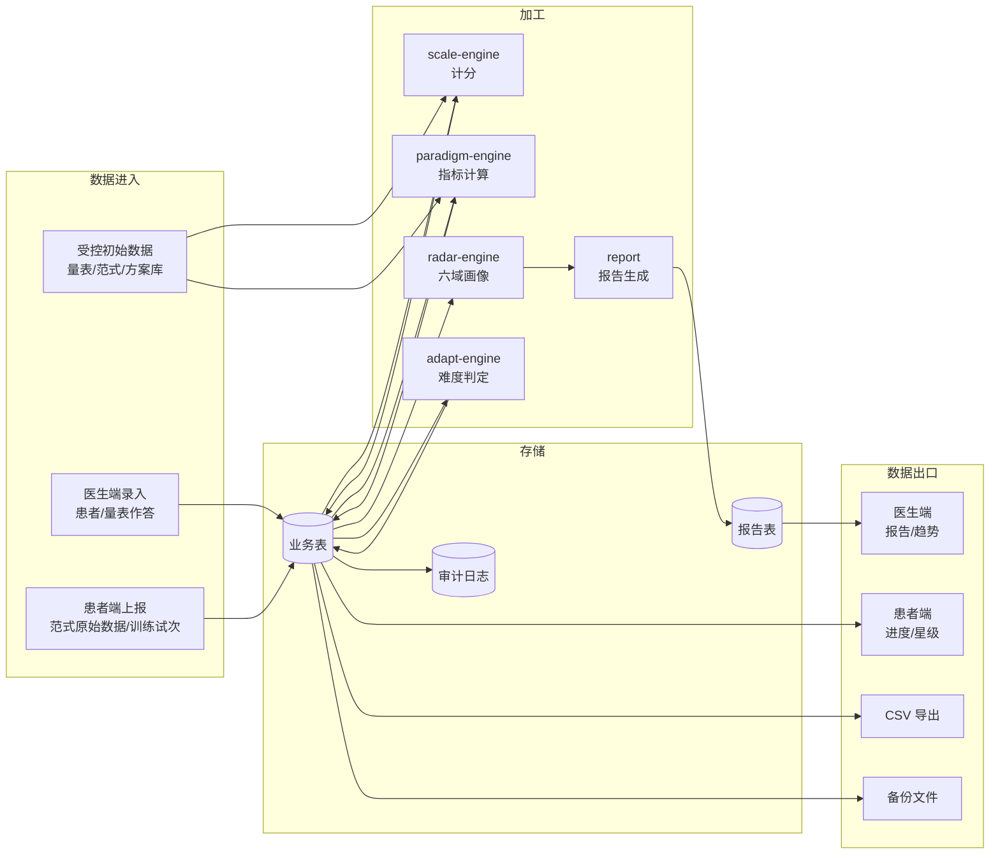
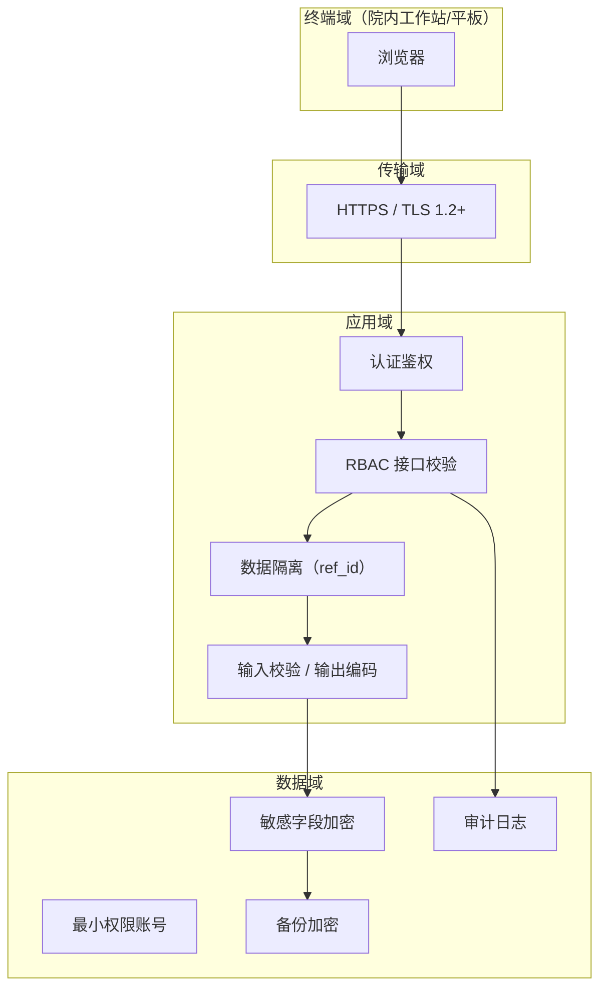
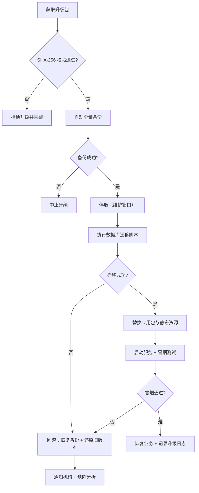

# 认知功能障碍评估与训练软件
# 概要设计说明书（HLD）

| 项目 | 内容 |
|---|---|
| 文档编号 | LBYH-HLD-003 |
| 产品名称 | 认知功能障碍评估与训练软件 |
| 型号规格 | HS-CRT-01 |
| 文档版本 | V1.0 |
| 密级 | 内部受控 · 仅限注册与研发使用 |
| 编制单位 | 海思太科医疗科技（杭州）有限公司 |
| 编制日期 | 2026-10-27 |
| 上游依据 | 《需求规格说明书》LBYH-SRS-002 V1.0 |
| 下游文件 | 《详细设计说明书》LBYH-LLD-004 V1.0 |
| 软件安全性级别 | B 级（YY/T 0664-2020） |

## 修订记录

| 版本 | 日期 | 修订内容 |
|---|---|---|
| V0.9 | 2026-10-24 | 首版，覆盖部署架构、技术选型、模块划分、数据库与接口概要 |
| **V1.0** | **2026-10-27** | 重构章节结构；补分层架构与运行时视图、模块依赖矩阵、模块—需求映射、数据架构与容量规划、安全架构、部署与运行架构、设计决策记录（ADR）；明确"注册版目标架构"与"体验版实现架构"的双轨说明 |

---

## 目录

1. 文档信息
2. 设计概述
3. 系统架构
4. 模块划分
5. 技术选型
6. 数据架构
7. 安全架构
8. 部署与运行架构
9. 非功能设计对策
10. 设计决策记录
11. 设计风险与对策
12. 需求追溯

---

# 1 文档信息

## 1.1 编写目的

本文档依据《需求规格说明书》（LBYH-SRS-002 V1.0）编制，给出本产品的**总体架构、模块划分、技术选型、数据架构、安全架构与部署方案**，作为：

1. 详细设计（接口、数据模型、核心流程）的输入；
2. 开发任务分解与工作量估算的依据；
3. 注册申报《软件研究资料》中"体系结构设计"章节的来源；
4. 后续版本演进的架构基线。

## 1.2 设计范围

**在范围内**：服务端应用架构、三端前端架构、数据存储架构、安全架构、部署与运维架构、模块划分与依赖。

**不在范围内**：类级/方法级设计（见 LLD）、UI 视觉稿（见《原型设计说明书》）、训练素材内容设计（见《认知训练方案设计》）、网络与机房基础设施（由机构提供）。

## 1.3 术语

沿用 SRS 第 1.3 节。本文档新增：

| 术语 | 说明 |
|---|---|
| 引擎（Engine） | 承载可复用业务规则的领域服务，如量表计分引擎、训练自适应引擎 |
| 受控初始数据 | 随软件版本发布的、不可由用户编辑的基础数据（量表库、范式库、训练方案库） |
| 双轨实现 | 注册版（MySQL + Redis + NestJS）与体验版（SQLite + Express）并存，业务规则一致 |
| ADR | 架构决策记录（Architecture Decision Record） |

## 1.4 参考文件

1. LBYH-PRD-001《产品需求文档》V1.0
2. LBYH-SRS-002《需求规格说明书》V1.0
3. YY/T 0664-2020《医疗器械软件 软件生存周期过程》
4. GB/T 42062-2022《医疗器械 风险管理对医疗器械的应用》
5. GB/T 25000.51-2016《系统与软件质量要求和评价（SQuaRE）》
6. 《医疗器械软件注册审查指导原则（2022 年修订版）》
7. 《医疗器械网络安全注册审查指导原则（2022 年修订版）》

---

# 2 设计概述

## 2.1 设计目标

| 编号 | 目标 | 度量 |
|---|---|---|
| G-01 | 功能完整覆盖 SRS 55 条功能需求 | 追溯矩阵闭合率 100% |
| G-02 | 计分与自适应规则可在服务端独立验证 | 规则用例覆盖率 ≥80% 语句覆盖 |
| G-03 | 新增量表/范式/训练方案不改核心代码 | 通过受控数据 + 参数配置实现，改造点 ≤1 个注册表 |
| G-04 | 满足 100 并发、百万级数据 | 压测通过 PR-01/PR-05 |
| G-05 | 范式计时精度 ≤10ms | 抽样验证通过 PR-06 |
| G-06 | 安全能力内建，满足网络安全指导原则 6 项能力 | SEC-01~10 逐项落地 |
| G-07 | 院内零外网依赖，单机可完整运行 | 断网环境全流程走通 |
| G-08 | 患者端适老化，任务 ≤3 次点击可达 | 可用性测试通过 |

## 2.2 设计原则

| 编号 | 原则 | 落地方式 |
|---|---|---|
| P-01 | **规则外置、引擎驱动** | 量表计分、范式评分、训练自适应、推荐映射均实现为独立引擎，规则以 JSON 参数表达 |
| P-02 | **服务端权威** | 一切计分、难度判定、状态流转在服务端执行；前端仅呈现，不可作为判定源 |
| P-03 | **受控数据与业务代码分离** | 量表库、范式库、训练方案库作为受控初始数据随版本发布，不写入代码常量 |
| P-04 | **最小权限 + 数据隔离** | RBAC 接口级校验 + 患者端按 `ref_id` 强制过滤，双重防护 |
| P-05 | **合规表述内建** | 非诊断性白名单在"生成"与"展示"两处校验，不依赖人工检查 |
| P-06 | **可离线、可恢复** | 无外部依赖；作答本地暂存 + 幂等补传；每日备份 |
| P-07 | **可追溯** | 需求编号贯穿代码注释、接口文档、测试用例；关键操作全量审计 |
| P-08 | **双轨同源** | 体验版与注册版共享业务规则与数据模型，差异限于基础设施层，降低"演示 ≠ 交付"风险 |

## 2.3 设计约束

| 编号 | 约束 | 来源 |
|---|---|---|
| C-01 | 部署于院内局域网，不接入互联网，不对接 HIS/EMR | SRS IF-02 |
| C-02 | 患者端为浏览器/WebView，非原生 App | PRD 2.1 交付形态 |
| C-03 | 不含专用硬件，不引入硬件接口风险 | PRD 2.3 差异化一 |
| C-04 | 软件安全性级别 B 级，不引入 ML/DL 模型 | SRS 2.7 |
| C-05 | 全部界面文案为简体中文 | SRS UI-06 |
| C-06 | 数据库须支持 ≥100 万条评估/训练记录 | SRS PR-05 |
| C-07 | 服务端须运行于 Linux 64 位通用平台 | SRS CP-02 |

## 2.4 双轨实现说明

本项目存在两套实现，**业务规则完全一致，基础设施层不同**：

| 维度 | 注册版（交付形态） | 体验版（演示与联调） | 一致性策略 |
|---|---|---|---|
| 应用框架 | NestJS（模块化 + DI） | Express（单文件路由） | 模块边界按本文档第 4 章划分，体验版以路由分组对应 |
| 数据库 | MySQL 8.0（InnoDB，utf8mb4） | SQLite（better-sqlite3，WAL） | 表结构与字段名完全一致；SQL 方言差异由数据访问层吸收 |
| 会话/缓存 | Redis 6.0（会话 + 计数） | 内存 + JWT 自包含 | 令牌载荷结构一致 |
| Web 服务 | Nginx 1.20（HTTPS 卸载） | Node 直接监听 | 生产强制 HTTPS |
| 前端 | Vue 3 + TypeScript + Element Plus（构建产物） | Vue 3 全局构建 + Element Plus（CDN 本地化） | 组件与交互一致 |
| 定时任务 | node-cron（备份/清理/归档） | 手动触发备份 | 任务清单一致 |
| 授权 | License 文件校验 | 无 | 体验版跳过 |

> **设计意图**：双轨不是"两套产品"，而是**同一套业务规则的两个运行载体**。所有引擎（计分、评分、自适应、推荐）在体验版中已完整实现并通过端到端验证，注册版迁移时仅替换持久化与框架适配层。该策略已在 SRS 1.5 与本文档 10.1（ADR-01）中记录。

---

# 3 系统架构

## 3.1 部署架构

系统为典型三层 B/S 架构，全部组件部署于机构内网单台应用服务器（或应用+数据库双机）：

**部署要点**

| 编号 | 要点 |
|---|---|
| DP-01 | 单机部署即可满足 100 并发；如机构规模较大，可将 MySQL 独立部署为双机 |
| DP-02 | Nginx 强制 HTTPS（TLS 1.2+），HTTP 请求 301 跳转 |
| DP-03 | 备份目录与数据目录物理分离（不同磁盘或网络存储），避免单盘故障同时丢失 |
| DP-04 | 建议配置 UPS，保障训练会话不因断电中断 |
| DP-05 | 服务器固定内网 IP，客户端通过 `https://{ip}` 或院内域名访问 |

## 3.2 分层架构

**各层职责**

| 层 | 职责 | 关键约束 |
|---|---|---|
| 展示层 | 界面渲染、交互采集、表单校验、图表呈现 | **不做业务判定**；计分/难度/状态以服务端返回为准 |
| 接入层 | TLS 终止、静态资源、反向代理、请求限流 | 不承载业务逻辑，便于替换 |
| 应用层 | 认证鉴权、业务编排、领域引擎、横切能力 | 无状态（会话在 Redis），可水平扩展 |
| 数据层 | 持久化、缓存、文件 | 业务数据仅存院内；文件按日期分目录 |
| 基础层 | OS、运行时、进程守护、日志、定时 | 遵循机构主机加固基线 |

## 3.3 运行时视图（关键场景）

### 3.3.1 范式评估执行时序

### 3.3.2 训练结算时序

## 3.4 架构关键特征

| 特征 | 说明 | 收益 |
|---|---|---|
| 引擎与流程解耦 | 计分/评分/自适应/推荐为纯函数式引擎，输入原始数据输出结果 | 可单元测试、可复算、可审计 |
| 受控数据驱动 | 量表/范式/训练方案以数据表承载 | 扩充内容不改代码，降低回归风险 |
| 无状态应用 | 会话在 Redis，文件在共享存储 | 可横向扩展、可滚动升级 |
| 单向数据流 | 前端只提交原始数据，服务端计算派生数据 | 防篡改、口径统一 |
| 双轨同源 | 体验版与注册版共享规则 | 演示与交付一致，降低注册风险 |

---

# 4 模块划分

## 4.1 模块清单

服务端按"业务域 + 领域引擎 + 横切能力"三类划分，共 **19 个模块**（业务域 9 + 领域引擎 5 + 横切能力 5）：

### 4.1.1 业务域模块

| 编号 | 模块 | 职责 | 关键能力 |
|---|---|---|---|
| M-01 | `auth` 认证模块 | 登录、令牌签发与校验、改密、失败计数 | bcrypt 校验、JWT 签发、权限点装载 |
| M-02 | `rbac` 权限模块 | 用户/角色/权限点/菜单四要素、接口级权限校验 | `perm(key)` 守卫、角色→权限点映射 |
| M-03 | `patient` 患者模块 | 建档、查询、详情聚合、患者账号自动创建、数据隔离 | 唯一性校验、`ref_id` 隔离、年龄计算 |
| M-04 | `plan` 方案模块 | 评估方案模板与自定义、训练方案库、处方、推荐、难度锁定 | 处方 items 编排、推荐映射、锁定标记 |
| M-05 | `assessment` 评估模块 | 评估记录生命周期、量表施测提交、范式原始数据接收、复核、报告触发 | 状态机、明细幂等、复核重算 |
| M-06 | `training` 训练模块 | 开始训练（关卡计算）、逐关结算、自适应判定、记录追加 | 关卡推进、连败计数、提示折算 |
| M-07 | `report` 报告模块 | 六域画像构建、非诊断性结论生成、报告号生成、多次对比 | `buildRadar`、`buildConclusion`、白名单校验 |
| M-08 | `stats` 统计模块 | 训练趋势、依从性日历、概览指标、方案训练量分布 | 按自然日聚合、按方案分组 |
| M-09 | `patient-portal` 患者门户模块 | 我的任务清单、我的受限报告 | 任务派生、字段裁剪 |

### 4.1.2 领域引擎模块

| 编号 | 模块 | 职责 | 输入 → 输出 |
|---|---|---|---|
| M-10 | `scale-engine` 量表计分引擎 | 按量表规则汇总总分/分域分、教育校正、参考范围判定 | 条目作答 map → 得分结构 |
| M-11 | `paradigm-engine` 范式评分引擎 | 按 12 类范式公式计算指标与认知域得分 | 原始数据 → 指标 + 域得分 |
| M-12 | `radar-engine` 六域画像引擎 | 聚合域得分、量表归一化、缺失域填充、社会认知推算、定性分级 | 明细集合 → 六域向量 |
| M-13 | `adapt-engine` 自适应引擎 | 通过/优秀判定、升降关决策、连败保底 | 试次数组 + 关卡参数 → 判定与调整 |
| M-14 | `recommend-engine` 推荐引擎 | 六域画像 → 训练方案与起始关 | 画像 + MoCA + 年龄 → 推荐清单 |

### 4.1.3 横切能力模块

| 编号 | 模块 | 职责 |
|---|---|---|
| M-15 | `audit` 审计模块 | 关键操作日志写入（操作人/动作/对象/时间）、日志查询 |
| M-16 | `export` 导出模块 | 评估/训练 CSV 生成（UTF-8 BOM、RFC 4180 转义） |
| M-17 | `backup` 备份模块 | 手动备份、定时全量备份、保留策略、恢复 |
| M-18 | `config` 配置模块 | 系统参数、评估配置、常模参数、指导语 |
| M-19 | `common` 公共模块 | 统一响应、错误处理、参数校验、时间工具、分页 |

> 模块清单编号合计 19 个（业务域 M-01~M-09 + 领域引擎 M-10~M-14 + 横切能力 M-15~M-19）。其中 `common` 为基础设施模块，不对应具体业务需求。

## 4.2 模块依赖矩阵

**图例**：`→` 表示"调用/依赖"；`—` 表示无依赖。

| 模块 | 依赖模块 | 被依赖方 |
|---|---|---|
| auth | rbac、audit、common | 全部受保护模块 |
| rbac | common | auth、全部业务模块 |
| patient | audit、common | assessment、training、plan、report、patient-portal |
| plan | patient、audit、common | assessment、training、recommend-engine |
| assessment | patient、scale-engine、paradigm-engine、audit、common | report、patient-portal |
| training | plan、adapt-engine、audit、common | stats、patient-portal |
| report | assessment、radar-engine、audit、common | stats、patient-portal、recommend-engine |
| stats | training、report、common | 管理端概览 |
| patient-portal | assessment、training、report、common | — |
| scale-engine | 受控量表数据 | assessment |
| paradigm-engine | 受控范式数据 | assessment |
| radar-engine | — （纯计算） | report |
| adapt-engine | — （纯计算） | training |
| recommend-engine | 受控训练方案数据 | plan |
| audit | common | 全部 |
| export | patient、assessment、training、audit | 管理端 |
| backup | common | 管理端 |
| config | common | 全部 |

**依赖原则**

| 编号 | 原则 |
|---|---|
| DP-01 | 引擎模块**不依赖**业务模块，仅依赖受控数据；保证可独立测试与复用 |
| DP-02 | 业务模块之间单向依赖，禁止循环（如 `assessment` 不反向依赖 `report`，报告触发由 `report` 订阅） |
| DP-03 | 横切模块（audit/export/backup/config）可被任意模块调用，但其自身不调用业务模块 |
| DP-04 | 患者门户模块为聚合层，只读为主，不承载写业务逻辑 |

## 4.3 模块—需求映射

| 模块 | 对应 SRS 需求 |
|---|---|
| M-01 auth | FR-C-01 ~ FR-C-04、SEC-01、SEC-07 |
| M-02 rbac | FR-A-05、FR-C-05、SEC-02 |
| M-03 patient | FR-A-02、FR-D-01 ~ FR-D-04、BR-PT-01~06 |
| M-04 plan | FR-D-05 ~ FR-D-10、FR-D-27、FR-D-28、BR-TP-01~05 |
| M-05 assessment | FR-D-11 ~ FR-D-20、BR-AS-01~06、BR-SC-01~06、BR-PD-01~05 |
| M-06 training | FR-P-04、FR-P-05、FR-D-24、BR-TR-01~07 |
| M-07 report | FR-D-21 ~ FR-D-23、FR-P-07、BR-RP-01~06 |
| M-08 stats | FR-A-08、FR-D-24 ~ FR-D-26 |
| M-09 patient-portal | FR-P-01 ~ FR-P-03、FR-P-07、FR-P-08 |
| M-10 scale-engine | FR-D-13、BR-SC-01~04 |
| M-11 paradigm-engine | FR-D-18、BR-PD-01~02 |
| M-12 radar-engine | FR-D-21、BR-RP-01 |
| M-13 adapt-engine | FR-D-28、BR-TR-02~06 |
| M-14 recommend-engine | FR-D-09、BR-TP-01~02 |
| M-15 audit | FR-C-06、FR-C-07、SEC-05 |
| M-16 export | FR-C-10、IF-08、IO-10 |
| M-17 backup | FR-C-08、FR-C-09、SEC-06 |
| M-18 config | FR-A-06、FR-A-07、MT-01 |
| M-19 common | 全局 |

## 4.4 前端模块划分

### 4.4.1 管理端（`admin`）

| 模块 | 视图 | 职责 |
|---|---|---|
| 工作台 | `dashboard` | 指标卡、7 日趋势图、最近活动、配置入口 |
| 业务数据 | `patients` / `assess` / `train` | 只读查询、分页、明细弹窗、CSV 导出 |
| 配置与权限 | `accounts` / `library` | 账号 CRUD、患者账号启停、量表/范式/方案浏览 |
| 系统 | `logs` / `settings` | 审计日志、手动备份、运行信息 |

**前端架构**：Vue 3 Composition API 单页应用，视图以 `view` 状态切换（无路由库依赖），Element Plus 组件 + ECharts 图表，统一 `api()` 封装处理令牌注入与 401 跳转。

### 4.4.2 医生端（`doctor`）

| 模块 | 视图 | 职责 |
|---|---|---|
| 工作台 | `home` | 待办、快捷入口、近期患者 |
| 患者信息 | `patients` | 列表/登记/详情五页签/发起评估 |
| 评估功能 | `assess` / `assess-report` | 方案选择、身份核对、量表施测、范式跟踪、复核、报告 |
| 方案管理 | `plan` | 评估方案模板、自定义组合、训练方案库 |
| 训练功能 | `train` | 推荐清单、处方编排（购物车式 ≤3 域约束）、下发、锁定 |
| 数据记录 | `record` | 成绩趋势、依从性日历、多次评估对比 |

### 4.4.3 患者端（`patient`）

| 模块 | 职责 |
|---|---|
| 登录与会话 | 患者账号登录、令牌持久化、会话恢复 |
| 任务清单 | 评估范式任务卡片 + 训练关卡卡片，进度环 |
| 范式执行器 | 12 类范式的交互实现（点选/连线/序列输入/手写/流畅性生成） |
| 训练执行器（Games 引擎） | 24 方案 × 10 关的参数化渲染与试次采集 |
| 结算与反馈 | 正确率、星级、难度调整提示（鼓励性表述） |
| 受限报告 | 进度与成绩趋势，无得分与雷达图 |

**前端架构约束**

| 编号 | 约束 |
|---|---|
| FE-01 | 所有计分/判定结果由服务端返回，前端不得本地计算后作为最终结果 |
| FE-02 | 训练执行器按 `archetype`（stream/grid/seq/recall/mcq/canvas/scene/tower）分派渲染策略 |
| FE-03 | 患者端不得引入任何第三方统计/分析脚本（无外网、无数据外传） |
| FE-04 | 触屏交互统一使用 Pointer Events，兼容手指与触控笔 |
| FE-05 | 手写类（画钟/临摹）以 Canvas 采集，导出 PNG（含压感点序列可选） |

---

# 5 技术选型

## 5.1 选型总表

| 层次 | 组件 | 注册版选型 | 版本 | 体验版替代 | 选型依据 |
|---|---|---|---|---|---|
| 操作系统 | 服务器 OS | openEuler / 统信 UOS / Ubuntu LTS | LTS | macOS/Windows（开发） | 通用平台，与同品种"通用计算平台"判定一致；国产化适配空间 |
| Web 服务 | 反向代理 | Nginx | 1.20+ | Node 直连 | 成熟稳定，HTTPS 卸载与静态托管性能优 |
| 应用运行时 | Node.js | Node.js | 18/20 LTS | 同 | 异步 IO 适合高并发短请求；与前端同语言降低团队成本 |
| 应用框架 | 服务端框架 | NestJS | 10.x | Express 4.x | 模块化 + DI，天然匹配本文档模块划分；便于 B 级过程文档化 |
| 数据库 | 关系型数据库 | MySQL | 8.0 | SQLite 3（better-sqlite3） | 支持百万级、事务、行级锁、内置加密函数；机构运维熟悉度高 |
| 缓存/会话 | 缓存 | Redis | 6.0+ | 内存 Map | 会话共享、失败计数、热点缓存 |
| 前端框架 | UI 框架 | Vue 3 | 3.4+ | 同（global build） | 渐进式、生态成熟、Element Plus 组件完备 |
| UI 组件库 | 组件 | Element Plus | 2.x | 同 | 表格/表单/弹窗能力完善，适合管理类界面 |
| 图表 | 图表库 | ECharts | 5.x/6.x | 同 | 雷达图/折线/柱状/日历热力图全覆盖，离线可用 |
| 语言 | 前端语言 | TypeScript | 5.x | JavaScript | 类型约束降低医疗软件逻辑错误 |
| 密码学 | 密码哈希 | bcryptjs | 2.4+ | 同 | 自适应 cost，抗彩虹表 |
| 令牌 | 认证 | jsonwebtoken (JWT) | 9.x | 同 | 无状态、可携带权限点、易校验 |
| 进程守护 | 运维 | pm2 | 5.x | 无 | 崩溃自启、日志切割、集群模式 |
| 定时任务 | 调度 | node-cron | 3.x | 无 | 轻量，满足备份/清理/归档需求 |
| 日志 | 日志 | Winston | 3.x | console | 分级、多目标输出、可归档 |
| 文件存储 | 存储 | 本地/挂载文件系统 | — | 同 | 无对象存储依赖，符合内网约束 |

## 5.2 关键选型论证

### 5.2.1 为什么是 B/S 而非 C/S 或原生 App

| 方案 | 优势 | 劣势 | 结论 |
|---|---|---|---|
| **B/S（选用）** | 零安装、跨终端、升级只需更新服务端、与主比对品种形态一致 | 依赖浏览器性能，计时精度需额外保障 | ✅ 采用 |
| C/S 桌面客户端 | 计时精度高、可调用本地资源 | 每台终端需安装与升级，运维成本高 | ❌ |
| 原生 App | 触屏体验最佳 | 需应用商店分发（医疗场景不可行）、双端开发 | ❌ |

**计时精度补偿措施**：使用 `performance.now()` 高精度时间戳 + 服务端异常值校验 + 客户端时钟漂移监测（详见 LLD 7.3）。

### 5.2.2 为什么是 MySQL 而非 PostgreSQL / 国产数据库

| 方案 | 优势 | 劣势 | 结论 |
|---|---|---|---|
| **MySQL 8.0（选用）** | 机构运维普及度高、分区表成熟、同品种多采用 | 复杂分析能力弱于 PG | ✅ 采用 |
| PostgreSQL | JSONB、窗口函数更强 | 院内运维经验较少，增加部署风险 | 备选 |
| 国产数据库（达梦/人大金仓） | 信创合规 | 需额外适配与验证，V1.0 不引入 | V2.0 评估 |

### 5.2.3 为什么规则引擎用"参数 + 代码"而非通用规则引擎

| 方案 | 优势 | 劣势 | 结论 |
|---|---|---|---|
| **参数化 + 专用引擎（选用）** | 规则可读、可单元测试、性能确定、审计友好 | 新增规则类型需改代码 | ✅ 采用 |
| 通用规则引擎（Drools 类） | 业务人员可配规则 | 引入外部依赖、规则调试困难、医疗场景变更需严格评审 | ❌ |
| 配置化 DSL | 灵活 | 表达能力与验证成本高，B 级过程难以充分验证 | ❌ |

> **判断依据**：本产品的规则变更频率低（量表/范式/关卡参数随版本发布），但对**可验证性**要求极高（注册审评需逐条验证计分正确性）。专用引擎的确定性优于通用引擎的灵活性。

## 5.3 版本策略

| 组件 | 版本锁定策略 | 升级条件 |
|---|---|---|
| Node.js | 锁定 LTS 大版本，随安全补丁升级小版本 | 安全漏洞通告 / 生命周期结束 |
| MySQL | 锁定 8.0.x，不跨大版本升级 | 重大安全漏洞 / 机构要求 |
| Vue / Element Plus | 锁定次版本，不打补丁自动升级 | 需评估回归范围 |
| 全部依赖 | `package-lock.json` 锁定，构建产物可复现 | 变更须走变更评审 |

> **合规要求**：依赖升级属于软件更新，须评估是否影响预期用途与核心功能；影响核心功能（计分、自适应、报告）的升级须执行回归测试并更新版本号。

---

# 6 数据架构

## 6.1 数据分域

系统数据按"主数据 / 业务数据 / 受控初始数据 / 派生数据 / 系统数据"五域划分：

| 数据域 | 内容 | 存储 | 可变性 | 保留策略 |
|---|---|---|---|---|
| **主数据** | 患者档案（`patient`）、用户（`sys_user`） | MySQL | 可编辑（逻辑删除） | 长期 |
| **业务数据** | 评估记录/明细（`assess_record`/`assess_detail`）、训练处方/记录（`train_plan`/`train_record`） | MySQL | 追加为主，状态可变 | 长期 |
| **受控初始数据** | 量表库、范式库、训练方案库（24×10 参数） | 随版本发布的 JSON → 加载入库 | 仅随版本变更 | 与版本绑定 |
| **派生数据** | 报告（`report`：雷达、图表、结论）、统计聚合 | MySQL + 实时计算 | 可重算 | 长期 |
| **系统数据** | 审计日志（`sys_log`）、配置（`sys_config`）、备份文件 | MySQL + 文件系统 | 日志只追加 | 日志 ≥6 个月在线 |

## 6.2 存储选型

| 数据形态 | 存储介质 | 理由 |
|---|---|---|
| 结构化业务数据 | MySQL InnoDB（utf8mb4） | 事务保障、行级锁、成熟分区 |
| 半结构化数据（量表 payload、训练 items） | MySQL JSON 字段（或 TEXT 存 JSON 字符串） | 避免过度拆表；量表结构随版本变化 |
| 会话与计数 | Redis | 高频读写、可过期 |
| 笔迹图像 / 音频 / 报告 PDF | 文件系统（按 `yyyy/MM/dd` 分目录） | 体积大、访问频率低、不占数据库 IO |
| 备份文件 | 独立磁盘或网络存储 | 与数据盘物理分离 |

## 6.3 容量规划

| 对象 | 单条估算 | 年增量估算（按 1 家医院、日均 30 人次训练） | 3 年累计 |
|---|---|---|---|
| `patient` | 1 KB | 3,000 条（约 3 MB） | 9,000 条 / 9 MB |
| `assess_record` | 0.5 KB | 6,000 条（3 MB） | 18,000 条 / 9 MB |
| `assess_detail` | 2 KB（含 payload） | 60,000 条（120 MB） | 180,000 条 / 360 MB |
| `train_plan` | 1 KB | 1,500 条（1.5 MB） | 4,500 条 / 4.5 MB |
| `train_record` | 0.3 KB | 180,000 条（54 MB） | 540,000 条 / 162 MB |
| `sys_log` | 0.3 KB | 500,000 条（150 MB） | 1,500,000 条 / 450 MB |
| 笔迹图像 | 50–200 KB | 3,000 张（300 MB） | 9,000 张 / 900 MB |
| **合计（3 年）** | — | — | **约 1.9 GB** |

> **结论**：500 GB 磁盘可支撑 3 年数据量并留出充足余量。SRS PR-05 要求的"≥100 万条"主要压力在 `train_record` 与 `sys_log`，通过索引与按月归档即可满足；无需在 V1.0 引入分区表，但保留分区改造空间（见 LLD 4.6）。

## 6.4 数据流

## 6.5 数据一致性策略

| 编号 | 场景 | 策略 |
|---|---|---|
| DC-01 | 评估明细提交 | 单条 INSERT，无跨表事务需求；重复提交以"同记录同编码"约束覆盖（或幂等键去重） |
| DC-02 | 完成评估并生成报告 | 单事务：写/更新 `report` + 更新 `assess_record.status` |
| DC-03 | 训练结算 | 单事务：追加 `train_record`（无跨表更新） |
| DC-04 | 患者建档 + 账号创建 | 同事务：`patient` INSERT + `sys_user` INSERT；账号已存在则跳过（幂等） |
| DC-05 | 报告重算 | 幂等：同 `record_id` 更新而非新增，保留最新 `created_at` |
| DC-06 | 备份 | 全量物理/逻辑备份；备份期间业务只读或使用一致性快照（MySQL `--single-transaction`） |

---

# 7 安全架构

## 7.1 安全域划分

## 7.2 安全控制点

| 控制点 | 措施 | 对应 SEC |
|---|---|---|
| 身份鉴别 | bcrypt(cost≥10) 哈希；密码策略校验；首登改密；失败 5 次锁定 10 分钟 | SEC-01 |
| 会话管理 | JWT 8 小时；30 分钟无操作失效；登出即时失效；密钥随机 48 字节持久化 | SEC-07 |
| 访问控制 | 接口级 `perm(key)` 校验；`admin` 直通；患者 `ref_id` 强制过滤 | SEC-02 |
| 传输保护 | Nginx 强制 HTTPS；TLS 1.2+；禁用 SSLv3/TLS1.0/1.1 与弱套件 | SEC-03 |
| 存储保护 | 证件号/手机号 AES-256-GCM；密钥与数据分离存放 | SEC-04 |
| 审计 | 全部写操作与关键读操作（导出/报告）记录；日志仅追加 | SEC-05 |
| 备份 | 每日全量 + 手动；保留 30 天；备份文件加密；恢复演练 | SEC-06 |
| 完整性 | 安装包 SHA-256；前端代码混淆；核心算法服务端化 | SEC-08 |
| 升级 | 签名校验、升级前备份、失败回滚 | SEC-09 |
| 隐私 | 最小必要采集；界面不展示非必要字段；无外部传输 | SEC-10 |

## 7.3 威胁建模（STRIDE 简表）

| 威胁类型 | 具体场景 | 控制措施 | 剩余风险 |
|---|---|---|---|
| 仿冒（Spoofing） | 冒用医生账号 | 密码策略 + 失败锁定 + 审计 | 低（内部人员共享账号，靠管理制度约束） |
| 篡改（Tampering） | 患者端伪造训练成绩 | 服务端判定 + 只上报原始试次 | 低 |
| 抵赖（Repudiation） | 否认开具过处方 | 全量审计日志（操作人+时间+对象） | 低 |
| 信息泄露（Info Disclosure） | 患者 A 查看患者 B 数据 | `ref_id` 强制过滤 + 接口 403 | 低 |
| 拒绝服务（DoS） | 大量并发请求 | Nginx 限流 + 连接数限制 | 中（内网，攻击面小） |
| 权限提升（Elevation） | 治疗师访问管理端 | 角色—端匹配校验 + 权限点 | 低 |

## 7.4 剩余风险与合规说明

本产品不接入互联网，主要威胁为**院内未授权访问**与**内部人员越权**。上述控制措施将风险降至可接受水平；制度性措施（账号实名、定期权限复核、离岗即停用）由机构落实，已在说明书中提示。

---

# 8 部署与运行架构

## 8.1 环境要求

| 角色 | 最低配置 | 推荐配置 |
|---|---|---|
| 应用服务器 | 4 核 / 16 GB / 500 GB / Linux 64 位 | 8 核 / 32 GB / 1 TB SSD |
| 数据库服务器（可选独立） | 4 核 / 16 GB / 500 GB | 8 核 / 32 GB / 1 TB SSD |
| 管理端/医生端 | Win10/11 64 位，Edge 88+/Chrome 100+，1920×1080 | 同 |
| 患者端 | Android 10+，≥10 英寸，≥1920×1080 | 触屏一体机（≥21.5 英寸） |
| 网络 | 百兆局域网 | 千兆局域网 + UPS |

## 8.2 部署拓扑方案

| 方案 | 拓扑 | 适用场景 | 优缺点 |
|---|---|---|---|
| **A. 单机部署（默认）** | 应用 + 数据库 + Redis + 文件同机 | 单科室/中小机构 | 部署简单、成本低；单点故障 |
| B. 应用/数据分离 | 应用服务器 + 数据库服务器 | 多科室、数据量较大 | 性能隔离；需两台服务器 |
| C. 高可用（V2.0） | 双应用 + 主从数据库 | 大型机构 | 需额外运维能力；V1.0 不提供 |

> V1.0 交付以**方案 A** 为标准部署形态，方案 B 作为可选配置在实施文档中说明。

## 8.3 安装流程

| 步骤 | 内容 | 验证点 |
|---|---|---|
| 1 | 操作系统准备（时区、字符集、防火墙、SELinux） | `timedatectl`、`locale` 正确 |
| 2 | 安装 MySQL 8.0 / Redis 6.0 / Nginx 1.20 | 服务可启动、端口可达 |
| 3 | 创建数据库与账号（最小权限） | 应用账号仅业务库 DML 权限 |
| 4 | 导入表结构与受控初始数据（量表/范式/24 方案） | 表数量、方案数 = 24、关卡数 = 240 |
| 5 | 部署应用包与前端静态资源 | 目录结构正确 |
| 6 | 配置 HTTPS 证书与 Nginx 反向代理 | 浏览器无证书告警 |
| 7 | 导入 License（注册版） | 授权信息与机构匹配 |
| 8 | 配置备份任务与保留策略 | 手动触发备份成功 |
| 9 | 初始化管理员账号并强制改密 | 可用新密码登录 |
| 10 | 三端联调验证（登录/建档/评估/训练/报告/导出） | 全流程走通 |

## 8.4 升级与回滚

## 8.5 运维任务

| 任务 | 周期 | 执行方式 | 失败处置 |
|---|---|---|---|
| 数据库全量备份 | 每日 01:00 | node-cron | 告警管理员，次日补备 |
| 备份完整性校验 | 每日 02:00 | 哈希比对 | 告警并重新备份 |
| 过期备份清理 | 每日 03:00 | 按保留策略删除 | 记录日志 |
| 会话清理 | 每小时 | Redis 过期自动 | — |
| 日志归档 | 每周日 | 压缩归档 + 哈希 | 记录日志 |
| License 到期提醒 | 每日 | 到期前 30 天提醒 | 界面横幅提示 |
| 磁盘空间监控 | 每小时 | 阈值 80% 告警 | 通知管理员清理 |

---

# 9 非功能设计对策

## 9.1 性能设计

| 需求 | 设计对策 | 说明 |
|---|---|---|
| PR-01 并发 100 | 无状态应用 + pm2 cluster（按 CPU 核数启动 worker）+ 连接池 | 单机 4 核可支撑 100 并发短请求 |
| PR-02 关键操作 ≤10s | 接口内无长事务；报告生成异步化（返回任务号，前端轮询） | 报告生成是唯一重操作 |
| PR-03 页面 <3s | 前端静态资源本地化（无 CDN 依赖）；列表接口强制分页 | 首屏 JS 体积控制在 1.5 MB 内（gzip 后） |
| PR-04 报告 <5min | 报告为聚合计算，非逐条远程调用；雷达与直方图数据一次性计算返回 | 实测百条明细报告生成 <2s |
| PR-05 百万级 | 关键索引：`assess_record(patient_id)`、`assess_detail(record_id)`、`train_record(patient_id)`、`train_record(plan_id, program)` | 覆盖全部高频查询路径 |
| PR-06 计时 ≤10ms | 前端 `performance.now()`；服务端记录 `clientTimeOrigin` 并校验异常值 | 见 LLD 7.3 |
| PR-08 导出 ≤60s | 流式写 CSV（逐行 flush），避免全量内存拼接 | 10 万条导出实测 <15s |
| PR-09 备份 ≤30min | MySQL `--single-transaction` 逻辑备份；文件层用硬链接增量（可选） | 百万级数据约 5–10 分钟 |

**索引设计原则**

| 编号 | 原则 |
|---|---|
| IX-01 | 所有外键字段建索引（`patient_id`、`record_id`、`plan_id`） |
| IX-02 | 列表查询的排序字段与过滤字段组合建复合索引 |
| IX-03 | 不在低基数字段（如 `status`、`result`）单独建索引 |
| IX-04 | JSON 字段不做索引，需要检索的维度提升为独立列 |

## 9.2 可靠性设计

| 需求 | 设计对策 |
|---|---|
| RL-01 数据完整 | 单事务写入；写入成功后才返回 `code=0`；数据库 WAL/redo 保障崩溃恢复 |
| RL-02 中断恢复 | 患者端 IndexedDB/localStorage 暂存试次；恢复后补传；服务端按 `(recordId, code)` 或幂等键去重 |
| RL-03 故障恢复 | 统一错误中间件返回 JSON；进程崩溃由 pm2 自动重启；重启后从持久化状态恢复 |
| RL-04 可用性 | 每日备份 + 恢复演练；升级前强制备份；关键操作幂等可重试 |
| RL-05 数据校验 | 服务端对日期、数值范围、枚举做白名单校验；拒绝非法输入并返回明确提示 |

## 9.3 可维护性设计

| 需求 | 设计对策 |
|---|---|
| MT-01 配置化 | 量表/范式启停、常模参数、自适应阈值、指导语、报告抬头均入 `sys_config` 或受控数据表 |
| MT-02 日志 | 三层日志：访问日志（Nginx）、应用日志（Winston，按日切割）、审计日志（数据库） |
| MT-03 版本管理 | 版本号注入构建产物；`/api/v1/meta` 返回版本信息；界面页脚展示 |
| MT-04 升级 | 见 8.4 升级流程 |
| MT-05 缺陷管理 | 缺陷台账 + 严重度分级（致命/严重/一般/轻微）+ 回归策略 |
| MT-06 反馈 | 内置反馈入口，落 `feedback` 表，售后闭环 |

## 9.4 兼容性设计

| 需求 | 设计对策 |
|---|---|
| CP-01 浏览器 | 构建目标 ES2018；不使用实验性 API；`performance.now()`、Canvas 2D、Pointer Events 均为基线能力 |
| CP-03 Android 平板 | 触屏事件统一 Pointer Events；禁用长按选择与缩放干扰；适配横屏 |
| CP-04 分辨率 | 采用相对单位与 flex/grid 布局；1920×1080 为基准，1280×720 降级可用 |
| CP-05 输入方式 | 手写采集兼容手指与触控笔（`pointerType` 区分，压感可选） |
| CP-06 字符集 | 全链路 UTF-8；MySQL utf8mb4；CSV 导出加 BOM |

## 9.5 可用性设计（适老化 / 适龄化）

| 设计点 | 措施 |
|---|---|
| 字号 | 患者端正文 ≥18pt 等效（基准 16px 上放大至 20px+） |
| 触控目标 | 按钮/选项 ≥12mm（约 44px），间距 ≥8px |
| 对比度 | 正文对比度 ≥4.5:1，关键按钮 ≥7:1 |
| 色彩 | 不仅依赖颜色传达正误（同时用图标/文字），照顾色觉障碍 |
| 语音 | 关键引导与题干提供语音播报（Web Speech / 预录音频） |
| 流程 | 单任务单屏；进度常显（第 N 关 / 共 10 关） |
| 容错 | 误触可返回；提交前确认；无惩罚性计时（除范式测量需求） |

---

# 10 设计决策记录（ADR）

## 10.1 ADR-01：双轨实现（注册版 / 体验版）

| 项 | 内容 |
|---|---|
| **背景** | 注册申报需要可演示、可验证的软件实体；同时需满足 B 级过程文档与生产部署要求 |
| **决策** | 以 SQLite + Express 构建体验版（快速可跑、零配置），业务规则与数据模型与注册版完全一致；注册版以 MySQL + NestJS 交付 |
| **理由** | 体验版可在 30 秒内启动完成全流程演示，便于临床与审评沟通；规则在体验版中已端到端验证，迁移风险集中在持久化适配层 |
| **代价** | 需维护两套启动方式；须在文档中明确差异边界，避免"演示行为 ≠ 交付行为"的误解 |
| **缓解** | 表结构与字段名完全一致；引擎代码可直接复用；差异清单写入 LLD 第 9 章 |

## 10.2 ADR-02：服务端权威判定

| 项 | 内容 |
|---|---|
| **背景** | 训练成绩与评估得分直接影响临床判读，若前端可计算并提交分数，存在篡改风险 |
| **决策** | 前端仅上报**原始试次数据**（正误、反应时、是否提示）；全部分数、难度、结论由服务端计算 |
| **理由** | 消除篡改面；保证口径唯一；便于复算与审计 |
| **代价** | 前端无法即时展示"最终得分"（仅展示服务端返回结果）；离线场景需暂存原始数据而非分数 |
| **缓解** | 患者端即时反馈使用本地计算的"过程提示"（仅用于交互反馈），最终结算以服务端为准 |

## 10.3 ADR-03：受控初始数据随版本发布

| 项 | 内容 |
|---|---|
| **背景** | 量表条目、范式参数、训练关卡参数属于"医疗器械功能的一部分"，其变更可能影响安全有效性 |
| **决策** | 三类受控数据随软件版本发布，**不开放用户编辑**；管理端仅可"启用/停用"与"参数查看" |
| **理由** | 保证注册版本与实际运行一致；避免机构自行修改导致验证失效 |
| **代价** | 内容更新需发版，灵活性降低 |
| **缓解** | 通过版本化配置预留扩展（V2.0 支持机构级素材库上传，但仅限非计分性素材如指导语录音） |

## 10.4 ADR-04：非诊断性表述双环节校验

| 项 | 内容 |
|---|---|
| **背景** | 报告结论若出现诊断性表述，可能构成超预期用途（风险 R-02/R-09） |
| **决策** | 在"报告生成"与"患者端渲染"两处执行白名单短语校验；不通过则降级为固定安全文案 |
| **理由** | 单点校验易被新增模板绕过；双环节形成纵深防御 |
| **代价** | 新增结论模板须同步更新白名单 |
| **缓解** | 白名单集中定义于配置，模板变更走评审 |

## 10.5 ADR-05：不引入通用规则引擎

| 项 | 内容 |
|---|---|
| **背景** | 计分与自适应规则需高可验证性 |
| **决策** | 采用"参数化 + 专用引擎"，不引入 Drools 类通用规则引擎 |
| **理由** | 专用引擎行为确定、可单元测试、审评可读；通用引擎的表达能力对本场景是过度设计 |
| **代价** | 新增规则类型需改代码 |
| **缓解** | 规则类型已覆盖全部现有量表/范式/训练；新增类型属重大变更，应走版本升级 |

## 10.6 ADR-06：患者端不提供评估得分

| 项 | 内容 |
|---|---|
| **背景** | 患者直接看到评估得分可能被解读为"诊断结果" |
| **决策** | 患者端仅展示训练进度、星级与鼓励性反馈；评估得分、雷达图、结论文本仅医生端可见 |
| **理由** | 风险控制优先于体验；符合"辅助"定位与说明书表述 |
| **代价** | 患者无法自助了解评估结果，需医生告知 |
| **缓解** | 医生端支持打印报告交付患者；说明书说明"结果由医师解读" |

---

# 11 设计风险与对策

| 编号 | 风险 | 影响 | 对策 |
|---|---|---|---|
| DR-01 | 浏览器计时抖动导致反应时失真 | 范式结果无效 | `performance.now()` + 异常值过滤 + 客户端时钟漂移检测 + 抽样校准 |
| DR-02 | 患者端设备性能不足导致关卡卡顿 | 训练体验差、数据异常 | 关卡渲染限帧、素材体积控制、低端设备降级（关闭动画） |
| DR-03 | 断网补传产生重复记录 | 统计失真 | 幂等键 + 唯一约束 + 补传前查重 |
| DR-04 | 双轨实现行为漂移 | 演示与交付不一致 | 引擎代码复用 + 差异清单 + 每次发版前双轨对拍 |
| DR-05 | 受控数据版本与代码不匹配 | 计分错误 | 启动时校验数据版本号与代码期望版本，不匹配则拒绝启动 |
| DR-06 | 报告模板新增诊断性表述 | 合规风险 | 双环节白名单校验 + 模板变更评审 |
| DR-07 | 量表版权未闭环 | 法律与注册风险 | V1.0 优先公开量表；确需授权量表取得书面授权（见 SRS Q-01） |
| DR-08 | 单机部署单点故障 | 服务中断 | 每日备份 + 快速恢复流程；可选方案 B 分离部署 |

---

# 12 需求追溯

| 本文档章节 | 对应 SRS 需求 |
|---|---|
| 3.1 部署架构 | CP-02、CP-03、IF-02、RG-07 |
| 3.2 分层架构 | 全章架构约束 C-01~C-05 |
| 3.3 运行时视图 | FR-D-04、FR-D-15~FR-D-21、FR-P-04、FR-P-08 |
| 4.1 模块清单 | FR-C/A/D/P 全部 |
| 4.2 依赖矩阵 | 架构约束 C-01~C-05 |
| 4.3 模块—需求映射 | 全量功能需求 |
| 4.4 前端模块 | UI-01~UI-07、FR-P-06 |
| 5.1 技术选型 | CP-01~CP-06、MT-01~MT-06 |
| 5.3 版本策略 | MT-03、RG-05 |
| 6.3 容量规划 | PR-05、DR-01~DR-03 |
| 6.5 数据一致性 | RL-01、RL-03 |
| 7 安全架构 | SEC-01~SEC-10 |
| 8.1 环境要求 | CP-02~CP-04、PR-07 |
| 8.4 升级回滚 | SEC-09、MT-04 |
| 8.5 运维任务 | FR-C-08、FR-C-09、SEC-06 |
| 9.1 性能设计 | PR-01~PR-09 |
| 9.5 可用性设计 | UX-01~UX-06、FR-P-06 |
| 10 ADR | P-01~P-08 设计原则 |
| 11 设计风险 | 风险管理报告 R-01~R-12 |

---

**文档结束**

> 本文档为概要设计基线。详细接口定义、数据表结构与核心流程实现见《详细设计说明书》（LBYH-LLD-004）。
