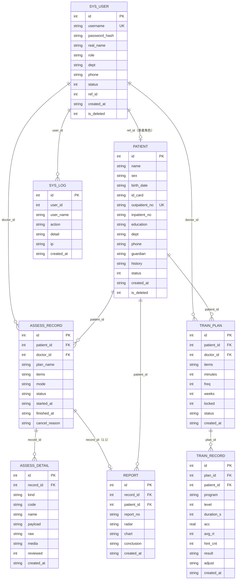
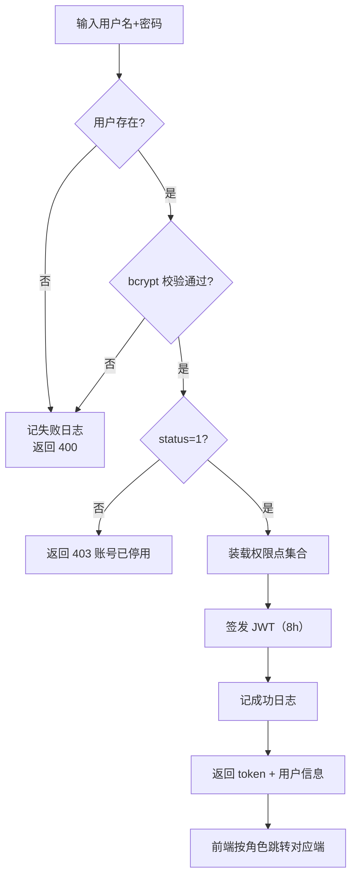
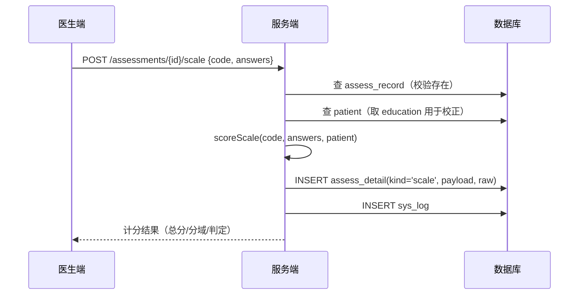
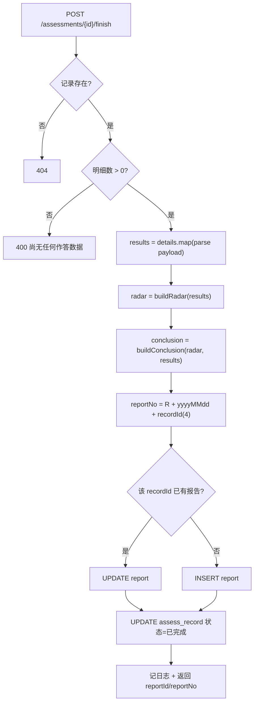
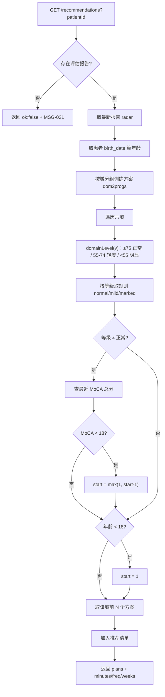
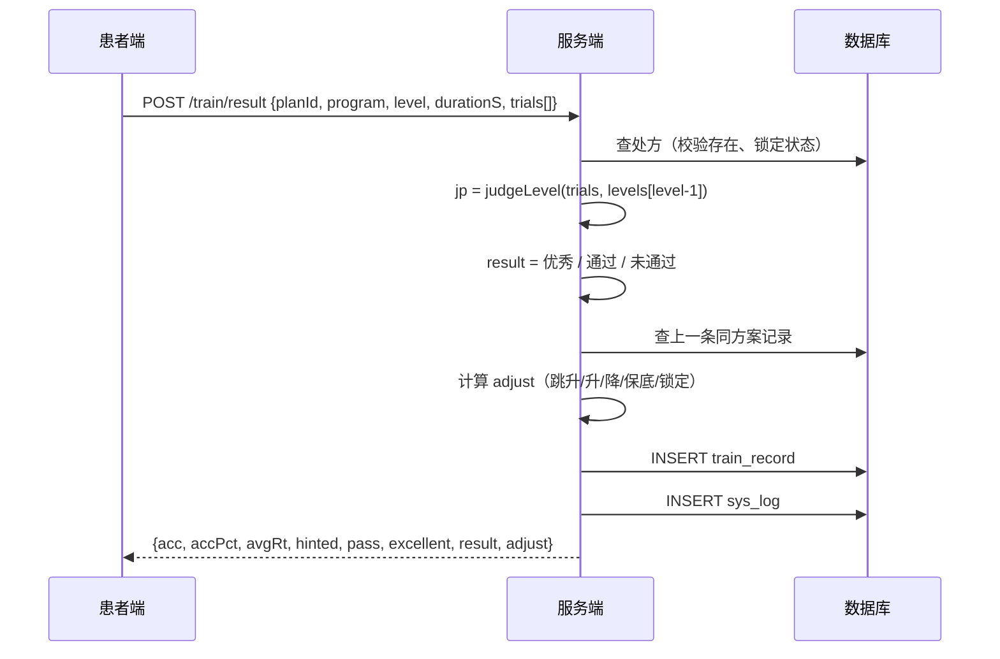
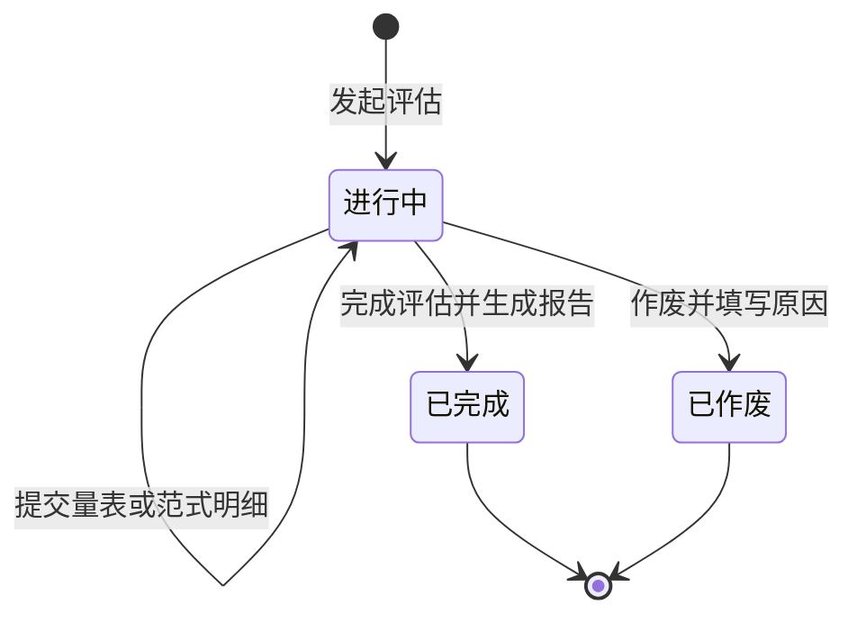
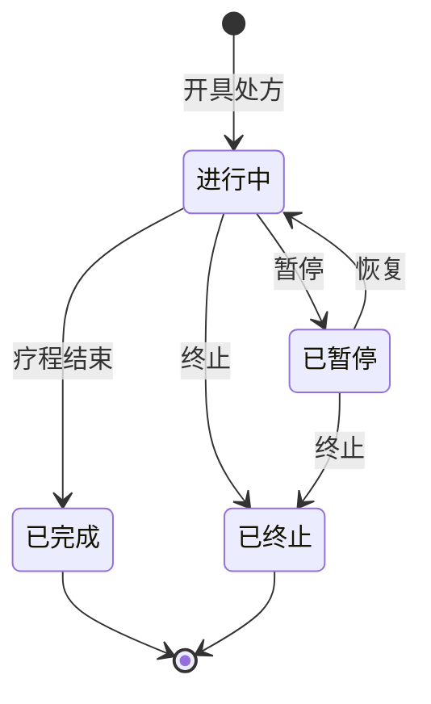
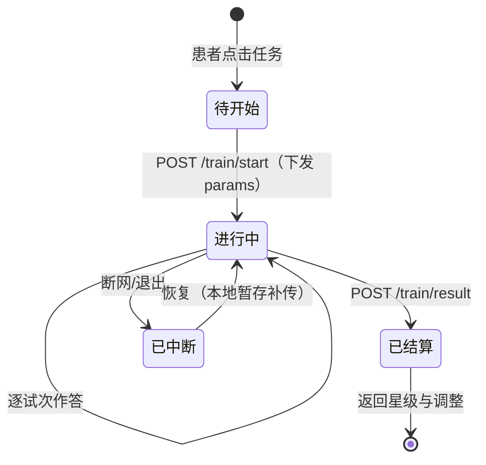

# 认知功能障碍评估与训练软件
# 详细设计说明书（LLD）

| 项目 | 内容 |
|---|---|
| 文档编号 | LBYH-LLD-004 |
| 产品名称 | 认知功能障碍评估与训练软件 |
| 型号规格 | HS-CRT-01 |
| 文档版本 | V1.0 |
| 密级 | 内部受控 · 仅限研发与注册使用 |
| 编制单位 | 海思太科医疗科技（杭州）有限公司 |
| 编制日期 | 2026-10-27 |
| 上游依据 | 《概要设计说明书》LBYH-HLD-003 V1.0 |
| 对应实现 | HS-CRT-01-体验版（Express + SQLite），与注册版（NestJS + MySQL）业务规则一致 |
| 软件安全性级别 | B 级（YY/T 0664-2020） |

## 修订记录

| 版本 | 日期 | 修订内容 |
|---|---|---|
| V0.9 | 2026-10-24 | 首版，含 API 清单、表结构、引擎算法概要 |
| **V1.0** | **2026-10-27** | 重构章节；补全 38 个接口的请求/响应/错误码定义；补 8 张表的完整字段字典与 DDL；补 14 个核心流程的时序与判定细则；补 7 类关键算法的伪代码与边界条件；补状态机汇总；补体验版与注册版差异清单；全部内容与体验版代码逐条核对 |

---

## 目录

1. 文档信息
2. 设计概述
3. 接口定义
4. 数据模型
5. 核心流程设计
6. 关键算法
7. 异常与边界处理
8. 状态机汇总
9. 体验版与注册版差异
10. 追溯与附录

---

# 1 文档信息

## 1.1 编写目的

本文档依据《概要设计说明书》（LBYH-HLD-003 V1.0）编制，给出可直接指导编码的**接口定义、数据模型、核心流程设计与关键算法**，并作为：

1. 开发实现与代码评审的依据；
2. 测试用例设计（接口级、算法级）的依据；
3. 注册申报《软件研究资料》中"详细设计"章节的来源；
4. 后续维护时理解实现意图的一手资料。

## 1.2 设计范围

| 在范围内 | 不在范围内 |
|---|---|
| REST API 定义（38 个端点） | UI 视觉与交互细节（见原型说明书） |
| 数据库表结构与字段字典（8 张表） | 训练素材内容（见《认知训练方案设计》） |
| 核心业务流程的判定逻辑与状态流转 | 第三方库内部实现 |
| 计分/评分/自适应/推荐算法 | 基础设施部署脚本 |
| 异常码与边界处理 | 性能调优参数（见 HLD 9.1） |

## 1.3 约定

| 约定 | 说明 |
|---|---|
| 路径前缀 | 全部业务接口以 `/api/v1` 开头 |
| 数据格式 | 请求与响应均为 `application/json; charset=utf-8`（导出接口除外） |
| 时间格式 | `YYYY-MM-DD HH:mm:ss`（服务器本地时间） |
| 日期格式 | `YYYY-MM-DD` |
| 反应时单位 | 毫秒（整数） |
| 分数字段 | 量表总分整数；认知域得分 0–100 整数；正确率 `acc` 为 0–1 小数（保留 3 位） |
| 布尔表示 | 数据库用 `INTEGER 0/1`；JSON 用 `true/false` 或 `0/1`（按字段说明） |
| 分页 | `limit`（默认 20，上限 200）、`offset`（默认 0） |
| 命名 | 数据库 `snake_case`；JSON 字段沿用数据库命名（减少映射层）；引擎内部变量 `camelCase` |
| 主键 | 自增整数 `id` |

## 1.4 参考文件

1. LBYH-PRD-001《产品需求文档》V1.0
2. LBYH-SRS-002《需求规格说明书》V1.0
3. LBYH-HLD-003《概要设计说明书》V1.0
4. 源码：`HS-CRT-01-体验版/server/index.js`（服务端）、`server/seed-data.js`（受控初始数据）、`web/*.html`、`web/games.js`（训练引擎）

---

# 2 设计概述

## 2.1 与概要设计的关系

| HLD 章节 | 本文档对应章节 | 关系 |
|---|---|---|
| 4.1 模块清单 | 3.3 接口分组 | 每个模块对应一组接口 |
| 6 数据架构 | 4 数据模型 | 数据域细化为表与字段 |
| 3.3 运行时视图 | 5 核心流程设计 | 时序细化为判定分支与数据写入 |
| 4.1.2 领域引擎 | 6 关键算法 | 职责细化为伪代码与边界条件 |

## 2.2 实现结构

```
HS-CRT-01-体验版/
├── server/
│   ├── index.js          # 应用入口：建库、中间件、38 个路由、引擎函数
│   └── seed-data.js      # 受控初始数据：SCALES / PARADIGMS / TRAININGS / MENUS / ROLES / RECOMMEND
├── web/
│   ├── index.html        # 门户页
│   ├── admin.html        # 管理端 SPA（8 视图）
│   ├── doctor.html       # 医生端 SPA（6 视图 + 报告页）
│   ├── patient.html      # 患者端 SPA（任务/范式执行器/训练引擎/报告）
│   ├── games.js          # 训练引擎：24 方案 × 10 关的渲染与试次采集
│   ├── train/*.html      # 24 个单关卡独立页（演示/联调用）
│   ├── theme.css         # 设计令牌（色板/字号/间距）
│   └── common.css        # 通用组件样式
└── data/
    ├── hscrt01.db        # SQLite 数据库（WAL 模式）
    ├── secret.key        # JWT 签名密钥（首次启动随机生成）
    └── backups/          # 备份文件
```

**服务端单文件结构说明**：体验版将路由、引擎、DB 初始化集中在 `index.js`（约 730 行），便于零配置演示。注册版按 HLD 第 4 章拆分为 19 个模块，**函数级逻辑保持不变**，仅做模块封装与依赖注入。

## 2.3 代码分层约定（注册版）

| 层 | 目录 | 职责 | 禁止 |
|---|---|---|---|
| Controller | `src/modules/*/*.controller.ts` | 参数接收、调用 Service、返回统一响应 | 不写业务规则、不直接访问 DB |
| Service | `src/modules/*/*.service.ts` | 业务编排、事务边界 | 不写 SQL |
| Repository | `src/modules/*/*.repository.ts` | 数据访问 | 不写业务判断 |
| Engine | `src/engines/*` | 纯计算（无 IO） | 不访问 DB、不读全局状态 |
| Guard | `src/common/guards/*` | 认证与权限 | 不写业务逻辑 |
| DTO | `src/modules/*/dto/*` | 入参校验与类型 | 不含逻辑 |

> **关键约束**：Engine 层必须为**纯函数**（输入 → 输出，无副作用），以保证可单元测试与可复算。这是实现"服务端权威判定"（ADR-02）的基础。

---

# 3 接口定义

## 3.1 通用规范

### 3.1.1 统一响应结构

```json
{
  "code": 0,
  "message": "success",
  "data": { }
}
```

| 字段 | 类型 | 说明 |
|---|---|---|
| code | 整数 | `0` 成功；非 0 为错误码（与 HTTP 状态码同值） |
| message | 字符串 | 面向用户的中文提示（可直接展示） |
| data | 任意 | 成功时为业务数据；失败时为 `null` |

### 3.1.2 HTTP 状态码与业务错误码

| HTTP | 业务码 | 含义 | 典型场景 |
|---|---|---|---|
| 200 | 0 | 成功 | 全部正常返回 |
| 400 | 400 | 参数错误 / 业务校验不通过 | 必填缺失、重复、格式不符 |
| 401 | 401 | 未认证或会话过期 | 无令牌、令牌过期、令牌伪造 |
| 403 | 403 | 无权限 | 权限点不足、角色与端不匹配、数据越权 |
| 404 | 404 | 资源不存在 | 患者/记录/报告/处方不存在 |
| 500 | 500 | 服务异常 | 未捕获异常（返回摘要，不含堆栈） |

### 3.1.3 鉴权

| 项 | 说明 |
|---|---|
| 请求头 | `Authorization: Bearer <JWT>` |
| 令牌载荷 | `{ id, username, name, role, refId, perms, iat, exp }` |
| 有效期 | 8 小时 |
| 校验失败 | 返回 401，`message` = "未登录或会话已过期" |
| 权限点校验 | 路由声明所需权限点；`role === 'admin'` 直接放行；否则校验 `perms.includes(key)` |

### 3.1.4 幂等约定

| 接口类型 | 幂等手段 |
|---|---|
| 量表提交 | `(record_id, code)` 唯一；重复提交覆盖原明细 |
| 范式提交 | `(record_id, code)` 唯一；重复提交覆盖 |
| 训练结算 | 客户端 `taskId`（可选）+ 服务端按 `(planId, program, level, createdAt 秒)` 判重 |
| 患者建档 | 证件号唯一约束；账号创建按用户名幂等跳过 |
| 报告生成 | `record_id` 唯一；重复生成更新原报告 |

## 3.2 接口总览（38 个）

| # | 模块 | 方法 | 路径 | 权限点 | 说明 |
|---|---|---|---|---|---|
| 1 | 认证 | POST | `/auth/login` | 公开 | 登录 |
| 2 | 认证 | GET | `/auth/profile` | 登录即可 | 当前用户信息 |
| 3 | 认证 | POST | `/auth/password` | 登录即可 | 修改密码 |
| 4 | 用户 | GET | `/users` | `admin:user` | 员工账号列表 |
| 5 | 用户 | POST | `/users` | `admin:user` | 新增员工账号 |
| 6 | 用户 | PUT | `/users/{id}` | `admin:user` | 修改员工账号 |
| 7 | 用户 | POST | `/users/{id}/reset-password` | `admin:user` | 重置密码 |
| 8 | 用户 | GET | `/admin/patient-accounts` | `admin:user` | 患者账号列表 |
| 9 | 患者 | GET | `/patients` | `doc:patient` | 患者列表 |
| 10 | 患者 | POST | `/patients` | `doc:patient` | 患者建档 |
| 11 | 患者 | GET | `/patients/{id}` | 本人或 `doc:patient` | 患者详情（五页签聚合） |
| 12 | 资产 | GET | `/banks` | 登录即可 | 量表/范式/方案/菜单/角色库 |
| 13 | 评估 | POST | `/assessments` | `doc:assess` | 发起评估 |
| 14 | 评估 | GET | `/assessments/{id}` | 登录即可 | 评估详情（含明细） |
| 15 | 评估 | POST | `/assessments/{id}/scale` | 登录即可 | 量表作答提交 |
| 16 | 评估 | POST | `/assessments/{id}/paradigm` | 登录即可 | 范式原始数据提交 |
| 17 | 评估 | POST | `/assessments/{id}/review` | `doc:assess` | 画钟/临摹复核评分 |
| 18 | 评估 | POST | `/assessments/{id}/finish` | `doc:assess` | 完成评估并生成报告 |
| 19 | 报告 | GET | `/reports` | 登录即可 | 患者报告列表 |
| 20 | 报告 | GET | `/reports/{id}` | 登录即可 | 报告详情 |
| 21 | 训练 | GET | `/recommendations` | `doc:train` | 训练方案推荐 |
| 22 | 训练 | POST | `/prescriptions` | `doc:train` | 开具处方 |
| 23 | 训练 | GET | `/prescriptions` | 登录即可 | 患者处方列表 |
| 24 | 训练 | PUT | `/prescriptions/{id}/status` | `doc:train` | 处方状态变更 |
| 25 | 训练 | POST | `/train/start` | 登录即可 | 开始训练（取关卡参数） |
| 26 | 训练 | POST | `/train/result` | 登录即可 | 关卡结算 |
| 27 | 统计 | GET | `/stats/trend` | 登录即可 | 训练趋势 + 历次报告 |
| 28 | 统计 | GET | `/stats/compliance` | 登录即可 | 依从性日历 |
| 29 | 导出 | GET | `/export/assess` | `admin:data:export` | 评估数据 CSV |
| 30 | 导出 | GET | `/export/train` | `admin:data:export` | 训练数据 CSV |
| 31 | 审计 | GET | `/logs` | `admin:config` | 审计日志（近 200 条） |
| 32 | 备份 | POST | `/backup` | `admin:config` | 手动备份 |
| 33 | 门户 | GET | `/my/tasks` | 患者 | 我的任务清单 |
| 34 | 门户 | GET | `/my/report` | 患者 | 我的受限报告 |
| 35 | 管理 | GET | `/admin/overview` | `admin:data` | 概览看板 |
| 36 | 管理 | GET | `/admin/assess` | `admin:data` | 评估明细（分页筛选） |
| 37 | 管理 | GET | `/admin/train` | `admin:data` | 训练明细（分页筛选） |
| 38 | 管理 | GET | `/admin/patient/{id}` | `admin:data` | 患者只读档案 |

## 3.3 认证模块

### 3.3.1 POST `/auth/login`

| 项 | 内容 |
|---|---|
| 权限 | 公开 |
| 请求体 | `{ "username": "doctor", "password": "123456" }` |
| 成功响应 | `{ code:0, data:{ token, user:{ id, username, name, role, refId } } }` |
| 失败 | 400 用户名或密码错误；403 账号已停用 |
| 副作用 | 写审计日志（登录成功 / 登录失败） |

**处理逻辑**

```
1. 按 username 查 sys_user（is_deleted=0）
2. 若不存在 → 记"登录失败"日志 → 返回 400（不区分用户不存在/密码错误）
3. bcrypt.compareSync(password, password_hash)
   若不匹配 → 记"登录失败"日志 → 返回 400
4. 若 status=0 → 返回 403（账号已停用）
5. 计算权限点集合 rolePerms(role)：patient → []；其他按 ROLES 映射
6. 签发 JWT（expiresIn=8h），载荷含 id/username/name/role/refId/perms
7. 记"登录成功"日志（含角色）
8. 返回 token 与用户基本信息（不含权限点，前端按需从 /banks 取）
```

### 3.3.2 GET `/auth/profile`

| 项 | 内容 |
|---|---|
| 权限 | 登录即可 |
| 请求体 | 无 |
| 成功响应 | `data` = 令牌载荷（`id/username/name/role/refId/perms`） |

### 3.3.3 POST `/auth/password`

| 项 | 内容 |
|---|---|
| 权限 | 登录即可 |
| 请求体 | `{ "old": "123456", "np": "abc12345" }` |
| 校验 | 原密码正确；新密码匹配 `^[A-Za-z0-9]{6,16}$` |
| 失败 | 400 原密码不正确 / 新密码须为 6–16 位字母或数字组合 |
| 副作用 | 更新 `password_hash`；记"修改密码"日志 |

## 3.4 用户管理模块

### 3.4.1 GET `/users`

| 项 | 内容 |
|---|---|
| 权限 | `admin:user` |
| 查询参数 | 无 |
| 响应 | 数组：`[{ id, username, real_name, role, dept, phone, status, created_at }]` |
| 过滤 | `role != 'patient' AND is_deleted = 0`，按 `id` 升序 |

### 3.4.2 POST `/users`

| 项 | 内容 |
|---|---|
| 权限 | `admin:user` |
| 请求体 | `{ "username": "doctor2", "real_name": "王医生", "role": "doctor", "dept": "康复科", "phone": "" }` |
| 校验 | `username`、`real_name`、`role` 必填；`username` 全局唯一 |
| 失败 | 400 用户名、姓名、角色为必填 / 用户名已存在 |
| 响应 | `{ id }`，message = "新增成功，初始密码 123456（首登请修改）" |
| 副作用 | 密码固定初始化为 `123456` 的 bcrypt 哈希；记"新增用户"日志 |

### 3.4.3 PUT `/users/{id}`

| 项 | 内容 |
|---|---|
| 权限 | `admin:user` |
| 请求体 | `{ "real_name"?, "role"?, "dept"?, "phone"?, "status"? }`（均可选，`COALESCE` 语义） |
| 约束 | **不作用于 `role='patient'` 的记录**（BR-UA-03） |
| 副作用 | 记"修改用户"日志 |

### 3.4.4 POST `/users/{id}/reset-password`

| 项 | 内容 |
|---|---|
| 权限 | `admin:user` |
| 请求体 | 无 |
| 响应 | message = "已重置为初始密码 123456" |
| 副作用 | 记"重置密码"日志 |

### 3.4.5 GET `/admin/patient-accounts`

| 项 | 内容 |
|---|---|
| 权限 | `admin:user` |
| 响应 | 数组：`[{ id, username, status, created_at, name, outpatient_no, dept, phone, pid }]` |
| 说明 | `LEFT JOIN patient ON patient.id = sys_user.ref_id`；`pid` 为患者档案 ID |

## 3.5 患者模块

### 3.5.1 GET `/patients`

| 项 | 内容 |
|---|---|
| 权限 | `doc:patient` |
| 查询参数 | `kw`（模糊匹配 姓名/门诊号/手机号） |
| 响应 | 数组：患者全字段 + `active_plans`（进行中处方数）+ `report_count`（报告数） |
| 排序 | `id DESC` |

### 3.5.2 POST `/patients`

| 项 | 内容 |
|---|---|
| 权限 | `doc:patient` |
| 请求体 | `{ name, sex, birth_date, education, id_card?, outpatient_no?, inpatient_no?, dept?, phone?, guardian?, history? }` |
| 校验 | `name/sex/birth_date/education` 必填；`id_card` 在未删除记录内唯一 |
| 失败 | 400 必填项缺失：{字段} / 该证件号已建档，禁止重复建档 |
| 响应 | `{ id, outpatient_no }`，message 含患者端账号与初始密码 |
| 副作用 | ① 写 `patient`；② 门诊号为空则生成 `MZ{260000+id}` 并回写；③ 创建 `PAT-{门诊号}` 患者账号（幂等）；④ 记"登记患者"日志 |

### 3.5.3 GET `/patients/{id}`

| 项 | 内容 |
|---|---|
| 权限 | 患者本人（`refId === id`）或 `doc:patient` 或 `admin` |
| 越权 | 403 "无权限：仅可查看本人档案" |
| 响应 | 患者全字段 + `age` + `assess[]` + `plans[]` + `reports[]` + `trains[]`（按方案聚合） |
| 说明 | `trains` 为 `GROUP BY program` 的 `{ program, cnt, acc(百分比), last_at }` |

**响应示例**

```json
{
  "code": 0, "message": "success",
  "data": {
    "id": 1, "name": "陈建国", "sex": "男", "birth_date": "1958-03-12",
    "outpatient_no": "MZ260812", "education": "初中", "dept": "康复科",
    "age": 68,
    "assess": [{ "id": 3, "plan_name": "全面评估方案", "status": "已完成", "started_at": "2026-10-20 09:12:00", "finished_at": "2026-10-20 09:58:00" }],
    "plans": [{ "id": 2, "items": "[...]", "minutes": 30, "freq": 3, "weeks": 12, "locked": 0, "status": "进行中" }],
    "reports": [{ "id": 1, "record_id": 3, "report_no": "R202610200003", "created_at": "2026-10-20 09:58:00" }],
    "trains": [{ "program": "EX-01", "cnt": 6, "acc": 87, "last_at": "2026-10-26 15:20:00" }]
  }
}
```

## 3.6 资产库模块

### 3.6.1 GET `/banks`

| 项 | 内容 |
|---|---|
| 权限 | 登录即可 |
| 响应 | `{ scales[], paradigms[], trainings[], menus[], roles[] }` |
| 说明 | 受控初始数据的只读出口。`trainings` 仅返回 `code/domain/name/archetype/desc/levelCount/levels`，不含素材生成逻辑 |

## 3.7 评估模块

### 3.7.1 POST `/assessments`

| 项 | 内容 |
|---|---|
| 权限 | `doc:assess` |
| 请求体 | `{ "patientId": 1, "planName": "全面评估方案", "items": [{ "type":"scale", "code":"MMSE", "name":"简易精神状态量表" }, { "type":"paradigm", "code":"SPAN", "name":"数字广度测验" }], "mode": "doctor" }` |
| 校验 | `patientId` 与 `items` 非空；`items` 至少 1 项 |
| 失败 | 400 缺少患者或评估项目 |
| 响应 | `{ recordId }` |
| 副作用 | 写 `assess_record`（`status='进行中'`，`items` 序列化为 JSON）；记"发起评估"日志（含方案名与"核对通过"） |

> **前置条件**：调用方（医生端）须先完成患者身份核对（FR-D-04）。核对在 UI 层完成，服务端不重复校验核对过程，但记录日志声明"核对通过"。

### 3.7.2 GET `/assessments/{id}`

| 项 | 内容 |
|---|---|
| 权限 | 登录即可（患者端仅应查询本人相关记录，由前端约束；服务端在 `/my/tasks` 中已做隔离） |
| 响应 | 评估记录全字段 + `details[]`（按 `id` 升序） |
| 失败 | 404 记录不存在 |

**`details[]` 元素结构**

| 字段 | 说明 |
|---|---|
| id | 明细 ID |
| record_id | 所属评估记录 |
| kind | `scale` / `paradigm` |
| code | 量表/范式编码 |
| name | 名称 |
| payload | 计算结果 JSON 字符串（需前端 `JSON.parse`） |
| raw | 原始作答 JSON 字符串 |
| media | 笔迹图像路径（画钟/临摹） |
| reviewed | 复核标记（0/1） |
| created_at | 提交时间 |

### 3.7.3 POST `/assessments/{id}/scale`

| 项 | 内容 |
|---|---|
| 权限 | 登录即可（医生端或患者端自评） |
| 请求体 | `{ "code": "MMSE", "answers": { "M01": 1, "M02": 0, "M19": 3 } }` |
| 校验 | 评估记录存在；量表编码存在于量表库 |
| 失败 | 404 评估记录不存在 / 500 未知量表 {code} |
| 响应 | 计分结果对象（见 6.1） |
| 副作用 | 写 `assess_detail`（`kind='scale'`，`payload`=计分结果，`raw`=作答原值）；记"量表提交"日志（含量表名与总分） |

### 3.7.4 POST `/assessments/{id}/paradigm`

| 项 | 内容 |
|---|---|
| 权限 | 登录即可（患者端执行后上报） |
| 请求体 | `{ "code": "CPT", "raw": { "hits": 13, "targets": 15, "avgRt": 486 } }` |
| 校验 | 评估记录存在；范式编码存在 |
| 失败 | 404 评估记录不存在 |
| 响应 | 评分结果对象（见 6.2） |
| 副作用 | 写 `assess_detail`（`kind='paradigm'`）；记"范式提交"日志 |

**各范式 `raw` 字段定义**

| 编码 | raw 字段 | 说明 |
|---|---|---|
| SPAN | `fwd`, `bwd` | 顺背/倒背最大广度 |
| CPT | `hits`, `targets`, `avgRt` | 命中数、目标总数、平均反应时(ms) |
| SDMT | `count` | 正确配对数 |
| TMT | `timeA`, `timeB`, `errors` | A/B 完成时间(秒)、错误数 |
| STROOP | `congCorrect`, `congN`, `congRt`, `incongCorrect`, `incongN`, `incongRt` | 一致/不一致条件的正确数、总数、平均反应时 |
| TOL | `solved`, `total`, `extraMoves`, `time` | 达标数、总题数、超出步数、总用时(秒) |
| AVLT | `imm1`, `immB`, `delay`, `recog`, `recogAcc` | 第 1 次即刻回忆、干扰后回忆、延迟回忆、再认正确数、再认正确率 |
| REC | `hits`, `fa` | 命中数、虚报数（各 /8） |
| BNT | `spo`, `hinted`, `hintUsed`, `total` | 自发命名数、提示后命名数、提示使用数、总题数 |
| FLU | `animal`, `da` | 动物词数、"大"字词数 |
| CDT / COPY | `score`, `max`, `reviewed` | 要素分、满分、是否已复核 |

### 3.7.5 POST `/assessments/{id}/review`

| 项 | 内容 |
|---|---|
| 权限 | `doc:assess` |
| 请求体 | `{ "detailId": 12, "score": 7, "max": 10 }` |
| 校验 | 明细存在 |
| 失败 | 404 明细不存在 |
| 响应 | 重算后的评分结果（`metrics.复核` = "医生已复核"） |
| 副作用 | 更新 `assess_detail.payload`、`raw`、`reviewed=1`；记"复核评分"日志 |

### 3.7.6 POST `/assessments/{id}/finish`

| 项 | 内容 |
|---|---|
| 权限 | `doc:assess` |
| 请求体 | 无 |
| 校验 | 记录存在；**至少 1 条明细** |
| 失败 | 404 评估记录不存在 / 400 尚无任何作答数据，无法生成报告 |
| 响应 | `{ reportId, reportNo }` |
| 副作用 | ① 计算六域画像与结论；② 生成报告号；③ 写/更新 `report`；④ `assess_record.status='已完成'` + `finished_at`；⑤ 记"生成报告"日志 |

**处理逻辑**

```
1. 查 assess_record；不存在 → 404
2. 查 assess_detail（全部）；为空 → 400
3. results = details.map(d => JSON.parse(d.payload))
4. radar = buildRadar(results)
5. conclusion = buildConclusion(radar, results)
6. reportNo = "R" + yyyyMMdd + String(recordId).padStart(4,'0')
7. 若该 recordId 已有报告 → UPDATE（radar/chart/conclusion/created_at）
   否则 → INSERT
8. chart = results.map(r => ({ name: r.name, total: r.total ?? null, max: r.max ?? null }))
9. UPDATE assess_record SET status='已完成', finished_at=now()
10. 记日志；返回 { reportId, reportNo }
```

## 3.8 报告模块

### 3.8.1 GET `/reports`

| 项 | 内容 |
|---|---|
| 权限 | 登录即可 |
| 查询参数 | `patientId`（必填） |
| 响应 | 数组：报告全字段（`radar`/`chart` 为 JSON 字符串），`id DESC` |

### 3.8.2 GET `/reports/{id}`

| 项 | 内容 |
|---|---|
| 权限 | 登录即可 |
| 响应 | 报告全字段（`radar`/`chart` 已 `JSON.parse` 为对象）+ `patient`（患者档案） |
| 失败 | 404 报告不存在 |

**响应示例**

```json
{
  "code": 0, "message": "success",
  "data": {
    "id": 1, "record_id": 3, "patient_id": 1, "report_no": "R202610200003",
    "radar": { "复合性注意": 72, "执行能力": 58, "学习与记忆": 51, "语言": 68, "视结构-知觉能力": 64, "社会认知": 63 },
    "chart": [{ "name": "简易精神状态量表（MMSE）", "total": 24, "max": 30 }],
    "conclusion": "各项评估已完成。【学习与记忆】结果低于参考范围；【执行能力】处于临界水平，建议关注。本报告仅供医疗专业人员参考，不能单独作为诊断依据。建议由医师结合临床进行解读。",
    "created_at": "2026-10-20 09:58:00",
    "patient": { "id": 1, "name": "陈建国", "sex": "男", "birth_date": "1958-03-12", "outpatient_no": "MZ260812" }
  }
}
```

## 3.9 训练模块

### 3.9.1 GET `/recommendations`

| 项 | 内容 |
|---|---|
| 权限 | `doc:train` |
| 查询参数 | `patientId`（必填） |
| 响应（有报告） | `{ ok:true, radar, plans:[{ domain, level, program, name, start, archetype }], minutes, freq, weeks }` |
| 响应（无报告） | `{ ok:false, message:"该患者尚无评估报告，请先完成评估（不允许无依据开方）" }` |

### 3.9.2 POST `/prescriptions`

| 项 | 内容 |
|---|---|
| 权限 | `doc:train` |
| 请求体 | `{ "patientId":1, "items":[{ "domain":"执行能力","level":"轻度受损","program":"EX-01","name":"色词辨析","start":2,"archetype":"stream" }], "minutes":30, "freq":3, "weeks":12, "locked":0 }` |
| 校验 | `patientId` 与 `items` 非空 |
| 失败 | 400 缺少患者或训练方案 |
| 响应 | `{ planId }` |
| 副作用 | 写 `train_plan`（`status='进行中'`）；记"开具训练处方"日志（含方案码列表） |

### 3.9.3 GET `/prescriptions`

| 项 | 内容 |
|---|---|
| 权限 | 登录即可 |
| 查询参数 | `patientId`（必填） |
| 响应 | 数组：处方全字段（`items` 已 `JSON.parse`），`id DESC` |

### 3.9.4 PUT `/prescriptions/{id}/status`

| 项 | 内容 |
|---|---|
| 权限 | `doc:train` |
| 请求体 | `{ "status": "已暂停" }`（枚举：进行中 / 已暂停 / 已完成 / 已终止） |
| 副作用 | 更新状态；记"处方状态变更"日志（含变更前后值） |

### 3.9.5 POST `/train/start`

| 项 | 内容 |
|---|---|
| 权限 | 登录即可（患者端调用） |
| 请求体 | `{ "planId": 2, "program": "EX-01" }` |
| 校验 | 处方存在；`program` 在处方 `items` 内 |
| 失败 | 404 训练处方不存在 / 400 该方案不在处方中 |
| 响应 | `{ program, name, domain, archetype, desc, level, params, locked, failStreak }` |
| 说明 | `params` 为该关卡的参数对象；`failStreak` 为当前连续未通过次数 |

### 3.9.6 POST `/train/result`

| 项 | 内容 |
|---|---|
| 权限 | 登录即可（患者端调用） |
| 请求体 | `{ "planId":2, "program":"EX-01", "level":3, "durationS":185, "trials":[{ "correct":true, "rt":820, "hinted":false, "miss":false }] }` |
| 校验 | 处方存在；`level` 在 1..10 |
| 失败 | 404 训练处方不存在 |
| 响应 | `{ acc, accPct, avgRt, hinted, pass, excellent, result, adjust }` |
| 副作用 | 追加 `train_record`；记"训练结算"日志 |

## 3.10 统计模块

### 3.10.1 GET `/stats/trend`

| 项 | 内容 |
|---|---|
| 权限 | 登录即可 |
| 查询参数 | `patientId` |
| 响应 | `{ records:[{ program, level, acc, avg_rt, created_at }], reports:[{ id, report_no, radar, created_at }] }` |
| 用途 | 医生端训练成绩趋势图 + 评估曲线 |

### 3.10.2 GET `/stats/compliance`

| 项 | 内容 |
|---|---|
| 权限 | 登录即可 |
| 查询参数 | `patientId` |
| 响应 | `{ plan, days:[{ d, s }] }`（`plan` 为最新处方；`days` 为按自然日聚合的训练秒数） |
| 用途 | 依从性日历热力图 |

## 3.11 导出模块

### 3.11.1 GET `/export/assess`

| 项 | 内容 |
|---|---|
| 权限 | `admin:data:export` |
| 响应 | `text/csv; charset=utf-8`，`Content-Disposition: attachment; filename=assess.csv` |
| 列 | 姓名、编号、方案、类型、项目编码、项目、结果、时间 |
| 副作用 | 记"导出评估数据"日志（含条数） |

### 3.11.2 GET `/export/train`

| 项 | 内容 |
|---|---|
| 权限 | `admin:data:export` |
| 列 | 姓名、编号、方案、关卡、用时s、正确率、平均反应时ms、提示次数、结果、难度调整、时间 |

**CSV 生成规则**

```
1. 每个字段用双引号包裹
2. 字段内双引号 → 转义为两个双引号（""）
3. 行分隔符 \r\n
4. 文件头加 UTF-8 BOM（\ufeff），保证 Excel 正确识别中文
```

## 3.12 审计与备份模块

### 3.12.1 GET `/logs`

| 项 | 内容 |
|---|---|
| 权限 | `admin:config` |
| 响应 | 数组：`[{ id, user_id, user_name, action, detail, ip, created_at }]`，`id DESC`，上限 200 条 |

### 3.12.2 POST `/backup`

| 项 | 内容 |
|---|---|
| 权限 | `admin:config` |
| 请求体 | 无 |
| 响应 | `{ file }`，message = "备份完成：{文件名}" |
| 实现 | 复制数据库文件到 `data/backups/db-{yyyy-MM-dd-HH-mm-ss}.db`（注册版使用 `mysqldump`） |
| 副作用 | 记"手动备份"日志 |

## 3.13 患者门户模块

### 3.13.1 GET `/my/tasks`

| 项 | 内容 |
|---|---|
| 权限 | 患者角色（`role === 'patient'`），否则 403 "仅患者账号" |
| 响应 | `{ paradigmTasks:[{ recordId, code, name, minutes, icon, from }], planItems:[{ planId, program, name, desc, icon, level }] }` |

**任务派生逻辑**

```
1. pid = req.user.refId
2. 查该患者全部 status='进行中' 的 assess_record（id DESC）
3. 对每条记录：
     items = JSON.parse(record.items)
     done = 该记录已存在的 assess_detail.code 集合
     对 items 中 type='paradigm' 且 code ∉ done 的项目 → 加入 paradigmTasks
4. 查该患者最新一条 status='进行中' 的 train_plan
5. 对处方 items 中每个方案：
     last = 该方案最新 train_record
     level = last ? last.level : (item.startLevel || 1)
     若未锁定且 last 存在 → 按 last.adjust 调整（跳升+2 / 升+1 / 降-1）
     夹取到 [1, levels.length]
     → 加入 planItems
```

### 3.13.2 GET `/my/report`

| 项 | 内容 |
|---|---|
| 权限 | 患者角色 |
| 响应 | `{ report: { report_no, conclusion, created_at } \| null, records: [{ program, level, acc, result, adjust, created_at }] }` |
| 约束 | **不返回** `radar`、量表得分、明细 payload（BR-RP-04） |

## 3.14 管理端聚合模块

### 3.14.1 GET `/admin/overview`

| 项 | 内容 |
|---|---|
| 权限 | `admin:data` |
| 响应 | `{ patients, users, patientAccounts, assessTotal, assessDoing, reports, trainTotal, plansActive, logsToday, trainMinutes, trend[], recent[], domains[] }` |
| `trend[]` | 近 7 日（含今日）`{ d:"MM-DD", n:结算次数, minutes:训练分钟 }` |
| `recent[]` | 最近 8 条日志 `{ user_name, action, detail, created_at }` |
| `domains[]` | 训练量前 6 的方案 `{ program, n }` |

### 3.14.2 GET `/admin/assess`

| 项 | 内容 |
|---|---|
| 权限 | `admin:data` |
| 查询参数 | `kw`（姓名/门诊号/项目编码）、`kind`（scale/paradigm）、`limit`、`offset` |
| 响应 | `{ rows:[...], total }`；`rows` 含患者姓名、门诊号、方案、记录状态、类型、编码、项目名、payload、复核标记、时间 |

### 3.14.3 GET `/admin/train`

| 项 | 内容 |
|---|---|
| 权限 | `admin:data` |
| 查询参数 | `kw`（姓名/门诊号/方案码）、`result`（通过/优秀/未通过）、`limit`、`offset` |
| 响应 | `{ rows:[...], total }` |

### 3.14.4 GET `/admin/patient/{id}`

| 项 | 内容 |
|---|---|
| 权限 | `admin:data` |
| 响应 | 患者全字段 + `age` + `assessCount` + `reportCount` + `planCount` + `trainCount` + `trainMinutes` + `lastTrain` + `reports[]` |
| 失败 | 404 患者不存在 |

---

# 4 数据模型

## 4.1 设计原则

| 编号 | 原则 | 说明 |
|---|---|---|
| DM-01 | 表名小写 + 下划线 | `assess_record`、`train_plan` |
| DM-02 | 主键统一 `id INTEGER PRIMARY KEY AUTOINCREMENT`（注册版 `BIGINT AUTO_INCREMENT`） | 单库单表自增，无分布式需求 |
| DM-03 | 时间字段统一文本/时间戳 | 体验版 `TEXT`（`YYYY-MM-DD HH:mm:ss`）；注册版 `DATETIME` |
| DM-04 | 业务删除用 `is_deleted` | 仅 `sys_user`、`patient` 启用；业务明细表不删除 |
| DM-05 | 半结构化数据存 JSON 文本 | `items`、`payload`、`raw`、`radar`、`chart` |
| DM-06 | 金额/分数不用浮点存精确值 | 得分用整数；正确率用 `REAL`（0–1，3 位小数） |
| DM-07 | 外键逻辑关联，不建物理外键 | 便于分库与历史数据保留；完整性由应用层保证 |
| DM-08 | 字符集 utf8mb4（注册版） | 支持生僻字姓名 |

## 4.2 实体关系



## 4.3 表结构定义（DDL）

### 4.3.1 `sys_user` 用户表

```sql
CREATE TABLE sys_user(
  id            INTEGER PRIMARY KEY AUTOINCREMENT,
  username      TEXT UNIQUE NOT NULL,
  password_hash TEXT NOT NULL,
  real_name     TEXT NOT NULL,
  role          TEXT NOT NULL,              -- admin / doctor / therapist / patient
  dept          TEXT DEFAULT '',
  phone         TEXT DEFAULT '',
  status        INTEGER DEFAULT 1,          -- 1 启用 / 0 停用
  ref_id        INTEGER DEFAULT 0,          -- 患者角色 → patient.id
  created_at    TEXT DEFAULT (datetime('now','localtime')),
  is_deleted    INTEGER DEFAULT 0
);
```

| 字段 | 类型 | 空 | 默认 | 说明 |
|---|---|---|---|---|
| id | INTEGER | 否 | 自增 | 主键 |
| username | TEXT | 否 | — | 唯一；患者为 `PAT-{门诊号}` |
| password_hash | TEXT | 否 | — | bcrypt（cost 10） |
| real_name | TEXT | 否 | — | 真实姓名 |
| role | TEXT | 否 | — | 枚举：admin/doctor/therapist/patient |
| dept | TEXT | 是 | '' | 科室 |
| phone | TEXT | 是 | '' | 联系方式 |
| status | INTEGER | 是 | 1 | 1 启用 / 0 停用 |
| ref_id | INTEGER | 是 | 0 | 患者账号关联的患者档案 ID |
| created_at | TEXT | 是 | 当前时间 | 创建时间 |
| is_deleted | INTEGER | 是 | 0 | 逻辑删除标记 |

### 4.3.2 `sys_log` 审计日志表

```sql
CREATE TABLE sys_log(
  id         INTEGER PRIMARY KEY AUTOINCREMENT,
  user_id    INTEGER,
  user_name  TEXT,
  action     TEXT,
  detail     TEXT,
  ip         TEXT,
  created_at TEXT DEFAULT (datetime('now','localtime'))
);
```

| 字段 | 说明 |
|---|---|
| user_id | 操作人 ID（系统操作为 0） |
| user_name | 操作人姓名（冗余存储，避免关联查询；系统操作为"系统"） |
| action | 动作名（如"登录成功""生成报告""训练结算"） |
| detail | 明细描述（对象、关键参数、结果） |
| ip | 客户端 IP（体验版固定 `-`） |
| created_at | 时间 |

**`action` 取值清单（共 20 类）**

| 类别 | action |
|---|---|
| 系统 | 系统初始化 |
| 认证 | 登录成功、登录失败、修改密码 |
| 用户 | 新增用户、修改用户、重置密码 |
| 患者 | 登记患者 |
| 评估 | 发起评估、量表提交、范式提交、复核评分、生成报告 |
| 训练 | 开具训练处方、处方状态变更、训练结算 |
| 数据 | 导出评估数据、导出训练数据、手动备份 |

### 4.3.3 `patient` 患者表

```sql
CREATE TABLE patient(
  id            INTEGER PRIMARY KEY AUTOINCREMENT,
  name          TEXT NOT NULL,
  sex           TEXT NOT NULL,
  birth_date    TEXT NOT NULL,
  id_card       TEXT DEFAULT '',
  outpatient_no TEXT UNIQUE,
  inpatient_no  TEXT DEFAULT '',
  education     TEXT NOT NULL,
  dept          TEXT DEFAULT '',
  phone         TEXT DEFAULT '',
  guardian      TEXT DEFAULT '',
  history       TEXT DEFAULT '',
  status        INTEGER DEFAULT 1,
  created_at    TEXT DEFAULT (datetime('now','localtime')),
  is_deleted    INTEGER DEFAULT 0
);
```

| 字段 | 类型 | 空 | 说明 |
|---|---|---|---|
| name | TEXT | 否 | 姓名 |
| sex | TEXT | 否 | 男/女/未说明 |
| birth_date | TEXT | 否 | `YYYY-MM-DD` |
| id_card | TEXT | 是 | 证件号；应用层校验唯一（未删除记录内） |
| outpatient_no | TEXT | 是 | 唯一；为空时自动生成 `MZ{260000+id}` |
| inpatient_no | TEXT | 是 | 住院号 |
| education | TEXT | 否 | 文盲/小学/初中/高中/大学及以上 |
| dept | TEXT | 是 | 科室 |
| phone | TEXT | 是 | 联系电话（注册版加密） |
| guardian | TEXT | 是 | 联系人及关系 |
| history | TEXT | 是 | 主诉/病史摘要 |
| status | INTEGER | 是 | 1 在册 / 0 停用 |

### 4.3.4 `assess_record` 评估记录表

```sql
CREATE TABLE assess_record(
  id            INTEGER PRIMARY KEY AUTOINCREMENT,
  patient_id    INTEGER NOT NULL,
  doctor_id     INTEGER,
  plan_name     TEXT DEFAULT '',
  items         TEXT DEFAULT '[]',           -- JSON: [{type,code,name}]
  mode          TEXT DEFAULT 'doctor',       -- doctor / patient
  status        TEXT DEFAULT '进行中',        -- 进行中 / 已完成 / 已作废
  started_at    TEXT DEFAULT (datetime('now','localtime')),
  finished_at   TEXT,
  cancel_reason TEXT DEFAULT ''
);
```

| 字段 | 说明 |
|---|---|
| patient_id | 患者 ID（必填） |
| doctor_id | 发起医生 ID |
| plan_name | 方案名称（标准方案名或"自定义评估方案"） |
| items | 项目清单 JSON 数组 |
| mode | 施测模式：`doctor`（医生端施测）/ `patient`（患者端自评） |
| status | 状态枚举（见 8.1 状态机） |
| started_at / finished_at | 开始/完成时间 |
| cancel_reason | 作废原因（状态为已作废时填写） |

**`items` JSON 结构**

```json
[
  { "type": "scale",    "code": "MMSE", "name": "简易精神状态量表（MMSE）" },
  { "type": "paradigm", "code": "SPAN", "name": "数字广度测验" }
]
```

### 4.3.5 `assess_detail` 评估明细表

```sql
CREATE TABLE assess_detail(
  id         INTEGER PRIMARY KEY AUTOINCREMENT,
  record_id  INTEGER NOT NULL,
  kind       TEXT NOT NULL,                  -- scale / paradigm
  code       TEXT NOT NULL,                  -- MMSE / CPT ...
  name       TEXT NOT NULL,
  payload    TEXT DEFAULT '{}',              -- 计算结果 JSON
  raw        TEXT DEFAULT '{}',              -- 原始作答 JSON
  media      TEXT DEFAULT '',                -- 笔迹图像路径
  reviewed   INTEGER DEFAULT 0,              -- 复核标记
  created_at TEXT DEFAULT (datetime('now','localtime'))
);
```

| 字段 | 说明 |
|---|---|
| record_id | 所属评估记录 |
| kind | `scale`（量表）/ `paradigm`（范式） |
| code | 量表/范式编码 |
| name | 名称（冗余，避免每次关联受控数据） |
| payload | 计算结果（量表计分结构 / 范式评分结构，见 6.1、6.2） |
| raw | 原始作答（量表为条目→分值；范式为原始指标） |
| media | 画钟/临摹的笔迹图像文件路径（相对 `data/media/`） |
| reviewed | 0 待复核 / 1 已复核 |

### 4.3.6 `report` 报告表

```sql
CREATE TABLE report(
  id         INTEGER PRIMARY KEY AUTOINCREMENT,
  record_id  INTEGER UNIQUE NOT NULL,        -- 一条评估记录仅一份报告
  patient_id INTEGER NOT NULL,
  report_no  TEXT NOT NULL,
  radar      TEXT DEFAULT '{}',              -- 六域画像 JSON
  chart      TEXT DEFAULT '[]',              -- 直方图数据 JSON
  conclusion TEXT DEFAULT '',
  created_at TEXT DEFAULT (datetime('now','localtime'))
);
```

| 字段 | 说明 |
|---|---|
| record_id | 评估记录 ID（唯一约束保证 1:1） |
| report_no | 报告号 `R{yyyyMMdd}{recordId 4位}` |
| radar | `{ "复合性注意":72, "执行能力":58, ... }` |
| chart | `[{ name, total, max }]` |
| conclusion | 非诊断性结论文本（白名单短语组合） |

### 4.3.7 `train_plan` 训练处方表

```sql
CREATE TABLE train_plan(
  id         INTEGER PRIMARY KEY AUTOINCREMENT,
  patient_id INTEGER NOT NULL,
  doctor_id  INTEGER,
  items      TEXT NOT NULL,                  -- JSON: [{domain,level,program,name,start,archetype}]
  minutes    INTEGER DEFAULT 30,
  freq       INTEGER DEFAULT 3,
  weeks      INTEGER DEFAULT 12,
  locked     INTEGER DEFAULT 0,
  status     TEXT DEFAULT '进行中',
  created_at TEXT DEFAULT (datetime('now','localtime'))
);
```

**`items` JSON 结构**

```json
[
  {
    "domain": "执行能力",
    "level": "轻度受损",
    "program": "EX-01",
    "name": "色词辨析",
    "start": 2,
    "archetype": "stream"
  }
]
```

> 注意：推荐接口返回的起始关字段为 `start`，而患者端任务派生读取 `startLevel`。**注册版须统一为 `startLevel`**，见第 9 章差异清单 D-03。

### 4.3.8 `train_record` 训练记录表

```sql
CREATE TABLE train_record(
  id         INTEGER PRIMARY KEY AUTOINCREMENT,
  plan_id    INTEGER NOT NULL,
  patient_id INTEGER NOT NULL,
  program    TEXT NOT NULL,
  level      INTEGER NOT NULL,
  duration_s INTEGER DEFAULT 0,
  acc        REAL DEFAULT 0,                 -- 0-1，提示折算后
  avg_rt     INTEGER DEFAULT 0,              -- 毫秒
  hint_cnt   INTEGER DEFAULT 0,
  result     TEXT DEFAULT '',                -- 通过 / 优秀 / 未通过
  adjust     TEXT DEFAULT '',                -- 无 / 升1关 / 跳升1关 / 降1关 / 保底第1关 / 医生锁定
  created_at TEXT DEFAULT (datetime('now','localtime'))
);
```

| 字段 | 说明 |
|---|---|
| plan_id | 处方 ID |
| patient_id | 患者 ID（冗余，便于按患者直查） |
| program | 方案编码（如 `EX-01`） |
| level | 本次关卡（1–10） |
| duration_s | 本次会话/关卡用时（秒） |
| acc | 正确率（0–1，已按提示折算） |
| avg_rt | 平均反应时（毫秒） |
| hint_cnt | 使用提示的试次数 |
| result | 判定结果 |
| adjust | 难度调整方向 |

## 4.4 索引设计

```sql
CREATE INDEX idx_ar_patient ON assess_record(patient_id);
CREATE INDEX idx_ad_record  ON assess_detail(record_id);
CREATE INDEX idx_tr_patient ON train_record(patient_id);
```

**注册版补充索引**

```sql
CREATE INDEX idx_ar_patient_status ON assess_record(patient_id, status);
CREATE INDEX idx_tp_patient_status ON train_plan(patient_id, status);
CREATE INDEX idx_tr_plan_program  ON train_record(plan_id, program, id);
CREATE INDEX idx_tr_patient_time  ON train_record(patient_id, created_at);
CREATE INDEX idx_rp_patient       ON report(patient_id, id);
CREATE INDEX idx_log_time         ON sys_log(created_at);
CREATE UNIQUE INDEX uk_ad_record_code ON assess_detail(record_id, code);  -- 幂等保障
```

| 索引 | 支撑查询 |
|---|---|
| `idx_ar_patient` | 患者详情页评估列表、`/my/tasks` |
| `idx_ad_record` | 评估详情明细、完成评估时读取 |
| `idx_tr_patient` | 患者训练聚合、趋势统计 |
| `idx_tr_plan_program` | 训练开始时查上次记录与连败计数 |
| `uk_ad_record_code` | 量表/范式重复提交幂等 |

## 4.5 注册版扩展表

注册版在 8 张核心表之外增加以下表（体验版以受控 JSON 常量替代）：

| 表 | 用途 | 体验版替代 |
|---|---|---|
| `sys_role` | 角色定义 | `ROLES` 常量 |
| `sys_menu` | 菜单/权限点 | `MENUS` 常量 |
| `sys_user_role` | 用户-角色关联（支持多角色） | `sys_user.role` 单角色 |
| `sys_role_menu` | 角色-权限点关联 | `ROLES[].perms` |
| `sys_config` | 系统与评估配置（KV + JSON） | 常量 `RECOMMEND` 等 |
| `scale_bank` / `scale_item` | 量表库与条目库 | `SCALES` 常量 |
| `paradigm_bank` | 范式库与参数 | `PARADIGMS` 常量 |
| `train_program` | 训练方案与 10 关参数 | `TRAININGS` 常量 |
| `norm_param` | 常模/参考范围参数（按年龄、教育分层） | 量表内嵌 `cutoff` |
| `train_detail` | 训练逐试次明细（体验版不落库，仅聚合） | 无 |
| `feedback` | 意见反馈 | 无 |

## 4.6 容量与分区规划

| 表 | 3 年预估行数 | 单行估算 | 3 年容量 | 分区策略 |
|---|---|---|---|---|
| `patient` | 9,000 | 1 KB | 9 MB | 不分区 |
| `assess_record` | 18,000 | 0.5 KB | 9 MB | 不分区 |
| `assess_detail` | 180,000 | 2 KB | 360 MB | 不分区（V2.0 视情况按月分区） |
| `train_plan` | 4,500 | 1 KB | 4.5 MB | 不分区 |
| `train_record` | 540,000 | 0.3 KB | 162 MB | **建议按月分区**（`PARTITION BY RANGE(TO_DAYS(created_at))`） |
| `sys_log` | 1,500,000 | 0.3 KB | 450 MB | **建议按月分区** + 归档 |
| `train_detail`（注册版） | 约 2,000 万 | 0.15 KB | 3 GB | **必须按月分区** |

> **结论**：V1.0 的 8 张核心表在 3 年内无需分区即可满足 PR-05；若启用逐试次明细（`train_detail`），须同步启用分区，否则单表将超过 2000 万行。

---

# 5 核心流程设计

## 5.1 流程清单

| 编号 | 流程 | 涉及接口 | 关键算法 |
|---|---|---|---|
| F-01 | 登录与会话建立 | #1 | — |
| F-02 | 患者建档与账号自动创建 | #10 | — |
| F-03 | 施测前身份核对 | （前端）+ #13 | — |
| F-04 | 发起评估 | #13 | — |
| F-05 | 量表施测与自动计分 | #15 | A-01 |
| F-06 | 范式任务下发与执行 | #33 → #16 | A-02 |
| F-07 | 画钟/临摹复核评分 | #17 | A-02 |
| F-08 | 完成评估并生成报告 | #18 | A-03、A-04 |
| F-09 | 训练方案推荐 | #21 | A-05 |
| F-10 | 开具训练处方 | #22 | — |
| F-11 | 开始训练（关卡计算） | #25 | A-06 |
| F-12 | 关卡结算与自适应 | #26 | A-06 |
| F-13 | 数据导出 | #29、#30 | A-07 |
| F-14 | 备份与恢复 | #32 | — |

## 5.2 F-01 登录与会话建立



**关键点**

| 项 | 说明 |
|---|---|
| 用户枚举防护 | 用户不存在与密码错误返回同一文案（MSG-002） |
| 权限点装载 | `patient` → `[]`；其他按 `ROLES` 映射；`admin` 在校验时直通 |
| 令牌持久化 | 前端 `localStorage`（`hs_atk` / `hs_dtk` / `hs_ptk` 分端存储）；**内存态须同步赋值**（体验版曾因仅写 localStorage 导致首登 401，已修复） |

## 5.3 F-02 患者建档与账号自动创建

```
1. 接收患者字段
2. 必填校验：name / sex / birth_date / education
   缺失 → 400 "必填项缺失：{字段}"
3. 证件号唯一性校验（若填写）：
   SELECT 1 FROM patient WHERE id_card=? AND is_deleted=0
   命中 → 400 "该证件号已建档，禁止重复建档"
4. INSERT patient
5. 门诊号处理：
   若 outpatient_no 为空 → no = "MZ" + (260000 + newId)，UPDATE 回写
   否则 → no = 提交值
6. 患者账号创建（幂等）：
   若 sys_user 中不存在 username = "PAT-" + no：
     INSERT sys_user(username, password_hash=bcrypt("123456"), real_name=name+"(患者)",
                     role="patient", ref_id=newPatientId, dept=dept)
7. 记日志"登记患者"（姓名 / 门诊号）
8. 返回 { id, outpatient_no }，message 含账号与初始密码
```

**边界条件**

| 场景 | 处理 |
|---|---|
| 门诊号重复提交 | `outpatient_no` 有 UNIQUE 约束，插入报错 → 捕获并返回 400 "门诊号已存在" |
| 账号已存在（同门诊号历史患者） | 跳过创建，不报错（幂等） |
| 姓名为空但其他字段齐全 | 第 2 步拦截 |
| 出生日期晚于今日 | 应用层校验（注册版），返回 400 "出生日期不能晚于今日" |

## 5.4 F-03 施测前身份核对

核对在**前端**完成，服务端不重复校验过程，但要求：

```
1. 医生在患者详情页点击"发起评估"
2. 弹出核对弹窗，要求输入/确认：姓名 + 门诊号 + 出生日期
3. 三项与当前选中患者档案逐项比对（字符串全等）
4. 全部匹配 → 允许选择评估方案并提交 POST /assessments
   任一不匹配 → 阻止提交，提示"核对信息不一致，请重新选择患者"
5. 服务端在"发起评估"日志中记录"（核对通过）"作为可追溯证据
```

> **设计取舍**：核对不放到服务端强制校验，是因为服务端无法区分"医生确认过"与"前端跳过"。当前设计通过**日志留痕 + UI 强制拦截**实现，注册版可增加 `verifyToken`（核对通过后由服务端签发的一次性令牌，创建评估时校验），以形成技术强制。该改进列入 V1.1。

## 5.5 F-04 发起评估

```
1. 校验 patientId、items 非空
2. INSERT assess_record(patient_id, doctor_id=当前用户, plan_name, items=JSON, mode)
   status 默认 '进行中'，started_at 默认当前时间
3. 记日志"发起评估"（患者#ID 方案名（核对通过））
4. 返回 { recordId }
```

**并发约束**：同一患者同一方案允许存在多条"进行中"记录（BR-AS-06 允许不同方案并行），但同一方案同一时间应仅一条；注册版增加应用层校验。

## 5.6 F-05 量表施测与自动计分



**步骤细则**

```
1. 查 assess_record；不存在 → 404
2. 取 patient（rec.patient_id）；不存在 → 404
3. sc = 量表库中 code 对应定义；不存在 → 500 "未知量表 {code}"
4. total = 0；byGroup = {}
   遍历 sc.items：
     v = answers[item.id] ?? 0
     total += Number(v) || 0
     byGroup[item.g] += Number(v) || 0
5. 教育校正（仅 MoCA）：
   若 sc.adjust.type === "education_le12_add1"：
     eduYears = {文盲:0, 小学:6, 初中:9, 高中:12, 大学及以上:16}[patient.education] ?? 9
     若 eduYears <= 12 → adjust = 1
   total = min(total + adjust, sc.total)
6. 参考判定：
   若 sc.cutoff.edu → 按 education 前缀匹配取分界值（未命中取最后一项）
   若 sc.cutoff.fixed → 取固定分界
   higher_better：total < cut → "低于参考范围（分界 N 分）" 否则 "处于参考范围内（分界 N 分）"
   lower_better：total > cut → 同上逻辑
   无 cutoff → "供医师判读"
7. INSERT assess_detail（payload=结果 JSON，raw=answers JSON）
8. 记日志；返回结果
```

## 5.7 F-06 范式任务下发与执行

```
【下发侧】
1. 医生发起评估时 items 含 type='paradigm' 的项目
2. 患者登录 → GET /my/tasks
3. 遍历患者 status='进行中' 的评估记录：
   done = 该记录已有 assess_detail 的 code 集合
   对 items 中 type='paradigm' 且 code ∉ done 的项 → 生成任务卡片
4. 返回 { recordId, code, name, minutes, icon, from }

【执行侧】
5. 患者点击任务 → 前端按 code 分派到对应范式执行器（runner）
6. 执行器按 PARADIGMS[code].cfg 参数呈现刺激，逐试次记录
7. 结束后 POST /assessments/{recordId}/paradigm {code, raw}
8. 服务端 scoreParadigm(code, raw) → 写入 assess_detail
9. 前端提示"已提交，等待医生查看"；任务从清单移除
```

**范式 runner 与执行器映射**

| runner | 执行器 | 交互形态 |
|---|---|---|
| `span` | 数字广度执行器 | 序列输入（数字键盘） |
| `cpt` | CPT 执行器 | 刺激流点按 |
| `sdmt` | 符号编码执行器 | 配对点选 |
| `tmt` | 连线执行器 | 节点顺序连线 |
| `stroop` | 色词执行器 | 色块点选 |
| `tol` | 伦敦塔执行器 | 球体拖动（合规移动校验） |
| `avlt` | 词表执行器 | 学习-回忆-再认三段 |
| `rec` | 图形再认执行器 | 新旧判断 |
| `bnt` | 命名执行器 | 图片命名（语音/点选） |
| `flu` | 流畅性执行器 | 限时词语生成 |
| `canvas` | 手写执行器 | Canvas 采集 → PNG |

## 5.8 F-07 画钟/临摹复核评分

```
1. 医生端在评估执行页看到 reviewed=0 的画钟/临摹明细
2. 查看笔迹图像，按要素打分（0–max，默认 max=10）
3. POST /assessments/{id}/review { detailId, score, max }
4. 服务端：
   d = 查 assess_detail；不存在 → 404
   scored = scoreParadigm(d.code, { score, max, reviewed: true })
   UPDATE assess_detail SET payload=scored, raw={score,max}, reviewed=1
5. 记日志"复核评分"（项目名 分数/满分）
6. 返回重算结果（metrics.复核 = "医生已复核"）
```

**约束**：未复核的画钟/临摹在报告中标注"待复核"，其域得分以 0 计并单独提示（BR-PD-03）；注册版可选择"待复核项不参与画像"。

## 5.9 F-08 完成评估并生成报告



**报告生成耗时控制**：全部计算为内存聚合，无远程调用；百条明细实测 <2 秒，满足 PR-04（<5 分钟）。

## 5.10 F-09 训练方案推荐



## 5.11 F-10 开具训练处方

```
1. 校验 patientId、items 非空
2. INSERT train_plan(patient_id, doctor_id, items=JSON, minutes, freq, weeks, locked)
   status 默认 '进行中'
3. 记日志"开具训练处方"（患者#ID 方案码列表）
4. 返回 { planId }
5. 患者端 GET /my/tasks 即可见
```

**约束**：单次会话建议 ≤3 域（前端购物车约束，超限提示"单次会话建议≤3域（每日菜单约束）"）；服务端不做硬限制。

## 5.12 F-11 开始训练（关卡计算）

```
1. 查 train_plan；不存在 → 404
2. items = JSON.parse(plan.items)；找 program 对应项；找不到 → 400 "该方案不在处方中"
3. last = 该 (plan_id, program) 最新一条 train_record
4. level = last ? last.level : (item.startLevel || 1)
5. 若 plan.locked = 0 且 last 存在：
     adjust = last.adjust
     "跳升1关" → level += 2
     "升1关"   → level += 1
     "降1关"   → level -= 1
     其他（无/保底第1关/医生锁定）→ level 不变
6. level = clamp(level, 1, levels.length)
7. failStreak = 当前连续"未通过"次数
   （统计 id > 最近一条非"未通过"记录 的"未通过"条数）
8. 返回 { program, name, domain, archetype, desc, level, params: levels[level-1], locked, failStreak }
```

## 5.13 F-12 关卡结算与自适应



**判定细则**

| 条件 | 结果 |
|---|---|
| `acc ≥ 0.95` 且无 `miss` | 优秀 |
| `acc ≥ 0.80` 且 `avgRt ≤ rtl` | 通过 |
| 其他 | 未通过 |

| 调整条件 | adjust |
|---|---|
| 本次优秀 且 上次优秀 | 跳升1关 |
| 本次通过/优秀（非连优） | 升1关 |
| 本次未通过 且 同关连续 3 次未通过 且 level>1 | 降1关 |
| 本次未通过 且 同关连续 3 次未通过 且 level=1 | 保底第1关 |
| 本次未通过 且 未达 3 次 | 无 |
| 处方 locked=1 | 医生锁定 |

## 5.14 F-13 数据导出

```
1. 权限校验 admin:data:export
2. 查询全量数据（评估：detail JOIN record JOIN patient；训练：record JOIN patient）
3. 构造表头行 + 数据行
4. CSV 转义：字段双引号包裹，内部 " → ""
5. 行分隔 \r\n；文件头加 \uFEFF（BOM）
6. 设置 Content-Type: text/csv; charset=utf-8
   Content-Disposition: attachment; filename=assess.csv
7. 记日志"导出评估数据"（条数）
8. 发送
```

> **性能提示**：全量导出在数据量大时会占用内存。注册版改为**流式写**（`res.write` 逐行 flush），并对单次导出条数设上限（默认 10 万条）或分批导出。

## 5.15 F-14 备份与恢复

**手动备份（体验版）**

```
1. 权限校验 admin:config
2. dest = data/backups/db-{yyyy-MM-dd-HH-mm-ss}.db
3. fs.copyFileSync(DB_FILE, dest)
4. 记日志"手动备份"（文件名）
5. 返回文件名
```

**自动备份（注册版）**

```
1. node-cron 每日 01:00 触发
2. mysqldump --single-transaction --routines --triggers {db} > {dest}.sql
3. gzip 压缩 + 计算 SHA-256
4. 校验：文件大小 > 阈值、gzip 可解压、表数量匹配
5. 保留策略：删除 30 天前的日备份；保留每月最后一份 12 个月
6. 失败告警（写日志 + 界面横幅）
```

**恢复流程**

```
1. 停应用服务
2. 备份当前库（防止恢复失败二次损坏）
3. 解压并校验备份文件哈希
4. 重建数据库 → 导入 SQL → 校验表数量与关键表行数
5. 启动服务 → 冒烟测试（登录/患者列表/报告）
6. 记录恢复操作日志（含操作人、时间、源文件）
```

---

# 6 关键算法

## 6.1 A-01 量表计分算法

**函数签名**

```
scoreScale(code: string, answers: Record<itemId, number>, patient: Patient)
  → { kind, code, name, total, max, adjust, byGroup, verdict, direction }
```

**伪代码**

```
function scoreScale(code, answers, patient):
    sc = SCALES[code]
    if sc is null: throw "未知量表 " + code

    total = 0
    byGroup = {}
    for item in sc.items:
        v = answers[item.id] ?? 0
        n = Number(v) or 0
        total += n
        byGroup[item.g] = (byGroup[item.g] or 0) + n

    adjust = 0
    if sc.adjust?.type == "education_le12_add1":
        eduYears = MAP[patient.education] ?? 9
        if eduYears <= 12: adjust = 1

    total = min(total + adjust, sc.total)

    verdict = "供医师判读"
    if sc.cutoff:
        if sc.cutoff.edu:
            cut = 按 patient.education 前缀匹配取分界（未命中取最后一项）
            verdict = judge(total, cut, sc.direction)
        elif sc.cutoff.fixed != null:
            verdict = judge(total, sc.cutoff.fixed, sc.direction)

    return { kind:"scale", code, name:sc.name, total, max:sc.total,
             adjust, byGroup, verdict, direction:sc.direction }

function judge(total, cut, direction):
    lower = direction == "higher_better" ? total < cut : total > cut
    return lower ? "低于参考范围（分界 {cut} 分）" : "处于参考范围内（分界 {cut} 分）"
```

**边界条件与处置**

| 场景 | 处置 |
|---|---|
| `answers` 缺少某条目 | 该条目按 0 分计（不报错，避免中断施测） |
| 答案值超过条目满分 | 不做单项夹取；总分由 `min(total+adjust, sc.total)` 封顶 |
| 教育程度不在枚举内 | 按 9 年（初中）处理 |
| 教育校正后超过满分 | 封顶为满分（MoCA 30 分） |
| 量表无 `cutoff`（ADAS/IMCT/CCSE） | 输出"供医师判读" |
| `direction = lower_better` 且无 cutoff | 同上 |

**测试用例（MMSE）**

| 用例 | 输入 | 期望 |
|---|---|---|
| TC-SC-01 | 全部条目选最高分选项 | total = 30；verdict = 处于参考范围内（分界 24） |
| TC-SC-02 | 全部选 0 | total = 0；verdict = 低于参考范围（分界 24） |
| TC-SC-03 | 教育=文盲，total=18 | verdict = 处于参考范围内（分界 17） |
| TC-SC-04 | 教育=文盲，total=16 | verdict = 低于参考范围（分界 17） |

**测试用例（MoCA 教育校正）**

| 用例 | 输入 | 期望 |
|---|---|---|
| TC-SC-05 | 原始 25 分，教育=初中 | adjust=1 → total=26；verdict=处于参考范围内（分界 26） |
| TC-SC-06 | 原始 30 分，教育=文盲 | adjust=1 但封顶 → total=30（不出现 31） |
| TC-SC-07 | 原始 25 分，教育=大学及以上 | adjust=0 → total=25；verdict=低于参考范围 |

## 6.2 A-02 范式评分算法

**函数签名**

```
scoreParadigm(code: string, raw: object)
  → { kind, code, name, domain, metrics, domainScore, verdict }
```

**伪代码（按 runner 分派）**

```
function scoreParadigm(code, raw):
    p = PARADIGMS[code]
    if p is null: throw "未知范式 " + code
    clamp(v,lo,hi) = max(lo, min(hi, v))
    pct(v) = round(clamp(v, 0, 100))

    switch p.runner:
      case "span":
        metrics = { 顺背广度: raw.fwd, 倒背广度: raw.bwd }
        domainScore = pct((raw.fwd/9)*55 + (raw.bwd/8)*45)

      case "cpt":
        acc  = pct(raw.hits / max(raw.targets,1) * 100)
        miss = pct(100 - acc)
        speed = raw.avgRt ? clamp(100 - (raw.avgRt-400)/8, 0, 100) : 60
        metrics = { 正确率: acc+"%", 漏报率: miss+"%", 平均反应时: round(raw.avgRt)+"ms" }
        domainScore = pct(acc*0.7 + speed*0.3)

      case "sdmt":
        metrics = { 正确配对数: raw.count }
        domainScore = pct(clamp(raw.count/40*100, 0, 100))

      case "tmt":
        sA = clamp(45*1.8/max(raw.timeA,10)*100, 0, 100)
        sB = raw.timeB ? clamp(90*1.8/max(raw.timeB,10)*100, 0, 100) : null
        metrics = { A完成时间: round(raw.timeA)+"s",
                    B完成时间: raw.timeB ? round(raw.timeB)+"s" : "未完成",
                    错误数: raw.errors or 0 }
        domainScore = pct(sB == null ? sA : sA*0.4 + sB*0.6)

      case "stroop":
        accI = pct(raw.congCorrect / max(raw.congN,1) * 100)
        accN = pct(raw.incongCorrect / max(raw.incongN,1) * 100)
        metrics = { 一致正确率: accI+"%", 不一致正确率: accN+"%",
                    干扰量: round((raw.incongRt or 0) - (raw.congRt or 0))+"ms" }
        domainScore = pct(accI*0.3 + accN*0.7)

      case "tol":
        metrics = { 达标题数: raw.solved+"/"+raw.total,
                    平均步数超出: raw.extraMoves, 总用时: round(raw.time)+"s" }
        domainScore = pct(raw.solved / max(raw.total,1) * 100)

      case "avlt":
        metrics = { 第1次即刻回忆: raw.imm1+"/12", 干扰后回忆: raw.immB+"/12",
                    延迟回忆: raw.delay+"/12", 再认正确: raw.recog }
        domainScore = pct((raw.delay/12)*70 + (raw.recogAcc/12)*30)

      case "rec":
        d = clamp(((raw.hits/8) - (raw.fa/8)) * 100, 0, 100)
        metrics = { 命中数: raw.hits+"/8", 虚报数: raw.fa+"/8", 辨别力: round(d) }
        domainScore = pct(d)

      case "bnt":
        metrics = { 自发命名数: raw.spo+"/"+raw.total,
                    提示后命名数: raw.hinted, 提示使用: raw.hintUsed }
        domainScore = pct((raw.spo + raw.hinted*0.5) / max(raw.total,1) * 100)

      case "flu":
        metrics = { 动物词数: raw.animal, "“大”字词数: raw.da }
        domainScore = pct(clamp(raw.animal*5,0,100)*0.5 + clamp(raw.da*5,0,100)*0.5)

      case "canvas":
        metrics = { 要素得分: raw.score+"/"+(raw.max or 10),
                    复核: raw.reviewed ? "医生已复核" : "待医生复核" }
        domainScore = pct(raw.score / (raw.max or 10) * 100)

      default:
        metrics = raw; domainScore = 60

    return { kind:"paradigm", code, name:p.name, domain:p.domain,
             metrics, domainScore, verdict:"供医师判读" }
```

**边界条件与处置**

| 场景 | 处置 |
|---|---|
| 分母为 0（`targets`/`congN`/`total`） | 用 `max(x,1)` 避免除零；结果为 0 或 60 |
| `timeA` 为 0 或极小 | `max(timeA,10)` 防止速度分爆表 |
| `timeB` 未完成 | 仅用 A 分，B 显示"未完成" |
| 原始值超范围（如 hits > targets） | 经 `pct()` 夹取到 0–100 |
| 画钟未复核 | 域得分按 `score/max`（score 默认 0）计算，标注"待医生复核" |
| `runner` 未匹配 | 兜底 `domainScore = 60`（中性值），记录告警日志 |

> **兜底值 60 的设计意图**：避免未知范式导致画像严重失真；60 落在"轻度受损"区间，属保守估计，且该异常会写日志供排查。

**测试用例（Stroop）**

| 用例 | 输入 | 期望 |
|---|---|---|
| TC-PD-01 | congCorrect=10/10，incongCorrect=10/10 | accI=100，accN=100，domainScore=100 |
| TC-PD-02 | congCorrect=10/10，incongCorrect=5/10 | accI=100，accN=50，domainScore=65 |
| TC-PD-03 | congN=0，incongN=0 | 不除零；accI=accN=0；domainScore=0 |

## 6.3 A-03 六域画像算法

**函数签名**

```
buildRadar(results: Result[]) → Record<domainName, number>
```

**伪代码**

```
DOMAINS = ["复合性注意","执行能力","学习与记忆","语言","视结构-知觉能力","社会认知"]
MAP = { "注意":"复合性注意", "执行":"执行能力", "记忆":"学习与记忆",
        "语言":"语言", "视空间":"视结构-知觉能力" }

function buildRadar(results):
    acc = {}          // 每域得分数组
    overall = []      // 量表归一化得分
    for r in results:
        if r.kind == "paradigm" and r.domainScore != null:
            d = MAP[r.domain] or r.domain
            acc[d].push(clamp(r.domainScore, 0, 100))
        if r.kind == "scale":
            norm = r.direction == "lower_better"
                     ? 100 - (r.total / r.max * 100)
                     : (r.total / r.max * 100)
            overall.push(clamp(norm, 0, 100))

    radar = {}
    for d in DOMAINS:
        if acc[d] not empty:
            radar[d] = round(mean(acc[d]))
        else if overall not empty:
            radar[d] = round(mean(overall))
        else:
            radar[d] = 50

    // 社会认知：无标准临床范式，由其余五域均值推算
    others = DOMAINS[0..4].map(d => radar[d])
    radar["社会认知"] = round(mean(others))
    return radar
```

**设计说明与边界**

| 项 | 说明 |
|---|---|
| 域得分聚合 | 同域多个范式取**算术平均**（等权）；不按范式重要性加权，避免引入主观权重 |
| 量表回填 | 某域无范式数据时，用**量表归一化均值**回填（而非留空或 0） |
| `lower_better` 归一 | ADAS-Cog/IMCT 得分越高越差，故取 `100 - 归一化`，使所有域"越高越好" |
| 社会认知 | 明确标注"由其余五域推算"，避免被误解为独立测量 |
| 全空场景 | 无任何数据时各域 = 50（中位），报告标注"数据不足" |
| 精度 | 四舍五入取整，避免雷达图出现小数抖动 |

## 6.4 A-04 非诊断性结论生成算法

**伪代码**

```
function buildConclusion(radar, results):
    weak = 域 where radar[d] < 55
    mid  = 域 where 55 <= radar[d] < 75

    c = "各项评估已完成。"
    c += weak.length ? "【{weak.join("、")}】结果低于参考范围；"
                     : "各认知域结果处于参考范围内；"
    if mid.length:
        c += "【{mid.join("、")}】处于临界水平，建议关注。"
    c += "本报告仅供医疗专业人员参考，不能单独作为诊断依据。"
    c += "建议由医师结合临床进行解读。"
    return c
```

**白名单校验（双环节）**

```
ALLOWED = [
  "处于参考范围内", "低于参考范围", "处于临界水平", "建议关注",
  "供医疗专业人员参考", "不能单独作为诊断依据", "建议由医师结合临床进行解读",
  "各项评估已完成", "数据不足", "请咨询您的医生"
]
FORBIDDEN = ["诊断", "确诊", "病情", "治愈", "康复", "障碍程度", "异常", "正常认知"]

function validate(text):
    if any(f in text for f in FORBIDDEN): return false
    return true
```

| 环节 | 位置 | 不通过处置 |
|---|---|---|
| 生成时 | `buildConclusion` 返回前 | 回退为固定模板（"各项评估已完成。本报告仅供医疗专业人员参考，不能单独作为诊断依据。"） |
| 展示时 | 患者端渲染前 | 降级为"请咨询您的医生" |

> **注意**："正常"作为**分域定性标签**（`domainLevel` 返回"正常"）会出现在医生端界面，但不进入结论文本；患者端不展示分域定性。

## 6.5 A-05 训练推荐算法

**伪代码**

```
RECOMMEND = {
  marked: { plans: 2, start: 3 },   // 明显受损
  mild:   { plans: 2, start: 2 },   // 轻度受损
  normal: { plans: 1, start: 1 },   // 正常
  mocaLow: 18,
  sessionMinutes: 30,
  maxDomainsPerSession: 3
}

function recommend(patientId):
    rep = 最新 report(patientId)
    if rep is null: return { ok:false, message:"该患者尚无评估报告，请先完成评估（不允许无依据开方）" }

    radar = parse(rep.radar)
    age = floor((now - patient.birth_date) / 365.25 天)
    dom2progs = groupBy(TRAININGS, t => t.domain)

    plans = []
    for (dom, v) in radar:
        lvl = domainLevel(v)                       // 正常 / 轻度受损 / 明显受损
        rule = RECOMMEND[key(lvl)]                  // normal / mild / marked

        start = rule.start
        if lvl != "正常":
            moca = 最近一次 MoCA 总分（无则 30）
            if moca < RECOMMEND.mocaLow: start = max(1, start - 1)
        if age < 18: start = 1

        for pr in dom2progs[dom][0 .. rule.plans-1]:
            plans.push({ domain: dom, level: lvl, program: pr.code,
                         name: pr.name, start, archetype: pr.archetype })

    return { ok:true, radar, plans, minutes: 30, freq: 3, weeks: 12 }
```

**规则表**

| 域定性 | 判定阈值 | 推荐方案数 | 起始关 |
|---|---|---|---|
| 正常 | ≥75 | 1 | 1 |
| 轻度受损 | 55–74 | 2 | 2 |
| 明显受损 | <55 | 2 | 3 |

| 修正项 | 条件 | 效果 |
|---|---|---|
| MoCA 修正 | 域非正常 且 MoCA < 18 | 起始关 −1（下限 1） |
| 年龄修正 | 年龄 < 18 | 起始关 = 1（覆盖 MoCA 修正） |

**边界条件**

| 场景 | 处置 |
|---|---|
| 无报告 | 返回 `ok:false` + MSG-021，**不允许无依据开方** |
| 某域无对应训练方案 | 该域不产生推荐（不报错） |
| 报告 radar 为空对象 | 遍历不产生推荐，返回空 plans |
| 出生日期缺失/非法 | 年龄按 60 岁兜底 |
| MoCA 查询无结果 | 按 30 分处理（不触发降关） |

## 6.6 A-06 训练自适应判定算法

**函数签名**

```
judgeLevel(trials: Trial[], levelParams: object)
  → { acc, accPct, avgRt, hinted, pass, excellent }
```

**伪代码**

```
function judgeLevel(trials, levelParams):
    valid  = max(trials.length, 1)
    hinted = count(trials, t => t.hinted)
    accRaw = count(trials, t => t.correct) / valid
    acc    = hinted > 0 ? accRaw * 0.8 : accRaw        // 使用提示按 80% 折算
    avgRt  = round(sum(trials.rt) / valid)
    rtl    = levelParams?.rtl ?? 5000

    pass      = (acc >= 0.80) and (avgRt <= rtl)
    excellent = (acc >= 0.95) and all(trials, t => !t.miss)

    return { acc: round3(acc), accPct: round(acc*100), avgRt, hinted, pass, excellent }
```

**关卡推进**

```
function nextLevel(lastRecord, plan):
    if plan.locked: return lastRecord.level          // 锁定：不推进
    switch lastRecord.adjust:
        "跳升1关": return lastRecord.level + 2
        "升1关":   return lastRecord.level + 1
        "降1关":   return lastRecord.level - 1
        default:   return lastRecord.level
    // 结果夹取到 [1, levels.length]
```

**调整决策**

```
function decideAdjust(jp, plan, level, prevResult, failStreak):
    if plan.locked: return "医生锁定"
    if jp.excellent and prevResult == "优秀": return "跳升1关"
    if jp.pass or jp.excellent: return "升1关"
    // 未通过
    if failStreak >= 3:
        return level > 1 ? "降1关" : "保底第1关"
    return "无"
```

**边界条件**

| 场景 | 处置 |
|---|---|
| `trials` 为空 | `valid=1`，acc=0，判未通过（不崩溃） |
| 全部试次使用提示 | `acc = accRaw × 0.8`，即使全对也只有 0.8（刚好通过线） |
| `avgRt = 0`（未采集） | 满足 `≤ rtl`，通过判定退化为仅看正确率 |
| 关卡已在上限 10 且优秀 | 计算得 11，夹取为 10（不报错） |
| 关卡已在下限 1 且三连败 | adjust = "保底第1关"，level 保持 1 |
| 处方锁定 | adjust 恒为"医生锁定"，level 不变 |

**测试用例**

| 用例 | 输入 | 期望 |
|---|---|---|
| TC-AD-01 | 20 试次全对、无提示、rt=800、rtl=4000 | acc=1.0，pass=true，excellent=true |
| TC-AD-02 | 16/20 对（acc=0.8）、rt=800 | pass=true，excellent=false |
| TC-AD-03 | 15/20 对（acc=0.75） | pass=false |
| TC-AD-04 | 20/20 对但 5 次用提示 | acc=0.8，pass=true（临界） |
| TC-AD-05 | 20/20 对、rt=5000、rtl=4000 | pass=false（超时） |
| TC-AD-06 | 首关三连败 | adjust="保底第1关"，level=1 |
| TC-AD-07 | 第 5 关三连败 | adjust="降1关"，下次 level=4 |
| TC-AD-08 | 连续两次优秀（第 5 关） | adjust="跳升1关"，下次 level=7 |

## 6.7 A-07 CSV 生成算法

**伪代码**

```
function csv(rows):
    lines = []
    for row in rows:
        cells = []
        for v in row:
            s = String(v ?? "")
            s = replace(s, '"', '""')
            cells.push('"' + s + '"')
        lines.push(join(cells, ","))
    return join(lines, "\r\n")

function sendCsv(res, filename, body):
    res.setHeader("Content-Type", "text/csv; charset=utf-8")
    res.setHeader("Content-Disposition", "attachment; filename=" + filename)
    res.send("\uFEFF" + csv(body))
```

**要点**

| 项 | 说明 |
|---|---|
| BOM | `\uFEFF` 前缀确保 Excel 识别 UTF-8，避免中文乱码 |
| 引号转义 | 内部 `"` → `""`（RFC 4180） |
| 行分隔 | `\r\n`（兼容 Excel 与 Unix 工具） |
| 空值 | 统一转为空字符串（不输出 `null`） |
| 正确率格式化 | 训练导出将 `acc`（0–1）转百分比整数串，如 `87%` |

---

# 7 异常与边界处理

## 7.1 异常分类与处置

| 类别 | 典型场景 | 处置 | 用户可见提示 |
|---|---|---|---|
| 参数异常 | 必填缺失、格式不符、重复 | 400 + 具体字段提示 | MSG-001/007/009/013/014 |
| 认证异常 | 无令牌、过期、伪造 | 401 | MSG-004 |
| 授权异常 | 权限点不足、跨端访问、数据越权 | 403 | MSG-005/016/026 |
| 资源异常 | 患者/记录/报告/处方不存在 | 404 | MSG-015/019/020/023/025 |
| 业务约束 | 无明细生成报告、无报告推荐、方案不在处方 | 400 | MSG-018/021/024 |
| 系统异常 | 未捕获错误、数据库故障 | 500 + 摘要 | MSG-029 |
| 客户端异常 | 断网、超时、页面关闭 | 前端提示 + 本地暂存 | "网络连接异常，进度已暂存" |

## 7.2 统一错误处理

```js
// 注册版（NestJS）：全局异常过滤器
app.useGlobalFilters(new AllExceptionsFilter());

// 体验版（Express）：末位错误中间件
app.use((err, req, res, next) => {
  console.error("API错误:", err.message);
  if (res.headersSent) return next(err);
  res.status(500).json({ code: 500, message: "服务异常：" + err.message, data: null });
});
```

**约束**

| 编号 | 约束 |
|---|---|
| EX-01 | 错误响应必须为 JSON，不得返回 HTML 错误页（否则前端 `res.json()` 解析失败） |
| EX-02 | 错误信息不得包含堆栈、SQL 语句、文件路径 |
| EX-03 | 错误信息不得回显患者临床数据 |
| EX-04 | 500 错误必须写应用日志（含调用标识与时间） |

## 7.3 前端异常处理

| 场景 | 处置 |
|---|---|
| 接口 401 | 清除本地令牌 → 跳登录页 → 提示会话过期 |
| 接口 403 | 提示无权限，不跳转（避免中断操作） |
| 接口 400 | 直接展示 `message`（服务端文案已面向用户） |
| 网络失败 | 提示"网络连接异常"，保留当前输入；提供重试 |
| 训练中断 | 试次暂存 localStorage（键 `hs_progress_{planId}_{program}`）；恢复时补传 |
| 计时异常 | 记录 `rt < 100ms` 或 `rt > rtl × 1.5` 的试次为异常，不计入有效试次 |

## 7.4 边界值汇总

| 对象 | 字段 | 下界 | 上界 | 越界处置 |
|---|---|---|---|---|
| 训练关卡 | `level` | 1 | 10 | 夹取 |
| 处方时长 | `minutes` | 10 | 60 | 拒绝（400） |
| 处方频次 | `freq` | 1 | 7 | 拒绝 |
| 疗程周数 | `weeks` | 1 | 52 | 拒绝 |
| 分页 | `limit` | 1 | 200 | 夹取到上限 |
| 分页 | `offset` | 0 | — | 负值归 0 |
| 正确率 | `acc` | 0 | 1 | 夹取 |
| 域得分 | `domainScore` | 0 | 100 | 夹取 |
| 量表总分 | `total` | 0 | 满分 | 封顶 |
| 密码 | 长度 | 6 | 16 | 拒绝（MSG-007） |
| 姓名 | 长度 | 1 | 32 | 拒绝 |
| 病史摘要 | 长度 | 0 | 2000 | 截断或拒绝 |

---

# 8 状态机汇总

## 8.1 评估记录状态机



| 当前状态 | 事件 | 目标状态 | 条件 | 副作用 |
|---|---|---|---|---|
| （无） | 发起评估 | 进行中 | 患者与 items 有效 | 写记录、记日志 |
| 进行中 | 提交明细 | 进行中 | 记录存在 | 写明细 |
| 进行中 | 完成评估 | 已完成 | **至少 1 条明细** | 写报告、更新 finished_at |
| 进行中 | 作废 | 已作废 | 填写原因 | 记日志、明细保留 |
| 已完成 | 完成评估 | 已完成 | 允许重复（更新报告） | 更新报告 |
| 已完成 | 作废 | ❌ 禁止 | — | 返回 400 |
| 已作废 | 任意写操作 | ❌ 禁止 | — | 返回 400 |

## 8.2 训练处方状态机



| 当前状态 | 事件 | 目标状态 | 患者端可见 |
|---|---|---|---|
| （无） | 开具 | 进行中 | ✅ |
| 进行中 | 暂停 | 已暂停 | ❌ |
| 已暂停 | 恢复 | 进行中 | ✅ |
| 进行中 / 已暂停 | 终止 | 已终止 | ❌ |
| 进行中 | 疗程结束 | 已完成 | ❌ |

> **实现要点**：患者端任务派生只读取 `status='进行中'` 的**最新一条**处方；暂停/终止后任务卡片立即消失。

## 8.3 训练关卡状态机（会话内）



## 8.4 患者账号状态机

| 当前状态 | 事件 | 目标状态 | 影响 |
|---|---|---|---|
| 启用（status=1） | 管理员停用 | 停用（status=0） | 无法登录；历史数据保留 |
| 停用 | 管理员启用 | 启用 | 可登录 |
| 启用 | 管理员重置密码 | 启用（密码变更） | 首登强制改密 |

## 8.5 报告状态机

| 状态 | 说明 |
|---|---|
| 不存在 | 评估记录未完成 |
| 已生成 | 完成评估时创建；`record_id` 唯一 |
| 已更新 | 重复完成评估时覆盖（`created_at` 刷新），不新增 |

> 报告**不设"作废"状态**：评估记录作废后，其报告保留供历史追溯，但不出现在患者当前报告列表中（查询按 `patient_id` + 记录状态过滤）。

---

# 9 体验版与注册版差异

> 本章为**必读**。体验版用于演示与联调，注册版为交付形态。以下差异须在注册版实现时逐项闭合，并在发版前完成"双轨对拍"（同一批数据在两侧跑出相同结果）。

## 9.1 差异清单

| 编号 | 项目 | 体验版现状 | 注册版要求 | 影响 | 优先级 |
|---|---|---|---|---|---|
| D-01 | 数据库 | SQLite（better-sqlite3，WAL） | MySQL 8.0（InnoDB，utf8mb4） | 无业务影响；SQL 方言差异 | 必须 |
| D-02 | 会话存储 | JWT 自包含，无服务端会话 | JWT + Redis 会话（支持强制下线） | 体验版无法主动使令牌失效 | 必须 |
| D-03 | **登录失败锁定** | 仅提示文案，**未实现计数与锁定** | Redis 计数，5 次锁 10 分钟 | 安全能力缺失（SEC-01/SEC-07） | **必须** |
| D-04 | **敏感字段加密** | 证件号、手机号**明文存储** | AES-256-GCM 加密 | 违反 SEC-04 | **必须** |
| D-05 | License 授权 | 未实现 | 绑定机构/站点/期限 | 商业授权缺失（FR-C-11） | 必须 |
| D-06 | 自动备份 | 仅手动备份 | node-cron 每日 01:00 + 保留策略 | SEC-06 不完整 | 必须 |
| D-07 | 逐试次明细 | `train_record` 仅存聚合（acc/avg_rt） | 增 `train_detail` 存逐试次 | 无法回溯单题表现 | 建议 |
| D-08 | 报告 PDF | 浏览器打印 | 服务端生成 PDF + 页脚校验码 | 打印格式不统一 | 建议 |
| D-09 | 会话超时 | 令牌 8 小时自然过期 | 30 分钟无操作失效（滑动续期） | 不符合 FR-C-03 | 必须 |
| D-10 | **处方字段名不一致** | 推荐返回 `start`，任务派生读 `startLevel` | 统一为 `startLevel` | **起始关可能取不到，回落为 1** | **必须** |
| D-11 | 单关卡独立页 | `web/train/*.html` 前端模拟判定 | 统一走 `/train/result` | 演示数据与正式数据可能不一致 | 建议 |
| D-12 | 患者端结论暴露 | `/my/report` 返回完整 `conclusion`（含域定性） | 仅返回中性提示，不暴露域级结论 | 与 BR-RP-04 存在张力 | **必须** |
| D-13 | 门诊号唯一性 | 依赖 DB UNIQUE，错误未友好捕获 | 前置校验 + 友好提示 | 极端场景返回 500 | 建议 |
| D-14 | 评估并发约束 | 未校验同方案并行 | 同患者同方案仅一条进行中 | 可能产生重复记录 | 建议 |
| D-15 | 画钟待复核处理 | 未复核按 0 分计入画像 | 待复核项不参与画像（可配置） | 报告可能偏低 | 建议 |

## 9.2 差异处置建议

| 阶段 | 动作 |
|---|---|
| 开发期 | D-03/D-04/D-09/D-10/D-12 在注册版首批迭代闭合（均为安全与合规项） |
| 联调期 | 建立"双轨对拍"脚本：同一批患者/评估/训练数据分别跑体验版与注册版，比对雷达、结论、关卡推进结果 |
| 发版前 | 逐项核对本清单，形成《双轨一致性确认记录》作为软件研究资料附件 |

## 9.3 已修复缺陷记录（体验版）

| 编号 | 缺陷 | 原因 | 修复 |
|---|---|---|---|
| BUG-01 | 患者端首次登录必失败 | 登录成功后仅写 `localStorage`，未同步内存态 `API.tk`，紧随的 `/patients/{id}` 请求带空令牌 → 401 | 登录处补 `API.tk = d.token` |
| BUG-02 | 24 个单关卡页点击"开始训练"报 `$ is not defined` | 抽取 Games 引擎为独立页时漏掉全局 `$` 与 `GOAL` 依赖 | 新增 `web/train/runtime-shim.js` 补齐全局，并在 24 页引擎脚本前引入 |

> 上述缺陷已修复并验证。记录保留用于说明"双轨实现"的维护成本，并作为注册版回归测试的参考用例。

---

# 10 追溯与附录

## 10.1 设计要素 ↔ 需求追溯

| 本文档章节 | 对应 SRS 需求 |
|---|---|
| 3.3 认证接口 | FR-C-01 ~ FR-C-04、SEC-01、SEC-07 |
| 3.4 用户接口 | FR-A-01、FR-A-02、BR-UA-01~04 |
| 3.5 患者接口 | FR-D-01 ~ FR-D-03、BR-PT-01~06 |
| 3.6 资产库接口 | FR-D-11、FR-D-15、FR-D-07 |
| 3.7 评估接口 | FR-D-04、FR-D-11 ~ FR-D-20、BR-AS-01~06、BR-SC-01~06、BR-PD-01~05 |
| 3.8 报告接口 | FR-D-21 ~ FR-D-23、BR-RP-01~06 |
| 3.9 训练接口 | FR-D-08 ~ FR-D-10、FR-D-27、FR-P-04、BR-TP-01~05、BR-TR-01~07 |
| 3.10 统计接口 | FR-D-24 ~ FR-D-26 |
| 3.11 导出接口 | FR-C-10、IF-08、IO-10 |
| 3.12 审计备份接口 | FR-C-06 ~ FR-C-09、SEC-05、SEC-06 |
| 3.13 患者门户接口 | FR-P-01 ~ FR-P-03、FR-P-07 |
| 3.14 管理聚合接口 | FR-A-03、FR-A-04、FR-A-08 |
| 4 数据模型 | IO-01 ~ IO-11、PR-05、SEC-04 |
| 5 核心流程 | 全部功能需求 |
| 6.1 量表计分 | FR-D-13、BR-SC-01~04 |
| 6.2 范式评分 | FR-D-18、BR-PD-01~02 |
| 6.3 六域画像 | FR-D-21、BR-RP-01 |
| 6.4 结论生成 | FR-D-21、BR-RP-03、BR-RP-05 |
| 6.5 推荐算法 | FR-D-09、BR-TP-01~02 |
| 6.6 自适应判定 | FR-D-28、BR-TR-02~06 |
| 6.7 CSV 生成 | FR-C-10、IF-08 |
| 7 异常处理 | MSG-001~029、RL-03 |
| 8 状态机 | BR-AS-01~06、BR-TR-01~07 |

## 10.2 附录 A：量表条目结构（摘要）

### A.1 MMSE（26 项，30 分）

| 分域 | 条目 ID | 条目数 | 计分 |
|---|---|---|---|
| 时间定向 | M01–M05 | 5 | 各 1 分 |
| 地点定向 | M06–M10 | 5 | 各 1 分 |
| 即刻记忆 | M11–M13 | 3 | 各 1 分（3 词全对得 1） |
| 注意与计算 | M14–M18 | 5 | 各 1 分（100 连续减 7） |
| 短时记忆 | M19 | 1 | 0–3 分（回忆词数） |
| 命名 | M20–M21 | 2 | 各 1 分 |
| 复述 | M22 | 1 | 1 分 |
| 三步命令 | M23 | 1 | 0–3 分 |
| 阅读 | M24 | 1 | 1 分 |
| 书写 | M25 | 1 | 1 分 |
| 视空间 | M26 | 1 | 1 分（临摹双五边形，canvas） |

分界值（按教育）：文盲 17 / 小学 20 / 中学 24 / 大学及以上 24。

### A.2 MoCA（26 项，30 分）

| 分域 | 条目 ID | 条目数 | 计分 |
|---|---|---|---|
| 视空间/执行 | C01–C05 | 5 | 连线、立方体、画钟（轮廓/数字/指针）各 1 |
| 命名 | C06–C08 | 3 | 各 1 分 |
| 注意 | C09–C14 | 6 | 数字广度（顺/倒）、拍手、连续减 7（3 项） |
| 语言 | C15–C17 | 3 | 复述 2 句、流畅性 ≥11 词 |
| 抽象 | C18–C19 | 2 | 各 1 分 |
| 延迟回忆 | C20 | 1 | 0–5 分（回忆词数） |
| 定向 | C21–C26 | 6 | 各 1 分 |

教育校正：≤12 年 +1 分，封顶 30。分界：≥26 参考正常。

### A.3 ADAS-Cog（11 项，67 分）

| 条目 ID | 内容 | 分值范围 |
|---|---|---|
| A01 | 单词回忆 | 0–10（答对词数，方向相反） |
| A02 | 命名 | 0–5（5 = 无法完成） |
| A03 | 命令 | 0–5 |
| A04 | 构图 | 0–5 |
| A05 | 定向 | 0–5 |
| A06 | 单词再认 | 0–12 |
| A07 | 记忆指令 | 0–5 |
| A08 | 口头语言 | 0–5 |
| A09 | 理解 | 0–5 |
| A10 | 找词 | 0–5 |
| A11 | 注意力 | 0–5 |

方向：`lower_better`（得分越高越差）。无固定分界。

### A.4 IMCT（12 项，36 分）

| 分域 | 条目 ID | 条目数 | 计分 |
|---|---|---|---|
| 常识 | I01–I05 | 5 | 各 0 或 2 分（错计 2） |
| 记忆 | I06–I10 | 5 | 各 0/2 分（I10 为 0/4） |
| 注意 | I11–I12 | 2 | 0/2/4 分（错误次数分档） |

方向：`lower_better`。无固定分界。

### A.5 CCSE（30 项，30 分）

定向 10 项（S01–S10）、常识/个人 6 项（S11–S16）、记忆与计算 7 项（S17–S23）、语言与视空间 7 项（S24–S30）。各 1 分，方向 `higher_better`。

### A.6 AMT（10 项，10 分）

T1–T10，各 1 分，方向 `higher_better`。分界 7（≤7 提示受损可能）。

## 10.3 附录 B：受控初始数据结构

```json
// 量表（SCALES 元素）
{
  "code": "MoCA",
  "name": "蒙特利尔认知评估量表（MoCA）",
  "total": 30,
  "minutes": "10–12",
  "desc": "7 分域…",
  "direction": "higher_better",
  "items": [
    { "id": "C01", "g": "视空间/执行", "t": "连线测验…", "type": "choice",
      "o": [[1, "正确"], [0, "错误"]] }
  ],
  "adjust": { "type": "education_le12_add1" },
  "cutoff": { "fixed": 26, "text": "总分≥26 为正常参考值" }
}
```

```json
// 范式（PARADIGMS 元素）
{
  "code": "CPT",
  "name": "持续性操作测验（CPT）",
  "domain": "注意",
  "minutes": 5,
  "runner": "cpt",
  "desc": "连续字符流中对目标反应…",
  "cfg": { "isi": 1100, "trials": 60, "targetRatio": 0.25 },
  "metrics": ["正确率", "漏报率", "平均反应时"]
}
```

```json
// 训练方案（TRAININGS 元素，节选 EX-01 前 3 关）
{
  "code": "EX-01",
  "domain": "执行能力",
  "name": "色词辨析",
  "archetype": "stream",
  "desc": "抑制控制训练（Stroop 范式）：按字色作答",
  "levels": [
    { "inc": 0.0, "rtl": 4000, "dur": 180 },
    { "inc": 0.2, "rtl": 4000, "dur": 180 },
    { "inc": 0.4, "rtl": 3500, "dur": 240 }
  ]
}
```

**关卡参数字段字典（按 archetype）**

| archetype | 参数字段 | 含义 |
|---|---|---|
| `stream` | `isi`, `ratio`/`inc`, `distr`, `dur`, `dual`, `rtl`, `switch`, `cue`, `rules`, `extra` | 刺激间隔、目标/不一致比例、干扰数、时长、双任务、反应时限、切换频率、线索、规则数、附加干扰 |
| `grid` | `n`, `sim`, `targets`, `tl`, `mode`, `pairs`, `memo`, `delay`, `foil` | 元素数、相似度、目标数、限时、连线模式、配对数、记忆时间、延迟、干扰图 |
| `seq` | `len`, `mode`, `speed`, `chan`, `distr` | 序列长度、正背/倒背/n-back、呈现速度、通道、干扰 |
| `recall` | `len`, `trials`, `delay`, `recog`, `inter`, `theme`, `cat`, `dur`, `hint`, `dual` | 词数、学习次数、延迟、再认、干扰表、主题切换、类别、时长、提示、双任务 |
| `mcq` | `type`, `opts`, `tl`, `n`, `k`, `strong`, `mix`, `ctx`, `lvl`, `scene`, `voice` | 题型、选项数、限时、题数、类别数、强度、混合、情境、难度级、场景、语音 |
| `canvas` | `shape`, `tl` | 图形类型、限时 |
| `scene` | `items`, `zones`, `pm`, `sim`, `tl` | 清单物品数、区域数、前瞻任务数、相似干扰、限时 |
| `tower` | `balls`, `moves`, `tl` | 球数、最少步数、限时 |

## 10.4 附录 C：接口—模块—表 对照

| 接口组 | 模块（HLD） | 主要读写表 |
|---|---|---|
| `/auth/*` | M-01 auth | `sys_user`、`sys_log` |
| `/users`、`/admin/patient-accounts` | M-02 rbac | `sys_user`、`patient`、`sys_log` |
| `/patients` | M-03 patient | `patient`、`sys_user`、`assess_record`、`train_plan`、`report`、`train_record` |
| `/banks` | M-18 config | 受控数据（内存/常量） |
| `/assessments/*` | M-05 assessment | `assess_record`、`assess_detail`、`patient`、`sys_log` |
| `/reports` | M-07 report | `report`、`patient` |
| `/recommendations`、`/prescriptions` | M-04 plan | `report`、`train_plan`、`patient`、`sys_log` |
| `/train/*` | M-06 training | `train_plan`、`train_record`、`sys_log` |
| `/stats/*` | M-08 stats | `train_record`、`report`、`train_plan` |
| `/export/*` | M-16 export | `assess_detail`、`assess_record`、`train_record`、`patient`、`sys_log` |
| `/logs`、`/backup` | M-15 audit、M-17 backup | `sys_log`、文件系统 |
| `/my/*` | M-09 patient-portal | `assess_record`、`assess_detail`、`train_plan`、`train_record`、`report` |
| `/admin/overview`、`/admin/assess`、`/admin/train`、`/admin/patient/{id}` | M-08 stats、M-03 patient | 全部业务表（只读聚合） |

## 10.5 附录 D：实现文件索引

| 文件 | 行数（约） | 内容 |
|---|---|---|
| `server/index.js` | 730 | 建库 DDL、认证/RBAC 中间件、6 个引擎函数、38 个路由、错误处理、静态托管 |
| `server/seed-data.js` | 330 | `SCALES`（6 量表）、`PARADIGMS`（12 范式）、`TRAININGS`（24 方案 × 10 关）、`MENUS`、`ROLES`、`RECOMMEND` |
| `web/admin.html` | 680 | 管理端 8 视图 |
| `web/doctor.html` | 680 | 医生端 6 视图 + 报告 |
| `web/patient.html` | 710 | 患者端任务/范式执行器/训练引擎/报告 |
| `web/games.js` | 1110 | 训练引擎：24 方案渲染与试次采集 |
| `web/train/*.html` | 24 文件 | 单关卡独立页（演示/联调） |

---

**文档结束**

> 本文档为详细设计基线。第 9 章差异清单中标注"必须"的 6 项（D-03、D-04、D-09、D-10、D-12 及 D-01 的方言适配）须在注册版首批迭代闭合，并在发版前完成双轨一致性确认。
